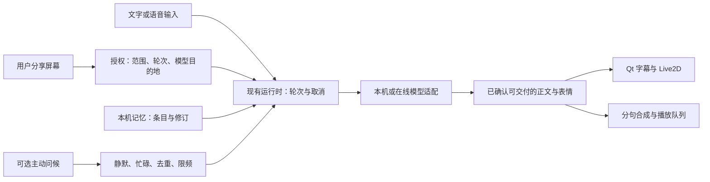

# 玄司桌宠最终制作方案

2026-11-12 根据《分析桌面宠物优化路线》《调研桌面宠物参考项目》两条对话、玄司当前 Windows 源码及 GitHub 固定提交整合。用户已确认感知范围仅限电脑屏幕。[最终修改方案](#最终修改方案)和[文件级实施顺序](#文件级修改顺序与验收)给出当前开发建议。[优化建议专项复核](#优化建议专项复核)保留两条对话的技术依据。

## 结论

**继续在玄司现有 Python、PySide6 和 Live2D 客户端上增量开发。** 复用已有窗口、角色、模型适配、语音和安装链路，先修屏幕授权和跨轮数据，再打磨中文陪聊、首句语音和表情。首次成功文字对话和真实设备试用是首个交付里程碑。试用通过后做记忆纠错和问候变化，再交付可选本机自动观察。

首批回归用例为「本机看图 → 关闭权限 → 切到在线文字」。第二轮的实际请求体必须没有上一轮画面、截图工具回执或由截图派生的上下文。现有普通文字对话仍会传入截图坐标，手动附图也会进入共享历史，因此这项测试覆盖了两个不同入口。[桌面交互入口](../../pet/app.py#L183) · [模型截图工具](../../pet/model_tools.py#L73) · [共享历史](../../pet/tool_dialogue.py#L168)

## 最终修改方案

### 首个可试用版本

用户启动后可选本机或自备密钥的在线模型，完成一次真实文字对话，再按需启用语音、识图与表情。试用版提供中文文字、轮流语音、四种表情和按轮手动分享屏幕。屏幕、麦克风和主动问候独立控制。通过实机试用后交付记忆纠错和问候变化，再启用可选本机自动观察。

实施前已确认低配设备可优先使用在线文字，本机能力按实测标注。首版验收默认形象已有的眼睛表情，眉嘴补绑单列。可用于实测的资源为独显机、麦克风、扬声器和 DeepSeek 测试账户，DeepSeek 测试预算上限为 10 元。无独显设备和 OpenAI 测试资源待确认。

Qt 负责界面和 Live2D，现有运行时协调轮次及取消，模型适配层报告实际能力。文字、语音、表情和工具结果沿用同一个对话轮次，屏幕授权另外持有可独立撤销的版本。普通聊天复用已有上下文，本机记忆按用户意图更新，主动发言统一检查静默和忙碌状态。

### 屏幕授权与视觉

| 用户设置 | 行为 |
| --- | --- |
| 关闭 | 全部入口停止发起新截图。对话页可直接关闭，生效优先于磁盘保存。新装和从旧权限设置升级时默认关闭，保留原人设、形象、模型和记忆。旧 `observe` 或 `cloud_observation` 设置不能自动授予新权限。 |
| 仅手动分享 | 点击「看一眼屏幕」或给下一条文字／语音附图时授权一张截图。默认鼠标附近，用户可选择鼠标所在显示器。面板显示本轮分享状态。本机优先策略下的附图轮固定走本机，在线优先策略下逐轮确认当前在线目标。 |
| 本机自动观察 | 在手动模式通过实测后交付，由用户在当前运行期间开启，重启回到已保存的手动模式或关闭状态。复用鼠标事件和现有窗口判断，只有可用的本机视觉模型才进入观察。窗口变化、锁屏、全屏、休眠或桌宠正在收音、回复、朗读时跳过。重复画面不主动评论。 |

1. **统一采集与撤权。** 手动按钮、文字和两条语音入口、模型工具、后台观察共用运行时授权检查。授权绑定轮次、截图范围和目标，检查点为排队、实际采集前、采集返回和实际发送前。复用 `mss`、物理坐标与 JPEG 内存编码。关闭时使屏幕授权版本立即失效，只停止相关涉图回复和朗读并丢弃迟到结果。普通文字任务及用户独立打开的麦克风继续按原状态运行。若保存失败，运行中保持关闭并明确显示保存状态。[采集实现](../../pet/desktop.py#L101) · [运行时取消](../../pet/runtime.py#L387)
2. **绑定实际发送目标。** 云端只处理用户手动分享且明确确认了范围、服务商和模型的画面。换模型、端点或备用路由后，旧授权失效。检查覆盖在线模型的普通生成、流式生成及在线 token 计数请求。对已授权的涉图轮优先使用本地预算估算，减少重复发送画面。本机视觉模型无法使用时提供纯文字重试。屏幕中的指令视为画面资料。已发出的数据按服务商规则处理。[路由](../../pet/ai/selection.py#L96) · [Gemini token 计数](../../pet/ai/providers/gemini.py#L83) · [Claude token 计数](../../pet/ai/providers/claude.py#L70)
3. **隔离图片和画面回复。** 现有手动附图进入共享的 `runtime.history`，后续轮次可能复用。把图片、截图工具调用与回执、画面派生内容放到本轮上下文，结束或撤权后清理。界面仍显示用户收到的回复，用户主动引用或保存的文字按普通文本处理。保留已完成的普通对话，并对工具调用及回执成对裁剪。日志只记录来源、拒绝原因和时长等运行信息。[图像入历史](../../pet/tool_dialogue.py#L118) · [共享历史](../../pet/tool_dialogue.py#L168)

### 陪聊与情绪表达

- 优先打磨三类中文交流。用户无聊时给一个容易接的话题，用户倾诉时先承接他说过的感受，用户想安静时结束追问。普通聊天可从最近对话接续，长期记忆沿用显式保存和可编辑入口。手动启麦，用户停顿后回复，播完恢复聆听，用户可以随时按「停止回复」。[现有聊天、记忆与语音](../../README.md#已实现能力)
- 复用 `present_reply` 和 Live2D 表情状态机，保留平静、开心、关切、好奇。按具体模型验证结构化回复和流式兼容。表情值无效、形象不支持或模型能力不足时以平静表情交付有效正文。同一轮只交付一次回复，正文进入字幕和朗读，表情事件单独传给当前角色。停止、取消、休眠或换形象时清理旧轮状态。[表情协议](../../pet/reply_presentation.py#L10) · [当前启用条件](../../pet/ai/selection.py#L75) · [角色表情实现](../../pet/avatar_expression.py)
- 首句语音先建立基线，再按[实现难点](#需要先验证的实现难点)做句级正文原型。可靠性通过后进入试用版本，未通过的提供方保留完整回复路径。表情保持时间与句子播放衔接；眉嘴形变补绑单独验收。
- 主动问候默认关闭，开启后沿用现有本机短句和限频。初始优先级为休眠与全屏、用户发起的交流、可选问候、待机。新增的自动观察发言与主动问候共用打扰上限，建议每小时最多一次、每天最多两次。用户忽略问候后保持安静。用实际试用记录重复追问、打断次数、等待感受和是否愿意继续聊。[问候门控与限频](../../pet/proactive_chat.py)

### 记忆纠错与主动问候

- 阶段 4 在现有本机存储增加条目 ID、正文、修订号、来源轮次和时间。迁移保留旧 `notes` 的可回退副本。用户明确更正时按 ID 和期望修订号原子提交，多候选时让用户选择。更新与删除交错时拒绝过期修改，避免复活旧偏好。临时心情保留在会话里，长期偏好由用户明确保存。[现有记忆实现](../../pet/memory.py#L29) · [上游并发修复](https://github.com/mem0ai/mem0/commit/753496cf1435d76c3a711f3af51303f7fdcb6420)
- 普通更正可撤销。「彻底遗忘」在用户明确选择后清除该条目、旧修订和能自动回灌它的摘要、检索缓存，阻止旧迁移副本自动导回；操作前说明原始聊天记录的保留范围。
- 主动问候保留排队预留额度和现有限频，另记已经展示的短句用于去重。用户可选择「这次先安静」或「今天安静」，主动发来消息仍正常回复。阶段 5 的观察评论和问候共用打扰上限。[现有门控](../../pet/proactive_chat.py)

### 本机和在线模型

| 路径 | 首版做法 | 验证重点 |
| --- | --- | --- |
| 本机 | 复用受控的 llama.cpp 和已有 Qwen3.5-9B 图文配置，作为性能与回复质量基线。文本和图文能力分别验证。在资源不足设备上评估一个更小的文字候选，视觉不可用时保持文字聊天。 | 冷启动和热启动分别测首字、首句语音、峰值内存与显存，以及连续使用时动画是否卡顿。README 所列约 6.60 GB 是标准 9B 权重和看图组件的磁盘量。CPU 和其他设备的适用性待实测。[本机引擎](../../pet/inference.py) · [安装条件](../../README.md#下载与安装) · [Qwen 模型卡](https://huggingface.co/Qwen/Qwen3.5-9B) |
| 在线 | 沿用自备密钥、系统凭据存储和现有适配器。首个试用版本各实测一个 DeepSeek 与 OpenAI 图文配置。首次配置让用户选「本机」或「在线」，先验证文字对话，再按需启用识图和表情。Gemini 与 Claude 继续使用现有适配，按实测记录能力。 | 复用配置指纹，分别记录文本、图片、流式、工具及表情输出能力。仅验证文本的配置也能陪聊。开始输出或执行工具后，同一轮由原模型继续，遇到错误提供显式重试。实际提供方与模型在界面可见。[配置指纹](../../pet/ai/settings.py#L14) · [提供方适配](../../pet/ai/providers/__init__.py) · [DeepSeek 视觉](https://api-docs.deepseek.com/guides/vision/) · [OpenAI 图像输入](https://developers.openai.com/api/docs/guides/images-vision) · [Gemini 图像理解](https://ai.google.dev/gemini-api/docs/image-understanding) · [Claude 视觉](https://platform.claude.com/docs/en/build-with-claude/vision) |
| 自备本机运行时 | 有已安装 Ollama 的用户再增加回环地址连接，优先复用兼容接口。模型发现和看图探测可用 Ollama 原生接口。建议在内置本机路径稳定后追加。 | 验证端点与所选模型实际在本机运行。Ollama 的兼容接口覆盖 OpenAI API 的一部分，逐项核对图文、结构化输出、取消和流式行为。[Ollama 兼容接口](https://docs.ollama.com/api/openai-compatibility) · [视觉](https://docs.ollama.com/capabilities/vision) · [结构化输出](https://docs.ollama.com/capabilities/structured-outputs) |

在线使用量主要取决于对话上下文、上传图数和回复长度。首版先限制每轮图片数和回复长度，再用真实试用记录每次会话的请求数、用量与等待时间，按选定服务商的实时价格估算月成本。本机的主要成本是安装资源、内存、显存和推理等待。决定是否把本机图文作为默认选择前，用目标机器与在线方案跑同一组场景。

在现有设备探测的基础上，首次配置先显示可用资源和本机候选，再用一次真实文字请求确认可聊天。识图能力单独验证，状态显示实际提供方与模型。端点或模型变化时重新验证该配置的能力，路由策略变化时重新选择提供方。流式失败沿用现有错误入口保留草稿，提供与失败类型对应的恢复操作。[设备探测任务](../../pet/ai_tasks.py#L58) · [模型设置](../../pet/model_page.py) · [对话错误](../../pet/conversation_issues.py)

### 需要先验证的实现难点

1. **句级流式与工具协议。** 先测话段结束、识别完成、首字、首个可朗读句和实际首句出声的时间。保留现有 Paraformer 的轻声与尾部补静音处理，按测量结果决定是否调整端点。选一种本机和一种在线配置做原型，只有已进入最终正文阶段的文本才进入现有 `SpeechChunks` 与播放队列。工具轮先走完工具阶段。完整解析 `present_reply` 后再交付其正文与表情，半截 JSON、工具参数和推理片段从朗读输入中排除。无法可靠区分最终正文的配置按完整回复朗读。覆盖中文停顿、小数、代码、尾句与重复片段。[语音入口](../../pet/live_input.py#L67) · [现有分句与队列](../../pet/streaming_speech.py)
2. **模型资源与表情代码。** 当前源码注明眉形和微笑参数存在但没有可见网格形变。先验收现有眼睛表现与复位；若要求更鲜明的喜怒表情，需要 Live2D 制作人员补绑并在目标模型验证。不能只增加参数名就宣称表现完成，美术工期单独估算。

## 文件级修改顺序与验收

| 顺序 | 交付 | 验收条件 |
| --- | --- | --- |
| 1. 屏幕权限与数据边界，约 2–3 个工作日 | `config.py`、`preferences.py` 和 `panel_content.py` 加屏幕模式、旧设置迁移和本轮状态。`app.py`、`runtime.py`、`conversation.py`、`live_dialogue.py`、`model_tools.py` 共用授权和任务代次。`tool_dialogue.py` 分离临时图文与聊天历史，`ai/selection.py` 和提供方发送路径按实际目的地复核。 | 合成截图测试覆盖手动按钮、文字附图、两条语音路径、模型工具与后台观察。关闭状态下新截图次数为零。撤权后让旧帧异步返回，验收新上传、旧结果展示和旧图复用均为零。验证窗口切换、模型切换、请求重试和在线 token 计数。 |
| 2. 陪聊、首句语音与表情，约 5–8 个工作日 | `ai/settings.py`、`ai/selection.py` 记录具体提供方与模型的能力。`conversation.py`、`tool_dialogue.py`、`streaming_speech.py` 做延迟基线和句级正文原型。`reply_presentation.py`、`avatar_expression.py` 接同轮表情和复位。先验证一个本机和一个在线配置。 | 同一组中文用例覆盖无聊、倾诉、看画面、想安静、记住一件事和切换模型。各句只交付一次，取消后旧轮音频、口型和表情一并停止。原型在满足可靠性门槛且有可测收益的配置启用，其余沿用完整回复路径。 |
| 3. 首次使用、设备与试用包，约 3–5 个工作日 | 复用 `first_chat_card.py`、`ai_tasks.py`、`model_page.py` 和 `conversation_issues.py` 做首次成功文字对话与失败恢复。验收第二个在线配置、低配路径和试用安装包。用相关测试覆盖配置迁移、权限、取消、表情和语音。 | GPU 与无独显两类 Windows 设备都要能走到首次成功文字回复，无独显设备可走仅 API 路径。分别记录仅 API、断网本机、双屏缩放、升级迁移、真实音频和长时间驻留。依据实测为各模型标注能力和推荐配置。 |
| 4. 记忆纠错与问候变化，约 3–5 个工作日 | `memory.py`、`model_tools.py` 及现有记忆界面增加条目身份、修订和更正入口；`proactive_chat.py` 增加已展示短句去重及临时静默。 | 更正、撤销、遗忘、旧数据迁移和重启后检索通过；忽略或拒绝问候后遵守静默；不增加现有打扰上限。 |
| 5. 可选本机自动观察，约 2–3 个工作日 | 阶段 3 试用通过，且优先解决试用暴露的记忆和问候问题后，在 `app.py`、`desktop.py` 和 `proactive_chat.py` 接入自愿启用、事件去重、观察状态和打扰限频，复用阶段 1 权限。 | 锁屏、全屏、休眠、连续收音、用户撤权以及本机视觉引擎故障时停止新的自动截图。断网仍能在本机理解已授权画面。连续触发或切窗口时无重复评论、无自动转发云端。 |

阶段 1–3 的试用版估算 **10–16 个工作日**，阶段 4 另加 3–5 日，阶段 5 另加 2–3 日。五阶段合计 **15–24 个工作日**，按单人熟悉现有项目、依赖可运行估算。Live2D 美术补绑、用户试用等待和后续语音插话分别估算。阶段 1–2 可先用现有测试替身开发和回归。阶段 3 需要所选在线服务的测试密钥、两类 Windows 设备及真实音频设备。阶段 5 需要可运行本机视觉模型的设备。

后续扩展顺序为自备 Ollama 连接和可打断语音。Ollama 路径以核实实际本机推理为验收条件。可打断语音在中文话段、噪声和回声场景验证，不抢占首轮设备验证。

### 试用验收与停止扩张条件

| 项目 | 验收方法与通过条件 |
| --- | --- |
| 屏幕权限 | 用合成图替换真实用户内容，检查所有入口的采集次数和实际 HTTP 请求体，包含生成、工具后续请求和在线计数。关闭时新增采集为零，撤权后新增涉图发送、迟到展示和旧图复用为零。覆盖切换模型、异步回调、停止与重试。 |
| 首句语音与表情 | 同机同参数，每配置至少 20 个中文轮次，冷启动单列，比较端点结束至首句出声的中位数和 P95。原型建议以中位数缩短至少 30% 为继续投入目标，同时通过无截句、无重复播报、无工具内容朗读及取消回归。停止、休眠和换形象后旧轮不得重新出声或变脸，目标形象需实测可辨。 |
| 陪伴体验 | 固定无聊、倾诉、不想聊、看画面、话题接续、取消和问候被忽略等场景，文字和真实语音各走多轮。检查停止追问、未经确认的推断和重复回复，记录用户是否愿意接下一句。结果供迭代。 |
| 首次使用、安装和驻留 | 记录包版本与设备，验证全新安装、旧版升级、仅 API、离线本机、真实语音及双屏缩放。保留人设、形象、模型配置、凭据引用和记忆，首次授权使用新默认。先完成 8 小时驻留和锁屏、休眠、网络恢复，记录待机资源、持续增长及模型卸载前后的差异，再做 3–5 天自愿试用。 |
| 记忆与自动观察 | 阶段 4 回归更正、撤销、遗忘、并发删除与升级重启。阶段 5 在权限和取消用例通过后启用，验证全屏、静默、窗口切换、本机引擎故障及断网。 |

开发验证按[操作手册](RUNBOOK.md#桌面客户端开发)运行针对性测试、全量 pytest 和 Ruff。安装记录按实际版本和设备留证。[安装与部署](MAP.md#安装与部署)

权限或取消失败时先修复当前阶段。语音原型收益不足时保留可靠的完整回复路径并继续定位瓶颈。代码通过、试用包通过和用户验收分别记录，公开发行按项目流程确认。

## 本轮 GitHub 筛选

本节为前轮筛选记录，保留标题以兼容既有引用。本次新增的专项参考单独说明适用范围，不改变本节的 5,000 Star 与多人维护门槛。

Star 取 2026-11-12 核验时 GitHub 仓库主页的显示值。近期按北京时间 2026-08-15 至 2026-11-12 的 90 个日历日计。多人维护以至少两位真人的实质代码改动或合并操作进入默认分支为依据，含先合入开发分支、随后进入默认分支的改动。排除机器人和纯文档提交。表中保留同日较早核验的 11 项，本次补齐 mem0 的维护证据，并增加 sherpa-onnx。

| 合格项目 | Star 和多人维护证据 | 可落到玄司的实现 |
| --- | --- | --- |
| AIRI | 约 51,300。11 月 11 日 `nekomeowww` 合并桌面端更新界面，11 月 12 日 `luoling8192` 合并角色语音选择修复。[仓库](https://github.com/moeru-ai/airi) · [PR #3485](https://github.com/moeru-ai/airi/pull/3485) · [PR #3491](https://github.com/moeru-ai/airi/pull/3491) | **主参考。** Live2D 表情执行器先验证当前形象支持的表情名称，再按时复位。Ollama 接入独立于角色渲染。屏幕预览更换来源时会停止旧流。玄司可沿用这些边界，让表情跟随有效回复，让模型接入独立于角色，并在撤权时清理旧截图任务。[表情执行器](https://github.com/moeru-ai/airi/blob/b0a3b02d93e961d5129adf5bb43d52908a22ee06/packages/stage-ui-live2d/src/contexts/expressions.ts#L194-L222) · [Ollama 适配](https://github.com/moeru-ai/airi/blob/b0a3b02d93e961d5129adf5bb43d52908a22ee06/packages/provider-inference/src/providers/local/ollama/index.ts) · [屏幕预览](https://github.com/moeru-ai/airi/blob/b0a3b02d93e961d5129adf5bb43d52908a22ee06/apps/stage-tamagotchi/src/renderer/composables/use-vision-screen-capture.ts#L35-L68) |
| VPet | 约 7,200。11 月 4 日 ZouJin 修复动画缓存，10 月 27 日 EvianChu（GitHub 账号 `YIYuNCU`）直接提交桌宠入口及界面代码。[仓库](https://github.com/LorisYounger/VPet) · [动画修复](https://github.com/LorisYounger/VPet/commit/91a058d9f0d9788efc1802e3b799ccb5cc9452e1) · [界面提交](https://github.com/LorisYounger/VPet/commit/f497e138200790dcfbeb60e3a0834d20f3449767) | **桌宠状态参考。** 在本机按空闲、睡眠和工作状态处理行为，播放说话动画前判断当前显示状态。玄司可把问候、待机动画、对话和休眠之间的优先级交给已有本机状态逻辑，空闲时仍有陪伴感。[角色状态与动画](https://github.com/LorisYounger/VPet/blob/c26be33d730ea5547711f6cc9781cf94e4d6ac7d/VPet-Simulator.Core/Display/MainLogic.cs#L264-L304) · [说话动画条件](https://github.com/LorisYounger/VPet/blob/c26be33d730ea5547711f6cc9781cf94e4d6ac7d/VPet-Simulator.Core/Display/MainLogic.cs#L85-L105) |
| Screenpipe | 约 22,400。11 月 11 日 Louis Beaumont 提交推理支持，Ezra Ellette 合并云端认证取消修复。[仓库](https://github.com/screenpipe/screenpipe) · [推理提交](https://github.com/screenpipe/screenpipe/commit/68689f8350f59bf414be41d022d9182bde2e1417) · [合并提交](https://github.com/screenpipe/screenpipe/commit/3323a3a38f9701e21d6e4e4cd3e1d234b4dbd2bd) | **屏幕采集参考。** 按窗口焦点等事件触发采集，macOS 存储路径在排除状态不明时跳过该帧。把同样的原则应用到 Windows 的玄司，权限或目标不可确认时直接跳过，单轮画面使用完即释放。Screenpipe 采用自定义商业许可，仅研究其机制，在玄司独立实现。[事件采集](https://github.com/screenpipe/screenpipe/blob/68689f8350f59bf414be41d022d9182bde2e1417/crates/screenpipe-engine/src/event_driven_capture.rs#L5-L9) · [排除判断](https://github.com/screenpipe/screenpipe/blob/68689f8350f59bf414be41d022d9182bde2e1417/crates/screenpipe-engine/src/capture_exclusions.rs#L5-L20) · [许可](https://github.com/screenpipe/screenpipe/blob/68689f8350f59bf414be41d022d9182bde2e1417/LICENSE.md) |
| Cherry Studio | 约 53,400。11 月 12 日 Lichenkang 修复模型选择器反馈，Raullen Chai 增加本地提供方适配。[仓库](https://github.com/CherryHQ/cherry-studio) · [选择器修复](https://github.com/CherryHQ/cherry-studio/commit/aad92f5ecb8b798a78ac119d1d11d9b708f2b0bb) · [本地提供方提交](https://github.com/CherryHQ/cherry-studio/commit/c53a5e02941bc2f35d3270dc73a33b13da82df15) | **截图取消和结果归属。** PNG 编码可能在取消后完成，项目用当前截图会话标识丢弃旧结果。玄司复用 `runtime.epoch`，在采集返回后及实际发送前检查它与本轮授权是否仍有效。[会话清理源码](https://github.com/CherryHQ/cherry-studio/blob/bc215da7204393c838b92bd19a4cfad20ec7d78d/src/main/services/screenshot/ScreenshotOverlayService.ts#L776-L794) · [复用窗口回归记录](https://github.com/CherryHQ/cherry-studio/blob/bc215da7204393c838b92bd19a4cfad20ec7d78d/.agents/notes/implemented/bug-fix/2026-11-08-screenshot-result-session-ownership.md#L7-L29) |
| Open WebUI | 约 158,400。11 月 8 日 Classic298 合并会话断连修复，11 月 9 日 Tim Baek 合并开发分支，两项操作均在主分支历史中。[仓库](https://github.com/open-webui/open-webui) · [断连修复合并](https://github.com/open-webui/open-webui/commit/494e2790af3d97fa0b7473a9c03a080c3b4c796d) · [主分支合并](https://github.com/open-webui/open-webui/commit/b0e6098e940942281d9c83f3529ea117287a3a22) | **用户能看到并停止分享。** 语音会话允许用户单独选取共享屏幕，停止时释放媒体轨道。玄司借鉴独立可见的分享与麦克风状态，收回画面授权后仍可纯文字或语音陪聊。玄司的截图采用本轮临时上下文。[采集与停止源码](https://github.com/open-webui/open-webui/blob/b0e6098e940942281d9c83f3529ea117287a3a22/src/lib/components/chat/MessageInput/CallOverlay.svelte#L180-L241) · [语音交互说明](https://docs.openwebui.com/features/chat-conversations/chat-features/voice-mode/) |
| SillyTavern | 约 35,500。9 月 7 日 Siyuan Chen 修复角色改名，9 月 14 日 Wolfsblvt 的模型适配与发布合并进入默认 `release` 分支。[仓库](https://github.com/SillyTavern/SillyTavern) · [角色修复](https://github.com/SillyTavern/SillyTavern/commit/d6b244cd25fec357469f3e31d96e9d92c94284ae) · [模型适配](https://github.com/SillyTavern/SillyTavern/commit/5e8d463ed41f79f8efc3b3ceb929a67a6d28ff61) · [发布合并](https://github.com/SillyTavern/SillyTavern/pull/6036) | **表情与回复解耦。** 表情扩展可选本机或 LLM 分类，按当前角色可用标签选择，失败时采用回退表情。玄司借鉴允许列表和回退，首版复用单轮结构化回复，未知或不支持的表情回到平静，保留原回复。[表情分类与回退](https://github.com/SillyTavern/SillyTavern/blob/06bde939fb1e9c4c8d8641d810f0a916b5bce127/public/scripts/extensions/expressions/index.js#L1091-L1158) |
| Jan | 约 45,700。11 月 9 日 Akarshan Biswas 修复本地 GPU 识别，Thinh Le 修复按模型读取 llama.cpp 属性。[仓库](https://github.com/janhq/jan) · [GPU 识别](https://github.com/janhq/jan/commit/1b51586ce1e49c93d68809e4dac0779050db1e9b) · [模型属性修复](https://github.com/janhq/jan/commit/894e96d9787e490f9d3a53668406e1e7d91d26b4) | **设备预检与首轮体验。** 在下载前展示硬件适配估算，提供本机 GGUF 和云服务两种配置。玄司复用已有设备探测，明确区分磁盘、内存或显存估算和真实首次回复结果，低配置用户先验证文字路径。[模型管理](https://github.com/janhq/jan/blob/c505648471bebedb25fd6a6f9ec095eca3d08efa/docs/src/pages/docs/desktop/manage-models.mdx#L29-L51) · [在线配置](https://github.com/janhq/jan/blob/c505648471bebedb25fd6a6f9ec095eca3d08efa/docs/src/pages/docs/desktop/manage-models.mdx#L103-L107) |
| AnythingLLM | 约 68,200。11 月 10 日 Max-Reisinger 修复模型路由缓存，11 月 11 日 Benyi Zheng 修复 Gemini 调用错误信息处理。[仓库](https://github.com/Mintplex-Labs/anything-llm) · [路由修复](https://github.com/Mintplex-Labs/anything-llm/commit/e82a80da0e5e81252cb19287ba32088233b81df4) · [Gemini 修复](https://github.com/Mintplex-Labs/anything-llm/commit/e8434c07c3d385411aec28e8f9758dfd073565ec) | **切换模型后的配置隔离。** 路由配置各自持有决策缓存，旧请求完成后无法回填到新配置。玄司在配置变更时重算路由，确认旧请求无法回填已失效的目的地。 |
| Chatbox | 约 42,300。11 月 11 日 themez 提交开放版发布准备，CHENG CHENG 提交自配 API 的错误引导改进，11 月 12 日 Wei-Lun Li 提交查询性能修复。[仓库](https://github.com/chatboxai/chatbox) · [API 错误改进](https://github.com/chatboxai/chatbox/commit/3e30371d38d070a2371a184c93db6c625be8583b) · [性能修复](https://github.com/chatboxai/chatbox/commit/704d4af5f3c8f466b74d8f8fc277c82b9895b4e7) | **本机和在线错误可恢复。** 从不同提供方的流式错误中提取状态与可读信息。玄司复用现有错误入口，给出密钥无效、限流、连接失败、模型不支持识图等可操作提示，并保留输入供用户重试。[流式错误解析](https://github.com/chatboxai/chatbox/blob/704d4af5f3c8f466b74d8f8fc277c82b9895b4e7/src/shared/models/utils/stream-error-message.ts#L8-L79) |
| Pipecat | 约 17,200。11 月 11 日 Aleix Conchillo Flaqué 合并语音表现相关改动，Mark Backman 合并评测规则更新。[仓库](https://github.com/pipecat-ai/pipecat) · [语音合并](https://github.com/pipecat-ai/pipecat/commit/e11a8c3773002d81e99718718b637cebaafb37e8) · [评测合并](https://github.com/pipecat-ai/pipecat/commit/de1afb6d1cba22d7425c2d15bd9abad243a22208) | **后续语音插话参考。** 示例将 VAD 和最小词数结合判断用户开始说话，并有处理中断的评测用例。玄司首版用现有停止按钮验证取消，后续实测按中文话段、噪声和扬声器回声判断插话，验证旧语音、口型及表情同时停止。[插话示例](https://github.com/pipecat-ai/pipecat/blob/7cf75afc37f321ecce1822901351bc5fdc372e0b/examples/turn-management/turn-management-interruption-config.py#L73-L112) · [中断评测](https://github.com/pipecat-ai/pipecat/blob/7cf75afc37f321ecce1822901351bc5fdc372e0b/evals/release/scenarios/scripted/interruption.yaml) |
| Ollama | 约 186,700。11 月 10 日 Daniel Hiltgen 更新 llama.cpp，11 月 7 日 Patrick Devine 更新 MLX 运行器。[仓库](https://github.com/ollama/ollama) · [引擎更新](https://github.com/ollama/ollama/commit/9b390157f2a9807e7d6748d31aa86ceba6c01b8c) · [运行器更新](https://github.com/ollama/ollama/commit/d63b702609c4300a2ca07be2bdb0adb9834725e5) | **自备模型的本机边界。** Ollama 单独报告云功能状态，并测试禁用后拒绝远程推理。后续接入时，同时检查服务地址、云功能状态和模型是否在本机，按实际推理位置显示状态。只在能验证本机路径时允许本机看图。[云状态与拒绝测试](https://github.com/ollama/ollama/blob/8a89b76cc7359805e48357ba7e5b99e845a4c211/server/routes_cloud_test.go#L25-L77) · [本机模式说明](https://docs.ollama.com/faq#how-do-i-disable-ollamas-cloud-features) |
| mem0 | 约 68,900。10 月 30 日 `harsh-mem0` 修复并发更新和删除，10 月 7 日 Shashidhar Kundur 修复 TypeScript 本机 SDK 修改调用方筛选条件的问题。[仓库](https://github.com/mem0ai/mem0) · [并发修复](https://github.com/mem0ai/mem0/commit/753496cf1435d76c3a711f3af51303f7fdcb6420) · [筛选修复](https://github.com/mem0ai/mem0/commit/0516f19f721d1b0bbf9171410031cd28fd1c19ac) | **记忆纠错。** 通过条目 ID 定位修改，防止在途更新把已删除条目重新创建。玄司在本机存储采用条目 ID、修订号和原子更新，增加删除与更新交错的回归用例。历史记录与彻底遗忘的取舍见[记忆方案](#记忆纠错与主动问候)。 |
| sherpa-onnx | 约 15,900。11 月 5 日 Hassan Kazi 修复 VAD 尾部样本丢失，Anmol Guragain 增加流式 Paraformer 示例。[仓库](https://github.com/k2-fsa/sherpa-onnx) · [VAD 修复](https://github.com/k2-fsa/sherpa-onnx/commit/079a6f05d05a18bc6e993704a557c2f62c7a17a5) · [流式示例提交](https://github.com/k2-fsa/sherpa-onnx/commit/b20026d8fd2002702b5d32330bb87a92f8215eae) | **识别端点与延迟归因。** 上游端点规则将尾部静音、话段长度和有效声音分开判断。玄司已使用该项目的 Paraformer，当前结束判断由应用处理。先测轻声、长停顿和尾字，分清识别结束与模型、合成的耗时，再决定是否改端点策略。[端点实现](https://github.com/k2-fsa/sherpa-onnx/blob/8972e456b206ec7ebc744a8547e499dcad023ec4/sherpa-onnx/csrc/endpoint.cc#L15-L27) · [玄司识别入口](../../pet/live_input.py#L34) |

Open-LLM-VTuber 约 14,700 Star，核验时 `main` 最新提交为 2026-05-15，`v2` 为 2026-01-10，`dev` 为 2025-08-21，未达到本轮活动门槛。蓝毛小女仆、Mellow 和 NekoAI 的 Star 均低于 5,000。[Open-LLM-VTuber](https://github.com/Open-LLM-VTuber/Open-LLM-VTuber) · [主分支](https://github.com/Open-LLM-VTuber/Open-LLM-VTuber/commits/main/) · [v2 分支](https://github.com/Open-LLM-VTuber/Open-LLM-VTuber/commits/v2/) · [dev 分支](https://github.com/Open-LLM-VTuber/Open-LLM-VTuber/commits/dev/) · [蓝毛小女仆](https://github.com/12we21/cute-fat-fish-pet) · [Mellow](https://github.com/Tarun-032/Mellow) · [NekoAI](https://github.com/nucket/NekoAI)

## 首轮 GitHub 项目对照

以下为首轮调研记录。本轮选型与实施依据见[本轮 GitHub 筛选](#本轮-github-筛选)。

| 项目 | 源码中的实现 | 对玄司的启发 |
| --- | --- | --- |
| 蓝毛小女仆 `12we21/cute-fat-fish-pet`，MIT | Electron 透明窗口按状态播放透明 WebM。后台观察先判断开关，再抓低分辨率签名，变化、冷却和预算满足后生成 JPEG，模型决定是否发言及使用哪个情绪。独立运行端支持 Ollama 和 OpenAI 兼容接口，截图助手在完整截图模式下会写 JPEG 文件。 | 功能组合最接近。可借鉴变化判断、发言冷却和保持安静的决策。玄司可继续用已有鼠标事件触发和内存截图，避免周期抓图和临时截图文件。[观察实现](https://github.com/12we21/cute-fat-fish-pet/blob/652c4abb3075e574b6fa5d68b79c8aadbaf7b6e7/src/lib/index.js#L2479-L2517) · [抓屏助手](https://github.com/12we21/cute-fat-fish-pet/blob/652c4abb3075e574b6fa5d68b79c8aadbaf7b6e7/defaults/dsh-pet/screen-watch/SwCapture.cs#L9-L11) · [模型与桌宠说明](https://github.com/12we21/cute-fat-fish-pet/blob/652c4abb3075e574b6fa5d68b79c8aadbaf7b6e7/README.md) |
| Open-LLM-VTuber，MIT | Python 对话后端通过 WebSocket 把分句、音频和动作送给角色界面。模型在回复里放表情标签，后端提取并映射到 Live2D 表情。模型工厂支持 Ollama、llama.cpp、OpenAI 兼容接口和 Claude。项目文档列出截图和透明桌宠模式。 | 最适合参考语音与角色同步。玄司已有结构化表情工具，可以沿用同样的分层思路，让对话正文与表情事件分开交付，避免标签出现在字幕或朗读里。后续有频繁抢话的实测需求时，再做语音插话。[中文说明](https://github.com/Open-LLM-VTuber/Open-LLM-VTuber/blob/992309c0aa19845960228f880013d4685fde93b5/README.CN.md#L65-L88) · [动作提取](https://github.com/Open-LLM-VTuber/Open-LLM-VTuber/blob/992309c0aa19845960228f880013d4685fde93b5/src/open_llm_vtuber/agent/transformers.py#L58-L89) · [对话分发](https://github.com/Open-LLM-VTuber/Open-LLM-VTuber/blob/992309c0aa19845960228f880013d4685fde93b5/src/open_llm_vtuber/conversations/single_conversation.py#L97-L110) · [模型工厂](https://github.com/Open-LLM-VTuber/Open-LLM-VTuber/blob/992309c0aa19845960228f880013d4685fde93b5/src/open_llm_vtuber/agent/stateless_llm_factory.py) |
| AIRI `moeru-ai/airi`，MIT | Electron 桌面端有屏幕源选择和预览，切换时停止旧媒体流。Live2D 单独管理 `.exp3` 表情参数、混合与复位。推理层独立接入 Ollama 等服务。 | 适合参考表情复位、多形象适配及采集会话的生命周期。源码核验覆盖屏幕源与预览组件，桌面陪聊的端到端屏幕体验待核实。整体工程还承担多形象和游戏集成，迁移会扩大桌面端与打包的改造面。[屏幕源与预览](https://github.com/moeru-ai/airi/blob/1e3d4df4a63d050f51be13f985b16e5ae5afd617/apps/stage-tamagotchi/src/renderer/composables/use-vision-screen-capture.ts) · [表情管理](https://github.com/moeru-ai/airi/blob/1e3d4df4a63d050f51be13f985b16e5ae5afd617/packages/stage-ui-live2d/src/contexts/expressions.ts) · [Ollama 适配](https://github.com/moeru-ai/airi/blob/1e3d4df4a63d050f51be13f985b16e5ae5afd617/packages/provider-inference/src/providers/local/ollama/index.ts) |
| Mellow `Tarun-032/Mellow`，AGPL-3.0，另附署名与改版条款 | Tauri 壳搭配 Python 后台。截图由请求触发，设置可禁用。后台按需抓一帧并做内存编码，针对 Ollama 通过 `/api/show` 探测视觉能力。在线识图由用户配置的服务商处理。 | 最适合参考「先确认能看、再按需抓图」和数据去向提示。建议参考其交互和边界设计，在玄司内独立实现。[隐私说明](https://github.com/Tarun-032/Mellow/blob/1628bfe56b139fe799c346dd7fe6281bd84a075b/README.md#L209-L211) · [抓屏编码](https://github.com/Tarun-032/Mellow/blob/1628bfe56b139fe799c346dd7fe6281bd84a075b/mellowd/capture.py#L438-L489) · [能力探测](https://github.com/Tarun-032/Mellow/blob/1628bfe56b139fe799c346dd7fe6281bd84a075b/mellowd/llm.py#L976-L1005) · [许可](https://github.com/Tarun-032/Mellow/blob/1628bfe56b139fe799c346dd7fe6281bd84a075b/README.md#L290-L294) |
| NekoAI `nucket/NekoAI`，MIT | Tauri/Rust 读取前台窗口标题和进程，前端将窗口上下文和宠物的精力、开心程度、好奇程度整理进提示。首次使用可探测 Ollama。README 把 NekoCapture 截图功能列为规划项。玄司曾采用其历史猫精灵素材。 | 可借鉴首次连接引导、低成本活动信号和宠物自身状态。窗口标题可能含私密内容，首版继续使用现有前台窗口与全屏状态做本机触发判断即可。[窗口监控](https://github.com/nucket/NekoAI/blob/fac0fcefc42cfee44593eb568ea8b1c013f3912c/src-tauri/src/desktop_monitor.rs#L24-L72) · [上下文构建](https://github.com/nucket/NekoAI/blob/fac0fcefc42cfee44593eb568ea8b1c013f3912c/src/ai/index.ts#L34-L103) · [功能表](https://github.com/nucket/NekoAI/blob/fac0fcefc42cfee44593eb568ea8b1c013f3912c/README.md#L77-L105) · [玄司来源声明](../../NOTICE) |

三种实现路线中，**增量开发玄司**的交付风险最低，现有形象、聊天入口、配置与安装链路都可复用。以 Open-LLM-VTuber 或 AIRI 为底座适合把跨平台或实时语音插话作为首要目标的产品，玄司采用时需要迁移桌面交互、用户数据和发布流程。以蓝毛小女仆或 NekoAI 为底座能快速得到精灵式桌宠原型，要达成当前玄司体验仍需接入现有 Live2D 与中文语音路径。

上游仓库的代码许可应逐项核对。Open-LLM-VTuber 的样本形象另有条款，玄司立绘、Live2D 运行时和本机语音权重也各有分发范围。建议按机制独立实现，复用本项目已有角色资源，并在实际安装包发版前核对随包组件。[上游 Live2D 样本声明](https://github.com/Open-LLM-VTuber/Open-LLM-VTuber/blob/992309c0aa19845960228f880013d4685fde93b5/README.CN.md#L127-L133) · [Live2D SDK 发行许可](https://www.live2d.com/en/sdk/license/) · [玄司第三方许可](THIRD_PARTY.md)

## 优化建议专项复核

### 会话依据与当前缺口

本次用本机 Codex `thread/read` 分别读取两条指定对话及其返回的历史。《分析桌面宠物优化路线》提出屏幕权限、陪聊、语音等待、表情、记忆纠错、主动问候、首次使用和长期驻留八项建议。《调研桌面宠物参考项目》进一步比较了源码机制、整端迁移成本和验收顺序。下表对应当前源码中的落点。

| 会话建议 | 本次源码核对与判断 | 开发落点 |
| --- | --- | --- |
| 屏幕权限与跨轮隔离 | `ToolContext.tools()` 仍以有无屏幕坐标决定是否开放截图工具；普通对话沿用 `runtime.history`，附图会写入该历史。 | 优先落地统一授权和临时图文上下文。[工具入口](../../pet/model_tools.py#L73) · [共享历史](../../pet/tool_dialogue.py#L168) |
| 陪聊质量 | 已有陪聊提示和工具约束；代码存在不能证明多轮聊天自然。 | 用相同中文场景比较各模型，记录重复安慰、追问和用户是否愿意接话。[对话原则](../../pet/tool_dialogue.py#L19) |
| 首句语音等待 | `generate_reply()` 先等待 `run_dialogue()` 完成，再向 `SpeechStream` 喂完整正文。 | 先测分段延迟，再增加可交付正文的句级流水线。[语音启动](../../pet/conversation.py#L75) |
| 表情同步与可见性 | 在线模型被 `supports_presentation` 排除；表情固定保持 4 秒，当前可见参数主要是眼睛开合。 | 提供方能力验证、按句同步和模型绑定检查要分别完成。[能力限制](../../pet/ai/selection.py#L75) · [参数与时序](../../pet/avatar_expression.py#L7) |
| 自然纠错的记忆 | 存储为 `notes` 文本，`remember()` 主要追加、按整行去重；没有条目级更新协议。 | 增加稳定条目 ID、修订号、更正和撤销；保留原数据迁移入口。[记忆实现](../../pet/memory.py#L29) |
| 主动陪伴的分寸 | 已有一小时与每日两次限额，问候来自四条固定句子。 | 保留现有限频，增加近期句子去重与临时静默。[现有门控](../../pet/proactive_chat.py#L11) |
| 首次成功对话 | 已有首次聊天入口和失败恢复，适合继续完善。 | 首次成功文字请求作为里程碑，文字、识图、语音、表情分开验收。[首次聊天](../../pet/first_chat_card.py) |
| 长时间驻留 | 本次未运行应用，无法确认资源占用、恢复行为或真实音频表现。 | 把驻留、恢复和真人试用作为试用包的独立门槛，不能用单元测试替代。 |

### GitHub 实现与可借鉴范围

以下九个项目按具体问题选取。桌宠项目用于比较整体实现，组件与通用客户端用于比较特定机制。固定提交链接对应本次实际读取的相关代码或官方文档；未安装运行上游，不将 README 功能列表视为体验验证。

| 项目与定位 | 上游实现证据 | 玄司采用方式与限制 |
| --- | --- | --- |
| **AIRI：角色表现主参考** | 每个 Live2D Root 独立维护表情注册表、执行器和定时器；执行前确认表情已启用，用执行代次避免过期操作影响当前角色。[固定源码](https://github.com/moeru-ai/airi/blob/b0a3b02d93e961d5129adf5bb43d52908a22ee06/packages/stage-ui-live2d/src/contexts/expressions.ts#L194-L222) | 在现有 `ReplyExpression` 中采用相同生命周期原则。TypeScript/Vue 实现不能直接放入 PySide6；按机制实现即可。上游无法替玄司补齐模型的眉嘴网格绑定。 |
| **Open-LLM-VTuber：句级输出历史参考** | token 流经过句子切分、动作提取、显示处理和 TTS 过滤，输出包含正文与动作的句级对象。[固定源码](https://github.com/Open-LLM-VTuber/Open-LLM-VTuber/blob/992309c0aa19845960228f880013d4685fde93b5/src/open_llm_vtuber/agent/transformers.py#L12-L89) | 保留对话中已有的 Python 句级机制分析。近期维护筛选结果见[本轮 GitHub 筛选](#本轮-github-筛选)。 |
| **VPet：桌宠状态参考** | 本机处理空闲、睡眠、工作等状态；说话动画需要结合当前显示状态判断。[固定源码](https://github.com/LorisYounger/VPet/blob/c26be33d730ea5547711f6cc9781cf94e4d6ac7d/VPet-Simulator.Core/Display/MainLogic.cs#L80-L107) | 状态仲裁保留在本机，供对话、问候和待机共用。C# 桌宠逻辑不解决玄司的模型接入和中文语音，整体迁移收益有限。 |
| **N.E.K.O.：问候变化与主动交付参考** | 启动问候区分一天严格去重和三天话题回顾，轮换开场角度，并跳过敏感、私密或被拒绝话题；另有主动消息队列处理合并、过期与播放门控。[问候源码](https://github.com/Project-N-E-K-O/N.E.K.O/blob/3985eea0b632765e675dc2bb08e3b50b6d12ad82/main_logic/startup_greeting_policy.py#L18-L45) · [交付管理](https://github.com/Project-N-E-K-O/N.E.K.O/blob/3985eea0b632765e675dc2bb08e3b50b6d12ad82/main_logic/proactive_delivery.py#L476-L536) | 先借鉴去重与实际交付记录，维持玄司更低的打扰限额。其插件、游戏、社交能力超出当前目标。主页约 3.2k Star，低于前轮门槛，列为专项参考；不据此声称通过多人维护核验。[仓库](https://github.com/Project-N-E-K-O/N.E.K.O) |
| **Miru：主动意图参考** | 注意力模块先将发言意图入队，按话题去重、按时间过期；最近用户发言或近期已有主动意图时阻止再次提出发言。[固定源码](https://github.com/kiyotakali/Miru/blob/cbea20b436a255e3cd26d952aaf952c003990b65/attention_engine.py#L1626-L1784) | 借鉴“想说”与“现在能说”分离。首版用本机规则实现静默和去重，不引入整套注意力推理。主页约 198 Star、维护稳定性待核实，作为实验参考。[仓库](https://github.com/kiyotakali/Miru) |
| **mem0：记忆修改接口参考** | `update(memory_id, …)`、`delete(memory_id)`、`history(memory_id)` 将记忆身份与变更分离；更新记录旧值与新值，删除也保留旧值历史。[固定源码](https://github.com/mem0ai/mem0/blob/f1791daa86d469249c9b002f62644d58a1eb96a0/mem0/memory/main.py#L1829-L1881) · [修改和删除记录](https://github.com/mem0ai/mem0/blob/f1791daa86d469249c9b002f62644d58a1eb96a0/mem0/memory/main.py#L2052-L2142) | 借鉴条目 ID 与修订接口，在玄司现有小规模本机存储内实现。其向量检索、嵌入和实体机制增加依赖；暂不接整套 SDK。特别注意其删除留历史行为不能直接当成“彻底遗忘”。[Apache-2.0 许可](https://github.com/mem0ai/mem0/blob/f1791daa86d469249c9b002f62644d58a1eb96a0/LICENSE) |
| **Cherry Studio：截图会话参考** | 清理时递增 `sessionGeneration`，释放媒体、定时器和截图缓存，使旧回调失效。[固定源码](https://github.com/CherryHQ/cherry-studio/blob/bc215da7204393c838b92bd19a4cfad20ec7d78d/src/main/services/screenshot/ScreenshotOverlayService.ts#L776-L799) | 利用玄司已有 `epoch` 并单独绑定屏幕授权版本、轮次和目的地。上游会话清理只是参考机制，玄司还需在实际 HTTP 发送前检查，才能覆盖本机切在线。 |
| **Pipecat：分句语音与取消主参考** | TTS 可按句边界聚合文本，区分跳过朗读的输出和轮次结束。中断时清理可中断音频及定时队列并同步说话状态。[分句聚合](https://github.com/pipecat-ai/pipecat/blob/7cf75afc37f321ecce1822901351bc5fdc372e0b/src/pipecat/services/tts_service.py#L84-L97) · [帧处理](https://github.com/pipecat-ai/pipecat/blob/7cf75afc37f321ecce1822901351bc5fdc372e0b/src/pipecat/services/tts_service.py#L1174-L1197) · [播放取消](https://github.com/pipecat-ai/pipecat/blob/7cf75afc37f321ecce1822901351bc5fdc372e0b/src/pipecat/transports/base_output.py#L609-L641) | 用玄司已有分句与播放链传递已确认正文，统一清理正文、合成、排队音频、口型与表情。以后有语音插话需求时另测噪声与扬声器回声。 |
| **Jan：首次使用参考** | 本机 GGUF 下载前按硬件给适配等级，区分能装下与可能很慢，下载可取消和重试。[固定文档](https://github.com/janhq/jan/blob/c505648471bebedb25fd6a6f9ec095eca3d08efa/docs/src/pages/docs/desktop/manage-models.mdx#L29-L54) | 复用玄司设备探测与首次聊天卡片。适配估算后仍需真实文字请求；硬件估算不等于语音或视觉已经可用。 |

实施时优先跟读 **Cherry Studio 的截图会话、Pipecat 的分句及取消、AIRI 的表情生命周期、Jan 的首次使用和 mem0 的记忆更新**。这些项目均通过当前的 Star 和维护筛选。问候默认采用玄司已有规则，N.E.K.O. 和 Miru 的发现保留为历史设计线索。

### 路线比较与推荐理由

以下为根据现有代码资产和迁移范围作出的工程判断，不是上游性能跑分。

| 开发路线 | 可复用资产 | 必须额外承担的工作 | 适用条件与建议 |
| --- | --- | --- | --- |
| **现有 Python／PySide6／Live2D 增量开发** | 角色、窗口、配置、凭据引用、安装器、模型适配、语音和测试 | 权限统一、流式交付协议、表情能力验证、真实设备验收 | **当前最佳。** 改进直接对应八项缺口，迁移范围最小。 |
| Fork Open-LLM-VTuber | Python 语音编排和角色输出链 | 桌面交互、数据迁移、资源管理、发布体系及上游维护风险 | 如果未来跨平台实时语音成为首要目标，再做独立原型比较。现阶段只借鉴句级输出。 |
| 以 AIRI 重建桌面端 | Web 角色表现和提供方生态 | Qt 界面与交互重写、Python 能力桥接、用户数据和安装更新迁移 | 当 Web／跨平台体验成为明确主目标时才有更强理由。当前八项优化不足以抵消迁移成本。 |
| 以 N.E.K.O. 整体重建 | 完整陪伴、主动交付及插件体系 | 产品功能取舍、多模块运行与配置整合、角色及旧数据迁移 | 适合目标已经扩展到游戏、插件、社交的平台；当前范围只采用局部设计。 |

架构与具体实施见[最终修改方案](#最终修改方案)。现有客户端增量路线能直接修复八项缺口，并沿用当前的用户数据、模型和安装路径。

## 本次验证范围

### 前轮验证记录

- 玄司工作区基于 `df39573`，核验包含当前未提交源码。公开版本与当前源码的功能差异以项目 README 和发行页为入口。情绪实验与主动问候按源码功能记录。[项目说明](../../README.md#版本与发布) · [公开 v0.9.0](https://github.com/DesktopPetXuansi/Xuansi/releases/tag/v0.9.0)
- Windows、Python 3.13.15，在项目虚拟环境运行 `pytest -q -p no:cacheprovider`，选择 `test_screen_capture.py`、`test_voice_screen.py`、`test_avatar_expression.py`、`test_reply_presentation.py`、`test_ai_selection.py` 和 `test_proactive_chat.py`。结果为 **130 项通过**。这是现有代码的基线，统一屏幕授权的建议尚待实现与验收。[测试入口](../../tests) · [项目验证手册](RUNBOOK.md#桌面客户端开发)
- 本轮核对了 GitHub Star、默认分支提交、相关合并记录和符合门槛的 11 个项目的相关源码。上游实现用于对照，玄司采用自己的代码实现这些机制。130 项测试为首轮调研记录。本轮交付为修改方案，代码实施和方案回归待执行。上游安装体验、目标机器本机推理性能、真实在线请求、麦克风和扬声器、安装升级及用户陪伴体验均待实测。模型与设备的已有缺口见[风险与验证缺口](RISKS.md#模型与设备验证)。

### 本次整合验证

2026-11-12 读取两条指定对话，核对当前工作区相关函数，验证 mem0 与 sherpa-onnx 的 Star、默认分支维护证据和固定源码，并复核 Pipecat 的分句与取消。其余项目沿用同日较早的记录。本次检查文档链接和方案涉及的路径。代码实施、pytest 与 Ruff 回归、真实在线请求、性能、音频、安装包及用户试用均待执行。

### 桌宠实施验证

2026-11-12 在 Windows 源码工作区实施。屏幕权限的请求生命周期参考 [Cherry Studio 截图会话](https://github.com/CherryHQ/cherry-studio/blob/bc215da7204393c838b92bd19a4cfad20ec7d78d/src/main/services/screenshot/ScreenshotOverlayService.ts#L776-L799) 和 [AIRI 屏幕源切换](https://github.com/moeru-ai/airi/blob/b0a3b02d93e961d5129adf5bb43d52908a22ee06/apps/stage-tamagotchi/src/renderer/composables/use-vision-screen-capture.ts#L35-L68)。语音和表情取消沿用 [Pipecat 播放队列](https://github.com/pipecat-ai/pipecat/blob/7cf75afc37f321ecce1822901351bc5fdc372e0b/src/pipecat/transports/base_output.py) 和 [AIRI 表情执行器](https://github.com/moeru-ai/airi/blob/b0a3b02d93e961d5129adf5bb43d52908a22ee06/packages/stage-ui-live2d/src/contexts/expressions.ts#L194-L222) 的生命周期机制。相关逻辑在玄司现有 Python 和 Qt 模块内独立实现。

- 屏幕权限代码覆盖手动按钮、下一条文字／语音和两条语音识别入口。拒绝模型自行截图，附图轮禁止变更长期记忆。本机优先的附图轮绑定所选本机模型，在线分享逐轮确认。合成回归检查旧配置迁移、迟到截图与回复、切换窗口与模型、请求目的地、保存失败和本机看图后在线纯文字的实际请求体。在线传输由 HTTP 测试替身记录，未向实际服务商发送请求。[授权检查](../../pet/screen_sharing.py) · [回归用例](../../tests/test_screen_sharing.py) · [语音入口用例](../../tests/test_voice_screen.py)
- Windows 项目虚拟环境全量 pytest 通过 1,337 项，跳过 2 项需显式启用的官网联调和原生 GPU 验收。改动的桌面代码和验证脚本通过 Ruff。全量 Ruff 仍报告官网媒体采集脚本的既有导入排序问题。[检查命令](RUNBOOK.md#桌面客户端开发) · [导入位置](../../scripts/capture_website_media.py#L45)
- Windows 冒烟启动在隔离数据目录中通过。内置 Live2D 加载、启动与退出均完成。眼睑探针对开心、关切和好奇分别测得相对平静帧 539、535、233 个变化像素，并验证眨眼与口型可叠加。[渲染探针](../../scripts/verify_reply_expression_render.py)
- 安装器预检清单已加入新的推理依赖文件。按预检清单暂存文件后，API 检查可导入，且未加载桌面、截图、声卡或 Qt 模块。安装包构建和安装验证待执行。[安装器预检清单](../../installer/online.iss#L47)
- RTX 4070 Laptop GPU 上的本机 9B 权重和视觉组件已就位。固定源不稳定时从 ModelScope 获取，两个文件的大小和 SHA-256 均与目录锁定值一致。真实 CUDA 引擎通过冷启动文字和红蓝色块识别。随后关闭屏幕权限并切到真实 DeepSeek，发往在线端点的请求体未带本机附图、截图回执和画面派生内容。9B 的六个表情协议与工具选择探针通过，包括开心、关切、平静回退和合成记忆保存意图。[资源目录](../../pet/ai/catalog.json) · [ModelScope 镜像](https://modelscope.cn/models/unsloth/Qwen3.5-9B-GGUF) · [表情协议探针](../../scripts/verify_reply_presentation.py)
- 真实 DeepSeek `deepseek-flash`（非思考）通过文字、合成图、工具与回执、流式结束和客户端取消。玄司对话入口另验证了无聊、倾诉、想安静、当轮附图和撤权后的纯文字。在线测试只使用合成文本和合成图。[服务商说明](https://api-docs.deepseek.com/zh-cn/quick_start/pricing/)
- 首次聊天探针使用真实 9B 与离屏 Qt。通过发送入口取得首条文字回复并写入临时完成标记。720×560 和 520×480 窗口的输入区域与恢复操作通过布局断言。恢复提示使用合成错误，探针退出后后台线程已停止。[首次聊天探针](../../scripts/verify_first_chat.py)
- 各配置跑一轮冷启动及 20 轮热机基线。输入为合成中文语音，使用真实 Paraformer、推理与 Melo，播放提交由测试替身接收。Windows 默认输入支持 16 kHz 单声道，默认输出接受 44.1 kHz 静音 PCM。计时从识别端点判定到首段 PCM 提交，未测实际出声的声学延迟。真实人声、试听感受和用户验收仍待进行。[计时实现](../../pet/turn_latency.py)

| 配置 | 冷启动首段 | 热机首段中位数 | 热机首段 P95 |
| --- | ---: | ---: | ---: |
| 9B CUDA | 17.88 秒 | 5.32 秒 | 7.47 秒 |
| DeepSeek Flash | 5.07 秒 | 2.12 秒 | 3.60 秒 |

SenseVoice 整句识别也用合成中文语音通过一次本机冒烟，识别保留了请求陪聊的核心含义，句首一字有误。无工具的独立正文探针分别对两个模型各跑 20 轮，所有提前合成的首段均与完整回复分句一致。本机中位数从 1.78 秒降到 0.91 秒，DeepSeek 从 1.72 秒降到 1.59 秒。探针未提前播放，未覆盖普通工具轮、提前播放后的取消或服务断连。客户端当前仍在完整回复校验后朗读。

2026-11-13 用户反馈首个试用版本验收完成、基本没有问题，并同意继续下一阶段。未提供分项结果，OpenAI、无独显设备、真实双屏、实际人声与安装包的独立证据仍待补。[试用验收条件](#试用验收与停止扩张条件)

### 试用后实施

- 2026-11-13 在 Windows 工作区实现长期记忆条目身份、修订号、时间和来源。控制中心可按条目更正、撤销和彻底遗忘。遗忘清除修订、旧格式迁移副本和可供推理的会话上下文。已显示的原始聊天留在对话界面。迁移、重启、迟到更正和工具保存回归已通过。[记忆存储](../../pet/memory.py) · [记忆回归](../../tests/test_memory.py)
- 主动问候记录已展示短句编号，避免近期重复。同一限额适用于本机观察，每小时最多一次、每天最多两次。临时静默为一小时，当日静默持久到当地日期结束。[限额与静默](../../pet/proactive_chat.py) · [回归](../../tests/test_proactive_chat.py)
- 对话页的本机自动观察默认关闭，仅本次运行可启用。复用按轮授权，在截图及发送前核对授权和桌面状态。相同帧和相同提醒去重。真实本机 9B 在普通聊天配置为在线优先时识别了合成构建错误，用时约 8.78 秒，未创建在线客户端，也未把画面或提醒写入聊天推理历史。该探针使用合成截图和界面确认替身。锁屏切换、真实双屏及新功能用户验收待补。[授权](../../pet/screen_sharing.py) · [自动观察回归](../../tests/test_screen_sharing.py)
- 全量 pytest 最终通过 1,348 项、跳过 2 项，退出码 0。较早一次在相同通过数下返回退出码 1，复跑未复现。桌面代码和测试通过 Ruff，全量 Ruff 仍报告官网媒体脚本既有的导入排序问题。独立 Windows 冒烟正常退出，确认 Live2D 加载和释放。[检查命令](RUNBOOK.md#桌面客户端开发)

### 本机模型准备与控制中心验收

2026-11-13 在 Windows 源码工作区补齐了本机模型准备。查找先检查配置的模型与看图组件，再检查配置目录、当前用户模型目录和旧安装目录中同一档位的配套文件。缺失时，对话页显示下载大小，首次下载前确认，可在模型设置启停自动补齐。下载保留临时文件用于暂停和续传，发布前核对大小和 SHA-256。仅本机模式缺少模型时保留输入草稿。在线优先继续使用既有已验收本机回退规则。[模型查找](../../pet/ai/local_candidates.py) · [下载入口](../../pet/first_chat.py)

原生 Qt 控制中心宽窗使用侧栏和角色状态区，窄窗使用顶部标签。浅色和深色主题取自 HTML 原型并跟随系统切换。隔离 Chrome 读取了两种主题的实际色值，Qt 回归逐点核对了底色、侧栏、选中项、准备卡片、角色底板、主按钮和待准备状态点；角色底板还原圆形衬底与底部渐隐。Windows 原生窗口完成了两种主题切换和截图，83 项相关测试通过。[桌面主题](../../pet/panel_style.py) · [配色回归](../../tests/test_panel_layout.py) · [原生界面验收](../../scripts/verify_control_center.py)

在清空路径的临时配置中实际识别到本机已有的 9B 和看图组件。通过本地 HTTP 回归验证暂停、Range 续传、文件校验及损坏文件拒绝发布。模型准备阶段全量 pytest 通过 1,342 项，跳过 2 项需显式启用的联调。真实远程全量重下和新安装包待验证。[下载回归](../../tests/test_local_model_setup.py) · [检查命令](RUNBOOK.md#桌面客户端开发)

2026-11-13 核对桌宠 Qt 窗口的主题和表单滚轮。反馈中心、商店首次配置与资源准备跟随控制中心的系统主题，形象和模型历史、独立资源和上传窗口也共用主题。表单滚轮优先滚动外层页面，聊天和日志仍可独立滚动，滚动条可拖动。用 Windows 原生反馈窗口核对两种主题、小窗无横向溢出、公开同意项和提交入口，并用离屏 Qt 验证滚轮和滑块拖动。[主题](../../pet/theme.py) · [滚轮处理](../../pet/form_wheel.py) · [反馈回归](../../tests/test_feedback_ui.py)

全量 pytest 最终 1,353 项通过、2 项跳过，退出码 0。较早一次在汇总后出现 Windows 原生访问异常，最终复跑未复现。桌面代码及测试通过 Ruff，Windows 源码版冒烟通过。[检查命令](RUNBOOK.md#桌面客户端开发)
