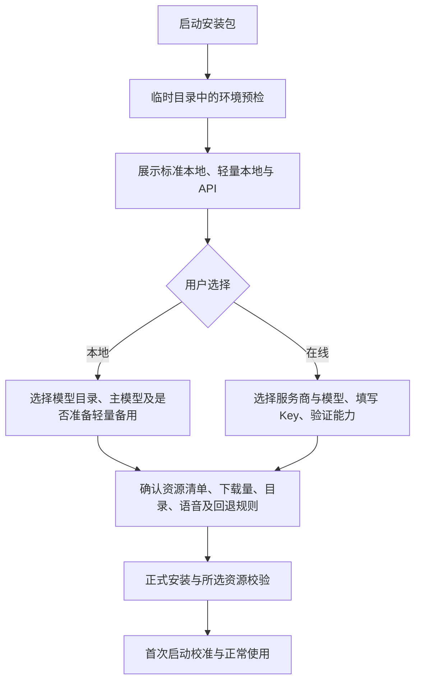

# 安装前适配与多模型方案

日期：2026-10-17；最新修复与接口实测：2026-10-18。同卷预算、基础探测未知两处 P2 已修复；DeepSeek Flash 非思考模式完成真实能力与 10／10 生产冒烟，临时凭据清理后不带入成品。其他云端、完整安装和跨设备仍缺验证，4B 实验语义未通过，尚未正式打包发布。本文保持唯一设计入口，[任务清单](../客户端/任务/安装前适配与多模型接入.md)记录状态，[实施验收](../客户端/验收/安装前适配与多模型-2026-10-18.md)记录事实和失败；已发布版本与本地源码分别标识。

## 已确定的产品决策

1. 环境检测和模型选择放在安装向导中，早于正式部署程序、创建虚拟环境、安装依赖及下载权重；首次启动不是主要适配入口。
2. 标准本地、轻量本地和在线 API 从安装开始并列可选。检测给出建议，用户保留选择权；运行较慢不作为禁用理由。
3. 明确不兼容或当前资源不足时禁用对应本地选项，解释原因并提供重新检测；探测失败标记未知，不冒充不兼容。
4. API 采用用户自备 Key、服务商直接计费。用户已于本轮明确选择；本次不建设软件统一收费、代充值或共享 Key 后台。
5. 预置主流服务商配置，按具体模型、模式及接口验证能力；自定义接口保留入口，但未验证时不列入完整桌宠自动回退候选。
6. 模型降级和转在线均持续显示当前状态；自动回退只执行安装或设置中已选择的规则，保留用户首选配置。
7. 内部可以按模块分别实现和测试，对外以完整安装、运行、回退和升级闭环交付，不把核心功能留到另一轮补做。

## 安装前流程

预检不依赖用户预装 Python。复用安装包内固定版本的私有 Python，将最小探测程序、标准库和模型目录提取至安装器临时目录；不在应用目录创建运行环境。安装器和客户端调用同一套评估逻辑，避免 Pascal、PowerShell 和 Python 分别维护硬件阈值。具体提取成本、路径和有界执行须通过真实安装器验证。

读取系统、架构、CPU 指令支持、可用与总内存、计算后端和驱动、各显卡可用显存、应用盘和模型盘空间。报告记录成功、未知和失败原因；不采集屏幕、音频、会话、账号资料或其他进程正文。探测有超时、进度和重试入口，不允许安装界面无限等待。

安装前硬件检测属于兼容性与资源适配预估。没有下载、加载目标模型时，不显示实测响应时间，不保证所有工作负载的速度；首次运行的短测仅校准建议，不代替安装前筛选。标准与轻量分别评估，不能只用显存大小或显卡名称判定。

| 状态 | 处理 |
| --- | --- |
| 预计适合／已验证推荐 | 展示依据；预估和实测标签分别记录 |
| 可以运行但较慢 | 保持可选，解释资源分担和等待代价 |
| 待验证 | 说明缺少的证据，允许安全验证，不宣称完整可用 |
| 当前资源不足 | 灰显对应项，说明如何释放资源及重新检测 |
| 当前环境不兼容 | 灰显对应项，说明系统、计算后端或驱动原因；不阻止满足基础条件的 API 安装 |

API-only 不要求 NVIDIA、D 盘、GGUF 或本地大模型引擎。操作系统、桌宠界面、音频和基础内存要求仍独立检查。模型目录可选，旧 D 盘路径继续识别；应用、模型和临时空间分别核算。

## 模块职责与依赖

下列边界已落实到 `pet/ai/`、独立预检入口和现有 Runtime／Qt 组件；具体接口见源码与实施验收。复用现有工具、存储与线程机制，没有引入新框架或业务依赖。

| 模块 | 建议位置 | 输入和输出 | 不承担的职责 |
| --- | --- | --- | --- |
| 环境探测 | `pet/ai/device.py` | 系统读取 → `DeviceReport` | 选模型、下载、凭据、界面 |
| 模型目录与适配评估 | `pet/ai/catalog.py`、`assessment.py`，配套版本化 JSON | 目录和设备事实 → `Assessment`、资源候选 | 创建窗口、联网推理、持久化用户设置 |
| 安装与资源部署 | `installer/`、`scripts/` 中独立预检与部署入口 | 已选择的 `InstallPlan` → 校验过的资源和安装结果 | 擅自改模型、重写适配规则、决定运行时回退 |
| 推理接入 | `pet/ai/providers/` | 统一请求 → 规范化回复、容量信息、分类错误 | 工具执行、记忆业务规则、修改用户偏好 |
| 运行选择与回退 | `pet/ai/selection.py` | 用户策略、可用资源、请求阶段 → 当前提供方和切换事件 | 拼 HTTP 请求、下载权重、直接操作 Qt |
| 配置与凭据 | `pet/ai/settings.py`、`credentials.py`，沿用配置保存事务 | 用户草稿 → 版本化配置；密钥 → Windows 凭据库引用 | 硬件判定、模型生成、官网 OAuth 业务 |
| 界面 | 安装器页面、客户端独立模型设置组件 | 报告、草稿、运行事件 → 展示和用户选择 | 内嵌探测、下载、API 协议或硬件阈值 |

依赖方向：界面调用应用服务；评估只依赖设备报告与目录；部署只执行安装计划；运行策略调用提供方与配置；对话、记忆和工具模块通过统一推理边界调用模型。提供方不能反向导入界面、安装器或工具执行器。

边界契约：

- `DeviceReport`：系统事实、后端状态、时间和未知原因，不含模型选择和秘密。
- `Assessment`：候选档位、状态、理由、预估／实测标志、报告版本和重新检测条件。
- `InstallPlan`：主模型、已选择的备用模型、提供方、资源集合、目录、语音组件、回退策略和凭据引用，不含 API Key。
- `ModelProfile`：服务商、地区、端点、具体模型与模式、协议类型、能力、验证时间及配置摘要。能力验证不能跨端点或模型随意复用。
- `Provider`：生命周期、完整生成、取消、容量预算及能力查询。记忆检索调用其生成与预算能力，不再直接操作私有 HTTP 接口。
- `SelectionEvent`：用户首选、当前提供方、切换原因和请求阶段；只表示实际状态，不反写首选配置。

## 本地模型与资源

标准档以现有 Qwen3.5-9B Q4_K_M 为起点；轻量候选为历史使用过的同系列 4B Q4_K_M，必须重新通过当前记忆、视觉和原生工具语义验收。历史可下载、哈希一致不等于业务能力与 9B 等效。

模型目录固定权重、配套投影、来源 revision、SHA256、大小、引擎版本、计算后端和验证证据。目录作为安装与客户端的共同事实来源。运行阈值和 CPU 路线需以目标设备实测确定，不能把单台 8 GiB 显存机器的测量变成产品最低配置。

按选项构造资源集合：仅本地轻量不下载标准模型；API-only 不下载本地大模型及其引擎；选择准备轻量备用才额外下载对应资源，安装确认页展示总量。运行时仅在已经安装和验证的模型之间切换，不在用户对话中突然下载数 GB 文件。

保留下载续传、完整哈希校验、安全解压和明确失败状态。磁盘不足、损坏下载、解压失败与显存不足分别报告。新的模型目录覆盖图文和语音资源，不能只移动 GGUF 而继续依赖固定 D 盘音频路径。

本地引擎可使用自动 GPU 层分配与显存余量目标，优先保留模型能力；转移到 CPU 可能降低速度并增加系统内存需求。布局、上下文和批量参数的调整在安全边界重载，不在一轮对话中频繁切换。尚未验证的后端不能仅因存在启动参数就宣称支持。

## API 兼容与安装前验证

目标支持清单包括通义百炼、DeepSeek、Kimi、智谱、豆包、OpenAI、Claude、Gemini，以及自定义兼容接口。每家须明确地区、协议、鉴权和已验证的具体模型；列出服务商名称不构成兼容完成。API Key 由用户提供，费用由相应服务商结算，功能验证可能产生少量调用费用，验证前明确展示。

能可靠复用通用兼容协议的共用适配器；有消息、参数、流式或必要上下文元数据差异的在对应提供方内转换。不能将本地 Qwen 的模板、思考参数和私有 token 计数端点原样发送到远端。

能力表按“服务商＋地区／端点＋模型版本＋工作模式”记录文字、图片、工具、流式、结构化输出、上下文、必要元数据及验证证据，分别标注官方声明和本项目实测。更换 Key、端点、模型或关键模式后使相关验证失效。自动更新目录须带版本和可信来源，不能因 `/models` 返回陌生名字就自动启用全部能力。

安装前验证依次覆盖鉴权与模型可用、合成文字、合成图片理解、无副作用工具调用及回执续答、流式完整结束和取消。验证不读取用户实际屏幕、音频和记忆。提供方不支持强制工具调用时，使用其支持方式与受控用例验证，不盲目统一发送 `tool_choice=required`。

完整桌宠自动回退候选必须满足所需能力；仅聊天或未验证的模型明确标记，缺失功能单独禁用。连接失败时保留安装选择，允许重新配置或改选本地；不能把 API 配置失败描述为安装成功。

## 运行策略、发送范围与切换

运行策略只有仅本地、本地优先且允许在线兜底、优先在线。允许的候选链由用户明确选择，限于已准备资源与有效 API；在线优先不要求先等待本地模型失败。每个请求记录已尝试候选，限次切换并有总等待保护，避免循环加载。

显存或加载资源不足可进入资源回退；用户取消、输入错误、协议错误、鉴权失败、额度不足和临时限流分别处理，不能统称低配并盲目换模型。首次检测保存建议，模型加载前复查动态资源；持续压力与恢复采用不同条件，避免因一次尖峰反复切换。

允许自动切换的默认安全边界是首个有效回复和工具执行之前。已经发布正文或执行动作／记忆写入后，本轮失败保留真实回执并停止，下一轮按策略选择；不能重放整轮对话导致动作或写入执行两次。

用户首选和当前实际模型分别保存与显示。降级事件解释能力差异，本地转在线说明提供方；状态栏持续显示本地／在线和模型，不被资源轮询覆盖。恢复资源后不在一轮中途擅自升档，也不覆盖首选。

在线数据范围独立于“允许回退”：对话文字、必要的相关历史和工具结果按约定发送。长期记忆的持久文件仍在本机；语义检索由当前提供方执行，因此云端检索不仅接收最终摘录，还可能按容量分批接收整个本地记忆库的候选内容。不能承诺先在本机筛选再只发命中结果。

“允许云端检索长期记忆”是独立选项，默认关闭，开启前说明候选发送范围和当前提供方。未开启时不向在线模型提供记忆检索工具，不上传候选，也不偷偷替换成关键词检索；普通对话仍可继续，界面标明在线记忆检索未启用。开启后候选按容量分片发送，原文出处验证仍在本机完成，仅通过校验的相关摘录加入后续对话；保存用户新记忆仍由本机存储模块执行。

当前明确附图时说明其发送去向；后台自动观察的云端截图默认关闭，须有独立选择。录音仍采用本地识别，不因开启大模型 API 自动上传。云端记忆检索和截图发送开关均参与当前可用能力展示，不能把尚未允许的能力显示为已启用。

API 请求使用 HTTPS，开发回环地址例外；禁止在命令行、普通 JSON、日志或安装回执保存 Key。密钥使用 Windows 凭据库，按端点与配置隔离，与官网 OAuth 使用独立命名空间。取消安装清理本次临时资料；日志只保留耗时、错误类别、资源和切换状态，不记录正文或秘密。

## 语音、动画与客户端

推理、语音识别、朗读和角色渲染独立评估。安装器提供语音组件选择；不启用语音时跳过对应模型。启用语音仍需确认其本机资源要求，启动不自动开启麦克风。语音排队拥塞须有可见反馈，不能静默漏字后继续表示一切正常。

资源紧张时降低自动观察频率及闲置动画负载，主动请求优先；隐藏页面停止已有预览与日志刷新。保留低内存保护与取消清理，不承诺 API 可以解决本机 UI、ASR 或 TTS 的性能不足。若基础桌宠也不满足系统要求，安装前明确阻止并说明原因。

沿用现有标签页和配置保存事务。密钥草稿变化纳入未保存检测；保存失败、关闭期间仍在编辑、显式取消均保留可恢复状态。模型和 API 设置不挤入官网资源上传模块。

## 实施前发现的接入断点（历史记录）

以下记录 2026-10-17 制定方案时的源码状态，不能用其中的“当前”判断实施后的完成情况；最新源码缺口及验证结论见本页顶部链接的实施验收。

- [安装器](../../installer/online.iss)当前在部署前仅检查 D 盘，[setup.ps1](../../setup.ps1)随后无条件安装并下载全部资源，需要改为执行统一安装计划。
- [本地推理](../../pet/inference.py)与[记忆检索](../../pet/model_memory.py)使用本地模板和私有容量接口，须通过提供方边界共同适配。
- [工具对话](../../pet/tool_dialogue.py)将图片放入工具资料消息，远端适配必须处理其支持的消息格式并保留不可信来源与关联关系。
- [Runtime 配置保存](../../pet/runtime.py)无条件检查 GGUF；API-only 保存不得依赖本地权重。
- [主窗口](../../pet/app.py)、[公共控件](../../pet/panel_chrome.py)和[UI 协调](../../pet/companion_ui.py)有固定本地状态文案，须绑定真实提供方。
- [官网凭据](../../pet/platform_auth.py)含可复用的 Win32 底层机制，但其官网 URL 与 OAuth 业务不能直接承担模型 API 配置。

## 工程验证与完整交付

没有待决定的统一计费产品问题；API 自备 Key 已确认。具体提供方模型 ID、本地后端、适配阈值和性能预算属于工程调研与验证任务，须在实现和发布前完成。无法取得外部服务测试凭据时，明确列出未实测项，不将模拟测试写成实测兼容。

验收覆盖安装前时序、无预装 Python／无 D 盘／无 NVIDIA、标准与轻量资源选择、API-only 零 GGUF 下载、密钥保护、视觉与工具闭环、记忆一致性、超时取消与安全回退、升级保留配置、语音及原生界面。所有已声明支持项都应有证据，阻塞项不能移交成下一轮“待补核心功能”。

源码完成、安装包验证和公开发布分别记录。制定方案时未授权付费调用；2026-10-18 用户另行提供临时凭据并授权 DeepSeek 真实合成验证，测试完成后清理凭据，密钥不进源码或成品。该授权不扩展至其他服务商、修改现有安装或发布新版本；正式发布沿用项目流程。

## 资料依据

查阅日期：2026-10-17。下列文档用于设计边界，不代表本项目已经接通相应服务。

- [Inno Setup 事件](https://jrsoftware.org/ishelp/topic_scriptevents.htm)、[选项页面](https://jrsoftware.org/ishelp/topic_isxfunc_createinputoptionpage.htm)。
- [当前固定 llama.cpp 构建参数](https://github.com/ggml-org/llama.cpp/blob/56381e407c0ccfb3a6f71e668a27a901001d22ce/tools/server/README.md)、[自动适配源码](https://github.com/ggml-org/llama.cpp/blob/56381e407c0ccfb3a6f71e668a27a901001d22ce/common/fit.cpp#L453-L464)。
- [百炼兼容接口](https://help.aliyun.com/zh/model-studio/qwen-api-via-openai-chat-completions)、[DeepSeek 接口](https://api-docs.deepseek.com/api/create-chat-completion/)、[Kimi 接口](https://platform.kimi.com/docs/api/chat)。
- [Claude 兼容层](https://platform.claude.com/docs/en/cli-sdks-libraries/libraries/openai-sdk)、[Gemini 兼容层](https://ai.google.dev/gemini-api/docs/openai)。
