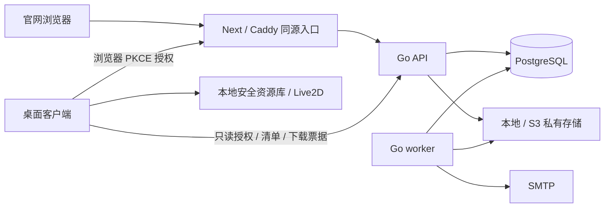

# 玄司官网与资源平台

`web/` 是 desktop-ai-pet 的配套官网代码目录。首期提供产品介绍、真实客户端下载、账号、个人资源工作台、管理员发布及客户端资源接入。用户方案与实施边界见 [官网规划](官网规划.md)，实际接口见 [OpenAPI](../../web/contracts/openapi.yaml) 和 [接口约定](接口约定.md)。

## 已实现的能力

- 注册、邮箱验证、登录、密码恢复、个人资料、会话管理、客户端授权撤销。
- 模型、动作、表情、静态图片、GIF 资源的创建、编辑、版本、封面、上传、删除和个人资源库。
- 隔离上传、后台结构校验、SHA-256、不可变规范 ZIP、精确模型版本依赖、配额预留和结算、取消及失败清理、幂等完成。
- 私有资源所有者隔离；管理员可发布公开资源、隐藏/停用资源、管理用户、编辑版本草稿、发布版本、查看任务和审计。
- 桌面源码已接入系统浏览器 PKCE、Windows 凭据保管、后台下载、安全安装、模型试载、动作/表情应用和离线恢复。支持在托盘中直接选择本地模型上传，自动整理运行文件、校验、设置当前版本并加入资源库。

公开下载仍指向已经发行的 **v0.5.6 Windows 在线安装器**。官网资源接入属于当前源码新增功能，尚未随新客户端发行。网站模型预览首期使用封面和资源信息；实际 Live2D 渲染在桌面客户端。

商店交易、用户自由公开分享、评论收藏排行、浏览器 Cubism 渲染、分片上传和客户端自动升级属于后续扩展。现有资源/版本/依赖、发布渠道和权限边界可继续演进，无需先引入微服务。

## 技术与架构

| 部分 | 选择 |
| --- | --- |
| 页面 | React 19.3、Next.js 16.4 App Router、TypeScript strict |
| 界面与状态 | Tailwind CSS 4.3、项目自身组件、Lucide、TanStack Query、React Hook Form、Zod |
| 业务服务 | Go 1.26.9、chi、GORM、Goose、Fosite |
| 数据库 | PostgreSQL 18；本机验收使用官方 Windows 18.6 二进制 |
| 文件 | 本地开发目录；生产 S3/R2 私有桶，AWS SDK v2 |
| 邮件与入口 | 本机 Mailpit 1.31；生产 SMTP、Caddy HTTPS |
| 契约 | OpenAPI 3.1、生成的 TypeScript/Go 类型、版本化 manifest JSON Schema |



Go 是业务唯一后端；Next 提供页面和同源代理。任务使用 PostgreSQL 队列与租约，worker 通过行锁领取。资源库、客户端版本安装包和资源版本依赖采用批量查询。网络及落盘工作在客户端后台执行，SDK 操作回到 Qt 主线程。平台不上传聊天、截图、录音或 AI 服务密钥。

## 本机启动

需要 Node.js 24、pnpm 11、可自动选择 Go 1.26.9 工具链的 Go 安装。桌面验收另需仓库 Python 虚拟环境、PySide6、live2d-py 和 Chrome。命令在项目根目录执行。

首次安装前端依赖：

```powershell
Push-Location web/frontend
pnpm install --frozen-lockfile
Pop-Location
Copy-Item web/.env.example web/.env
```

数据库和开发邮件常规使用 Docker：

```powershell
& web/scripts/run-dependencies.ps1
```

当前工作区已经准备了便携本机依赖，也可以运行：

```powershell
& web/scripts/run-dependencies.ps1 -Portable
```

本机默认数据库端口是54329。当前工作区原端口无法绑定，已保留原数据目录并使用15432；启动便携依赖时执行 `& web/scripts/run-dependencies.ps1 -Portable -PostgresPort 15432`，本地 `.env` 的 `DATABASE_URL` 已匹配此端口。新工作区若选择其他端口，同步修改自己的数据库地址。

便携工具位于忽略目录 `web/.runtime/tools/postgresql/pgsql/bin` 和 `web/.runtime/tools/mailpit/mailpit.exe`，数据位于 `web/.runtime/postgres`、`web/.runtime/mailpit.sqlite3`。新工作区可从 [PostgreSQL 官方 Windows 下载入口](https://www.postgresql.org/download/windows/) 获取 EDB 二进制，从 [Mailpit 官方发行页](https://github.com/axllent/mailpit/releases/tag/v1.31.0) 获取对应工具并放入上述目录。运行脚本只启动本项目数据目录，发现占用邮件端口的其他程序时停止，不操作该程序。

在三个独立终端依次启动 API、worker、前端；API 的 `/readyz` 返回成功后再启动 worker：

```powershell
& web/scripts/run-dev.ps1 -Service api
& web/scripts/run-dev.ps1 -Service worker
& web/scripts/run-dev.ps1 -Service frontend
```

| 服务 | 地址 |
| --- | --- |
| 官网 | http://localhost:3000 |
| Go 存活 / 就绪 | http://127.0.0.1:8080/healthz /readyz |
| 开发邮件捕获界面 | http://127.0.0.1:8025 |
| PostgreSQL | 127.0.0.1:54329；开发库 xuansi |

浏览器使用 `localhost:3000`，保持与 `APP_URL` 相同来源。默认开发配置使用 Mailpit，注册后在邮件捕获界面打开验证链接；配置真实 SMTP 时从实际邮箱打开链接。没有默认管理员账号。需先注册并验证实际账号，再在已配置 `DATABASE_URL` 的后端终端提升：

```powershell
Push-Location web/backend
$env:DATABASE_URL='postgres://xuansi@127.0.0.1:54329/xuansi?sslmode=disable'
go run ./cmd/admin -email 已验证的邮箱
Pop-Location
```

新密码要求 12～128 个字符，中文和 Emoji 按 Unicode 码点计数；注册、重置与修改密码从 `/api/v1/auth/config` 读取同一规则。默认 Mailpit 模式的邮件留在本地收件箱，不会投递到填写的真实邮箱。页面提供“打开本地收件箱”和“重新发送验证邮件”；验证通过有效期 1 小时的邮件链接完成，不需要填写数字验证码。接入真实 SMTP 后，页面自动隐藏本地收件入口。

QQ 邮箱可在本地 `web/.env` 中配置以下字段，并将占位文字替换为自己的实际信息。SMTP 登录账号和发件人使用同一个完整 QQ 邮箱地址；密码字段填写邮箱生成的授权码。服务器与认证方式可参考 [腾讯云邮箱登录配置说明](https://intl.cloud.tencent.com/zh/document/product/1266/71700) 和 [QQ 邮箱授权码说明](https://wx.mail.qq.com/list/readtemplate?name=app_intro.html#/agreement/authorizationCode)。

```dotenv
SMTP_HOST=smtp.qq.com
SMTP_PORT=587
SMTP_FROM=你的QQ邮箱完整地址
SMTP_USER=你的QQ邮箱完整地址
SMTP_PASSWORD=你的邮箱授权码
```

本项目通过 587 端口的 STARTTLS 校验服务器证书后登录。更新配置后重启 API 和 worker，前端刷新页面即可。此前在 Mailpit 收到的邮件不会自动补发，已有账号可在 `/verify-email` 重新发送验证链接。`.env` 不进入 Git；不要把授权码放入公开配置示例。`verify-platform.mjs` 和 `verify-auth-regression.mjs` 会在真实 SMTP 模式下提前停止，重新运行这些验收时须切回默认 Mailpit 配置。

API 启动时 `-migrate` 应用嵌入的四个迁移，可重复运行；不使用 AutoMigrate。开发的随机 OAuth 密钥随 API 重启失效，客户端需要重新授权。生产必须配置稳定密钥。

验收生产构建时，在 `web/frontend` 执行 `pnpm build`，关闭正在运行的开发前端，然后在项目根目录运行 `& web/scripts/run-preview.ps1`。它使用与镜像相同的 standalone 入口，仍仅绑定本机；不能与开发前端同时占用 3000 端口。

## 资源协议

模型上传包含 `.model3.json`、`.moc3`、纹理及引用文件的 ZIP；入口不明确时填写入口相对路径。动作上传 `.motion3.json`、表情上传 `.exp3.json`，必须绑定本人或可访问的已就绪模型版本。静态图片/封面支持 PNG、JPEG、WebP，动图首期使用 GIF。

worker 将所有类型转换为带 manifest 的 ZIP。默认上传和解包上限均为 512 MiB，文件数量上限 2048，默认用户配额 2 GiB。平台拒绝路径穿越、符号链接、Windows 非法名称、脚本和保留文件名。`minimumClientVersion` 留空表示未声明最低版本；声明时使用三段数字。

结构校验通过仅表示包完整。版本保持 `UNTESTED`，客户端以实际 SDK 试载判定兼容；试载失败回退。空的可选 Cubism 引用允许，MOC、纹理、动作/表情文件引用必须存在。凭据不写入配置或日志，下载票据短期有效，资源停用或授权撤销后立即拒绝访问。

## 客户端直接上传

在当前源码客户端的托盘菜单选择 **官网：上传本地模型**。首次使用时，浏览器会打开官网登录与“允许上传模型”页面；已有有效上传授权会直接复用。

选择包含运行文件的模型文件夹，或直接选择 `.model3.json`，确认预填的名称、作者、版本号和许可后点击 **上传模型**。客户端会只收集明确的 Cubism 运行引用，自动整理ZIP、上传、等待后台校验、设置当前版本并加入自己的资源库；不需要手工压缩或先在网页创建资源。模型目录中的编辑工程与无关附件不会被自动收集，目录内的链接不会用于入口搜索，引用中的链接或越界路径会被拒绝。

上传在后台运行，可以取消；若模型已校验完成但最后入库失败，按钮会显示 **完成加入资源库**，再次点击只恢复同一版本的完成步骤。该恢复状态保留在当前客户端窗口中，关闭并重新打开窗口可以继续；退出整个客户端后可从官网查看已上传资源。

下载授权仍为 `resources:read`，直接上传通过浏览器明确申请 `resources:read resources:write`。写权限只覆盖本人资源上传、当前版本选择和入库；已有只读令牌不会自动获得写权限，也不能通过上传授权修改账号、调用管理员接口或公开发布资源。详细说明见 [客户端上传](../客户端/官网资源上传.md)。

## 目录

```text
web/
  frontend/              页面、组件、API 调用及锁定依赖
  backend/
    cmd/{api,worker,admin}/
    internal/{api,oauth,platform,resource}/
    migrations/          显式 SQL 迁移与真实发行元数据
  contracts/             OpenAPI、manifest Schema、共享夹具、生成类型
  deploy/                Dockerfile、Caddy、独立生产 compose 和配置示例
  scripts/               启动、契约生成、浏览器/客户端/安装载荷验收
omx_wiki/
  官网/                  规划、界面设计、接口约定、部署、任务与验收
  客户端/                桌宠官网接入与直接上传说明、任务
```

全部文档入口见 [项目文档总览](../README.md)。生产模板和机器契约继续保留在 `web/deploy/` 与 `web/contracts/`，普通说明文档统一在 `omx_wiki/` 中维护。

生成类型执行 `& web/scripts/generate-contracts.ps1`；编辑 OpenAPI 后重新生成，不手改生成文件。生成 Go 类型可供服务适配和后续 SDK 使用，当前 API 使用显式业务模型和输入校验。

完整验证命令及结果见 [开发验收](验收/开发验收.md)，生产配置见 [部署说明](部署说明.md)。`.env`、便携工具、数据库、资源、邮件和验收截图不提交，也不进入桌面安装载荷。
