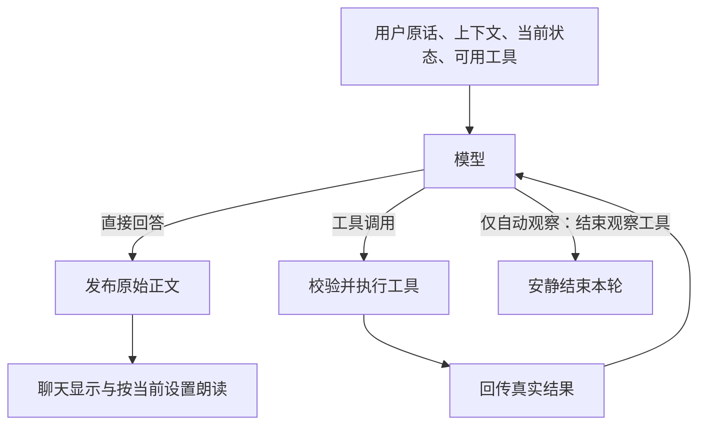

# 模型自主工具对话改造方案

日期：2026-10-16。初稿已获用户批准，原生对话实现已接通，0.6.0 候选仍在真实模型验证，尚未发布。当前进度见[实施清单](模型自主工具对话实施清单.md)，失败与复验见[候选验收记录](../验收/模型自主工具对话候选验收-2026-10-16.md)。以下保留初稿方案的设计语境及改造前现状，不作为当前实现快照。

本方案承接用户已经明确的方向：原始输入、上下文、系统提示和可用工具交给模型，由模型决定直接回答还是调用工具；不根据“无需回应”等自然语言进行匹配、删除或替换。当前阶段只提交方案，审核后再拆分实施任务。

## 目标与范围

改造桌宠的文字、实时语音、整句语音和自动观察对话链。复用本地 Qwen3.5-4B、llama.cpp、ASR、TTS、记忆存储和 Live2D 执行能力，不引入新的 Agent 框架、依赖或云端服务。

普通聊天允许一次模型请求直接返回正文；有工具需求时才执行工具并将真实结果回传。自动观察有明确的静默结束动作，不再让模型在正文中输出约定口令。明确附图继续直接提供图像，其余需要看屏的请求交由模型选择截图工具。

本轮不重做控制中心、官网、账号、资源上传、模型权重或安装器。工作区已有的界面和文档改动不属于本方案的实施内容。

后续范围补充：真实 4B 验收持续出现资料指令误执行后，用户明确允许先试验更大模型，再按效果决定是否替换默认模型。实验使用独立权重目录及同一验收入口，当前默认配置未改变；见[候选验收记录](../验收/模型自主工具对话候选验收-2026-10-16.md)。安装器仅清理此次退役的三个控制模块及其字节码，不重做安装体系或覆盖个人数据。

## 已确认的现状

| 改造前现状 | 父提交源码依据 |
| --- | --- |
| 自动观察要求模型输出“无需回应”，对话层再匹配该正文决定隐藏 | [app.py:282](https://github.com/DesktopPetXuansi/Xuansi/blob/1994f1a94c225e61e22ac869d40afe86321cb789/pet/app.py#L282)、[conversation.py:171](https://github.com/DesktopPetXuansi/Xuansi/blob/1994f1a94c225e61e22ac869d40afe86321cb789/pet/conversation.py#L171) |
| 语音先做是否截图的独立判断；有记忆候选时每轮先做语义检索，并将结果追加到系统提示 | [conversation.py:38](https://github.com/DesktopPetXuansi/Xuansi/blob/1994f1a94c225e61e22ac869d40afe86321cb789/pet/conversation.py#L38)、[conversation.py:49](https://github.com/DesktopPetXuansi/Xuansi/blob/1994f1a94c225e61e22ac869d40afe86321cb789/pet/conversation.py#L49) |
| 普通对话先请求控制分类，执行后再要求正文带固定控制头 | [inference.py:214](https://github.com/DesktopPetXuansi/Xuansi/blob/1994f1a94c225e61e22ac869d40afe86321cb789/pet/inference.py#L214)、[inference.py:255](https://github.com/DesktopPetXuansi/Xuansi/blob/1994f1a94c225e61e22ac869d40afe86321cb789/pet/inference.py#L255)、[speech_control.py:39](https://github.com/DesktopPetXuansi/Xuansi/blob/1994f1a94c225e61e22ac869d40afe86321cb789/pet/speech_control.py#L39) |
| 观察和试听另行分类选择 TTS，开麦还会预热旧控制分类 | [runtime.py:102](https://github.com/DesktopPetXuansi/Xuansi/blob/1994f1a94c225e61e22ac869d40afe86321cb789/pet/runtime.py#L102)、[runtime.py:161](https://github.com/DesktopPetXuansi/Xuansi/blob/1994f1a94c225e61e22ac869d40afe86321cb789/pet/runtime.py#L161) |
| 历史仅保存文本消息，用户文本截取 2000 字；SSE 只读取正文差量 | [conversation.py:176](https://github.com/DesktopPetXuansi/Xuansi/blob/1994f1a94c225e61e22ac869d40afe86321cb789/pet/conversation.py#L176)、[runtime.py:58](https://github.com/DesktopPetXuansi/Xuansi/blob/1994f1a94c225e61e22ac869d40afe86321cb789/pet/runtime.py#L58)、[text_stream.py:53](https://github.com/DesktopPetXuansi/Xuansi/blob/1994f1a94c225e61e22ac869d40afe86321cb789/pet/text_stream.py#L53) |
| 文件写入已有取消安全处理，动作目前通过 Qt 信号触发，尚没有工具执行结果回执 | [memory.py:19](https://github.com/DesktopPetXuansi/Xuansi/blob/1994f1a94c225e61e22ac869d40afe86321cb789/pet/memory.py#L19)、[conversation.py:106](https://github.com/DesktopPetXuansi/Xuansi/blob/1994f1a94c225e61e22ac869d40afe86321cb789/pet/conversation.py#L106)、[app.py:130](https://github.com/DesktopPetXuansi/Xuansi/blob/1994f1a94c225e61e22ac869d40afe86321cb789/pet/app.py#L130) |

本轮执行本机 `runtime/llama/llama-server.exe --version`，确认实际版本为 build 10930，commit `56381e407`。本轮未加载模型、启动 GPU 推理或重新运行历史业务验收。

## 对话流程

主动对话和自动观察共享协议与执行机制，使用不同的能力集合。观察事件属于后台资料，不伪装成用户指令，不写入普通聊天历史。

程序只处理原生协议字段、能力权限、参数、代次、执行结果和资源限制。用户意图、是否需要工具和回答措辞由模型判断。

## 工具集合

下列名称是拟议内部接口，实施时按已有类型和模块约定落地。工具之间没有固定调用顺序，由模型按当前任务选择。

| 工具 | 作用 | 执行约定 |
| --- | --- | --- |
| `capture_screen` | 获取当前允许查看的画面 | 复用 [desktop.py:101](../../../pet/desktop.py#L101)；程序提供有效位置和范围，不接受任意路径或后台越权截图 |
| `search_memory(query)` | 按需查找用户已有的长期记忆 | 只有模型调用才读取；首期复用 [model_memory.py:177](../../../pet/model_memory.py#L177) 的容量分批语义检索，结果作为工具资料返回，不提升为系统指令 |
| `save_memory(note)` | 保存本轮用户明确要求记住的事项 | 复用 [memory.py:67](../../../pet/memory.py#L67) 的校验、去重和实际写入；完成后才返回成功 |
| `set_speech_enabled(enabled)` | 改变本次运行的朗读开关 | 复用 [runtime.py:127](../../../pet/runtime.py#L127)，不改变麦克风和已保存偏好 |
| `select_tts_engine(engine)` | 需要时选择本轮合成引擎 | 复用当前合成执行链；用户明确选择的引擎优先，不再每轮提前分类 |
| `play_motion(action)` | 执行当前角色真实支持的动作 | 能力来自 [runtime.py:135](../../../pet/runtime.py#L135)；Qt 线程确认受理或失败后返回实际状态，不把发出信号当作动作已经完成 |
| `finish_observation` | 本次观察无须发言时终结本轮 | 只对自动观察提供；这是工具行为，不产生占位正文，也不额外请求一轮结束语 |

自动观察仅开放只读能力、遵守现有观察朗读偏好的本轮 TTS 选择，以及结束观察。它不能保存记忆、改变持续朗读开关或驱动用户请求类动作。显式看屏、附图聊天和正常语音请求继续遵守当前桌面状态与截图范围。

试听使用已经选择的语音配置，不经过聊天意图分类。实际波形生成、声音回避和播放仍使用现有实现，见 [runtime.py:102](../../../pet/runtime.py#L102)。

`search_memory` 内部可以使用现有模型筛选原文，但它仅在模型决定检索后发生；不保留“每条聊天先读记忆并分类”的隐藏前置流程，也不增加关键词检索回退。

## 协议、历史和执行边界

- 请求采用原生 `tools` 和自动工具选择。普通正文和 `tool_calls` 分开处理；移除强制控制 JSON 分类、正文控制头及其兼容解析。格式解析不负责猜用户意图。
- 保留完整的用户原话，不再以 `text[:2000]` 静默改写本轮输入；同时移除 [inference.py:327](../../../pet/inference.py#L327) 的 6000 字返回裁切和 [text_stream.py:76](../../../pet/text_stream.py#L76) 的正文静默截断。输出容量由请求预算控制，截断以结束原因显式报告；旧历史按完整用户轮次裁剪。
- 历史包含 assistant 工具请求、对应 `tool_call_id` 的工具结果和最后正文。不能截断调用组、留下孤立工具结果，或让工具执行完毕却在下一轮失去结果记录。
- 容量计算涵盖真实模板、工具定义、工具参数与结果、图像及输出预算。复用现有完整请求计数经验，见 [model_memory.py:83](../../../pet/model_memory.py#L83)，替换 [inference.py:329](../../../pet/inference.py#L329) 的纯文本历史预算。
- 工具执行串行，关闭并行工具生成；首期每个用户轮次最多处理 6 个工具调用提案，非法或被拒绝的完整调用也计数，不是 6 次模型请求。批量返回时按顺序处理，每个完整调用均有对应结果，超额部分只返回超限错误。预算耗尽后普通对话最多追加一次 `tool_choice:none` 的结果总结；观察结束并记录状态。模型就绪后生成与工具执行合计设 90 秒截止时间，冷加载沿用现有 100 秒就绪保护，正常音频播放不计入生成预算；无剩余时间时直接报告超时，不再请求总结。
- 同一调用 ID 只执行一次，失败、超时或截断参数不能自动重放写入和动作。新 ID 是否代表用户真正要求再次操作，由模型结合已有结果决定，不对正文或参数做语义去重。
- 每次调用和结果发布前后检查对话代次；观察还检查窗口与时效，沿用 [desktop.py:81](../../../pet/desktop.py#L81) 与 [app.py:224](../../../pet/app.py#L224) 的约束。
- 完整工具请求先进入本轮内存记录，再执行；每项结束立即补入真实结果，不等最终正文成功才保存历史。继续使用 [memory.py:19](../../../pet/memory.py#L19) 的短写入取消语义：未开始的调用记为取消，已启动的短写入等结果确认后记成功或失败；动作无法确认时标记结果未知，不能假装未发生。旧轮收尾后，新轮可读到这些结果；不额外持久化聊天或建立事务数据库。存储权限、长度和现有敏感资料约束保留。
- 工具错误作为结构化失败结果回传，让模型据实解释。未知工具、非法参数和不可用动作不能执行；角色动作需经过 Qt 回执，并明确区分受理、完成和失败，不声称程序未能确认的完成状态。
- `finish_observation` 只在本次响应没有可见正文、仅有这一项调用、参数完整合法时终结。若与正文或其他调用混合，整批返回协议冲突并禁止副作用，由模型重新选择；不会吞掉已经生成的正文。有效结束请求和结束结果配对写入观察的临时上下文后直接终止，无须再生成结束语。缺 ID、截断参数或流中断不执行、不冒充静默成功。
- 预热只准备模型与音频资源，不执行工具、不写历史和记忆、不切换用户状态。替换 [runtime.py:161](../../../pet/runtime.py#L161) 的旧控制预热。
- 日志记录轮次、调用 ID、工具名、成功/失败类型和耗时；不写原始聊天、记忆正文、图像或密钥。对协议时序、取消和线程回执补充解释原因的注释。

现有独立的记忆授权分类由普通模型对话中的授权理解和原生工具选择取代；不再为了每轮操作另起一个固定解释器。用户原话、引用、屏幕和记忆资料的来源在上下文中明确区分。实际是否选对工具必须由后述真实模型负例验证，不声称仅靠换协议就能消除语义误判。

## 文字与语音的时序

上游协议与 Qwen3.5 模板允许同一 assistant 消息同时包含正文和工具调用，因此不能假定“正文出现就代表这一轮不会调用工具”。

首期采用可验证的顺序：

1. 可调用工具的模型响应中，先在本轮内缓存正文并收齐工具调用差量。
2. 如果这一轮含工具调用，正文仍按原顺序原样展示并记入协议历史，作为模型的操作前说明；工具执行状态通过已有状态区域单独展示。工具轮正文不朗读，先执行并回传结果，再由模型生成最终答复。程序不判断其中哪句话像“成功”，也不删除这些文字。
3. 如果这一轮是最终正文，再按实际朗读状态和本轮 TTS 选择交给界面、分段合成与播放。
4. 如果有效调用结束观察工具，安静结束。该工具与可见正文并存时按上节规则拒绝终结并原样保留文字。普通对话空正文、流式中断和参数截断仍是独立错误，不能冒充静默。

提示和测试要求模型在收到工具成功结果前不提前宣布完成。即使模型违反要求，程序也不会改写它的原话；必须如实显示执行失败并保留原始证据，作为语义验收失败处理。

这会改变现有“模型正文尚未结束就开始合成”的时序，见 [conversation.py:142](../../../pet/conversation.py#L142)。保留分段合成、播放和取消能力，但首版不承诺首音延迟不变。先测量再决定是否有可证明正确的流式优化，不通过提前朗读或删正文掩盖时序问题。

## 建议的迁移顺序

以下是方案级顺序，不是已经批准或开始执行的任务清单。

| 阶段 | 修改重点 | 进入下一阶段的条件 |
| --- | --- | --- |
| 1. 本机协议探针 | 使用实际 b10930、Qwen3.5-4B 和当前模板，验证 auto 直答/调用、none/required、成功/失败回传、非思考模式、正文与调用混合、跨包参数、未知工具及图像工具结果后续答 | 真实请求取得正确结构；完整图片工具回传后能按图回答；含工具和图片的完整 token 计数可用。required 成功不能代替 auto 决策通过，探针只使用临时资料和无副作用工具 |
| 2. 先贯通一条对话 | 在 [inference.py](../../../pet/inference.py)、[text_stream.py](../../../pet/text_stream.py)、[conversation.py](../../../pet/conversation.py) 接通纯聊天、一次工具执行和续答 | 不需要工具时只有一次正文请求；调用失败时无虚假成功；历史与取消正确 |
| 3. 迁移既有能力 | 接入上述工具，迁移语音、观察、TTS、记忆及预热；在 [runtime.py](../../../pet/runtime.py)、[app.py](../../../pet/app.py) 对接实际状态与线程回执 | 既有行为回归通过，普通聊天、语音和观察都经过统一协议，没有强制前置分类 |
| 4. 清理和完整验收 | 移除 [model_control.py](https://github.com/DesktopPetXuansi/Xuansi/blob/1994f1a94c225e61e22ac869d40afe86321cb789/pet/model_control.py) 和 [speech_control.py](https://github.com/DesktopPetXuansi/Xuansi/blob/1994f1a94c225e61e22ac869d40afe86321cb789/pet/speech_control.py) 中退役协议及全部旧调用方，同步脚本和现行文档 | 没有新旧双轨；全部验收标准通过；原历史验收不被改写 |

内部职责分成“模型请求与协议”“工具能力和执行”“单轮生命周期”。优先复用现有代码；工具定义与执行可集中在拟新增的 `pet/model_tools.py`，循环复杂度影响可读性时再独立为 `pet/tool_dialogue.py`。不预先引入通用 Agent 框架或插件注册系统。

## 验收标准

| 场景 | 必须观察到的结果 |
| --- | --- |
| 普通闲聊 | 用户原话到达正文模型；一次请求直接回答；没有截图、记忆检索或固定控制分类 |
| 用户要求解释“无需回应”，或明确让模型说这句话 | 最终正文及工具调用前的可见正文均原样保留；没有按字符串隐藏、替换或吞消息；超过旧 6000 字边界的完整正文也不被静默裁切 |
| 普通画面，无需评论 | 真实模型选择结束观察工具；无聊天追加、气泡或朗读；状态恢复就绪 |
| 有值得评论的观察画面 | 生成自然正文，遵守观察朗读偏好；不执行写记忆、持续开关或动作 |
| 看屏请求和显式附图 | 模型按需调用截图；显式附图不重复截图；窗口变化和过期结果被拒绝 |
| 保存、拒绝保存和上下文确认 | 明确请求才调用保存；完成后能从隔离文件重载；拒绝和未确认不写入；无先报成功后失败 |
| 记忆末尾及长上下文 | 6000 字末尾相关资料可被工具召回；完整调用组裁剪；当前用户输入不被静默截断 |
| 关闭、恢复朗读及 TTS | 开关先于对应正文播放生效；恢复当轮可出声；不改变麦克风；中文、纯英文和混合回复使用支持的合成路径 |
| 角色动作 | 仅调用真实能力；Qt 拒绝或失败能回传；不以发出信号伪报完成 |
| 引用、翻译、假设、询问设置、普通偏好和屏幕指令 | 在真实默认采样设置下重复验证，均不误写记忆、不误切朗读、不误执行动作 |
| 协议破损、重复包、工具错误和调用超限 | 半截参数不执行；同 ID 无重复副作用；第 7 项不执行；所有完整调用有配对结果；达到上限按规定总结或结束，无无限循环 |
| 结束观察与正文/其他调用混合 | 原文可检查，整批无副作用，每项有冲突结果；仅完整、独占且无正文的结束调用能静默终结 |
| 中止、休眠、唤醒及旧轮迟到结果 | 不继续旧截图/动作/播放；声卡与模型资源正确收尾；保存完成但正文中止后，下一轮仍看到成功结果，不因结果丢失而重做 |
| 资源预热 | 无工具副作用，无用户历史或记忆写入，无麦克风选择变化 |
| 性能与界面线程 | 同条件记录前后模型请求数、首段文本时间、首音时间和总耗时；普通闲聊无额外语义请求，磁盘/截图/推理不阻塞 Qt 主线程 |

真实模型语义验证使用当前默认 `temperature=0.7`：引用、翻译、否定/假设、询问方法、普通偏好、截图指令六类负例，每类至少 3 种表达，每条重复 3 次，共至少 54 次，要求误写入、误切朗读和误执行动作均为 0；每项支持的工具至少验证 3 个正向样例。静默画面和需发言画面各 5 个合成场景、各重复 3 次，分别验证正确结束和自然回复。报告记录总运行数、误执行数和原始失败，有限采样不等于任意表达零错误。

性能使用同机暖机后的 10 轮普通短对话及各类工具场景比较，记录请求数、首文字、首音、总时长的中位数和范围。普通闲聊只允许一次正文模型请求；首音延迟变化据实列入验收，不能借移除分类请求便宣称整体更快。

已有针对“无需回应”正文保留的 [test_reply_recovery.py:37](../../../tests/test_reply_recovery.py#L37) 继续保留，旧协议测试改为验证对应工具行为，不删除原行为保障来换取通过。

## 验证与风险处理

实施时先做协议、执行顺序和取消的定向测试，再运行全量 pytest、Ruff、Python 编译与差异格式检查。真实模型与 Qt 业务检查顺序运行，使用合成图片、临时记忆、模拟麦克风和静音播放接收器，结果另存新报告。重点迁移 [verify_model_semantics.py](../../../scripts/verify_model_semantics.py)、[verify_model_speech.py](../../../scripts/verify_model_speech.py)、[verify_observation.py](../../../scripts/verify_observation.py) 及相应测试，保留旧验收日期和测量的历史意义。

主要风险及处理：

- 上游支持不代表本机模板完全兼容。先验证 `role=tool` 携带图像；若本机不接受，单独验证带工具来源标识的图像资料消息。若仍不可用，记录兼容性缺口，不回退关键词和旧控制头，也不擅自升级引擎或更换权重。
- 原生工具选择仍可能误解用户。用真实默认采样重复验证否定、引用、指代和低质量 ASR；发现未授权副作用就阻止该版本验收，不新增自然语言匹配兜底。
- 工具定义与历史占用 4096 上下文，工具参数也可能被 `max_tokens` 截断。以完整真实请求计数，限制参数与结果长度；截断调用不执行，容量不足明确报错。
- 缓存正文可能提高首音延迟，原来多轮前置分类也可能减少。必须同条件测量，不能先承诺一定更快。
- 移除旧 JSON 复核意味着不继续沿用那套双模型授权流程；语义选择可靠性需要新测试证明，执行层既有存储、来源和能力限制继续生效。

## 上游依据与本轮证据边界

- [llama.cpp 官方工具调用说明](https://github.com/ggml-org/llama.cpp/blob/master/docs/function-calling.md)：原生工具定义、tool_calls 和模板要求。
- [llama.cpp 本机对应源码](https://github.com/ggml-org/llama.cpp/tree/56381e407c0ccfb3a6f71e668a27a901001d22ce)：该提交 [识别 Qwen3.5 工具模板](https://github.com/ggml-org/llama.cpp/blob/56381e407c0ccfb3a6f71e668a27a901001d22ce/common/chat.cpp#L1194-L1199)，并 [解析 auto/none/required](https://github.com/ggml-org/llama.cpp/blob/56381e407c0ccfb3a6f71e668a27a901001d22ce/common/chat.cpp#L345-L355)。不能用 master 支持情况冒充本机已通过。
- [Qwen3.5-4B 官方固定模板](https://huggingface.co/Qwen/Qwen3.5-4B/blob/851bf6e806efd8d0a36b00ddf55e13ccb7b8cd0a/chat_template.jinja#L53)：允许正文与工具调用同轮，模板宏也支持图像；这不等于本机 GGUF 内嵌模板和多模态回传已验收。
- [Qwen3.5-4B 非思考模式说明](https://huggingface.co/Qwen/Qwen3.5-4B#instruct-or-non-thinking-mode)：保留当前 enable_thinking=false，不以提示词开关代替协议配置。
- 本轮已完成源码路径核对、实际二进制版本读取与上游文档/源码调研；尚未执行原生工具探针、业务改造、真实性能测量或新版验收。

用户审核后，才按上述阶段拆分带文件归属、依赖和验收步骤的具体任务；本方案不代表已完成任何功能迁移。

