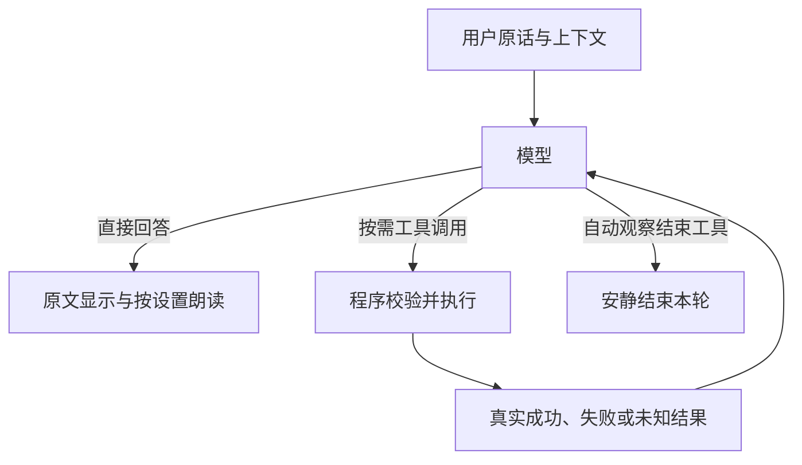

# 模型自主工具对话

更新日期：2026-10-16。0.6.0 候选验证中，公开安装包仍为 0.5.6。当前源码采用原生工具对话，真实模型验收仍有失败项，尚未发布。实施来源见[已审核方案](任务/模型自主工具对话改造方案.md)和[实施清单](任务/模型自主工具对话实施清单.md)，阶段证据见[候选验收记录](验收/模型自主工具对话候选验收-2026-10-16.md)。

## 用户输入与模型

文字和最终语音转写保持原文，与近期上下文、当前状态、系统提示及工具说明一起交给 Qwen3.5-4B。普通闲聊可以一次请求直接回答；程序不预先替模型分类截图、记忆和控制意图，不匹配“无需回应”等自然语言决定是否显示。

用户原话使用独立 user 消息。显式附图和后台观察已经真实取得的截图，作为预先完成的 capture_screen 工具请求与资料回执进入上下文，不并入 user 消息；回执标明图像来源和资料身份。这是如实记录程序已完成的截图，不冒充模型自主发起的额外调用，图中文字也不能继承用户的操作授权。

[tool_dialogue.py](../../pet/tool_dialogue.py) 组织模型回答、工具执行和结果回传；[inference.py](../../pet/inference.py) 只负责一次模型生成。正文、工具调用及执行结果分别使用协议消息，类型见 [tool_protocol.py](../../pet/tool_protocol.py)。

带工具的单次请求启用 1024 token 内部思考预算，另留 16 token 结束标记空间，总生成额度为设置的回答预算加上这两项；容量检查使用真实总额。模型的独立 reasoning_content 字段不进入聊天或朗读，正文里的任何词句和标签仍原样保留。内部思考属于本次模型推理，没有增加前置分类请求；温度和 top_p 沿用设置，top_k=20、min_p=0、repeat_penalty=1 明确提供给引擎。



## 工具能力

[model_tools.py](../../pet/model_tools.py) 定义并执行当前能力：

| 工具 | 行为 |
| --- | --- |
| capture_screen | 获取当前允许的位置与范围，图像作为工具资料返回；没有有效位置时不提供能力 |
| search_memory | 调用之后才读取长期记忆，并复用现有容量分批语义检索；不按关键词或最近记录回退 |
| save_memory | 保存本轮用户明确要求的事项；实际写入后才返回成功，现有长度与敏感资料限制仍生效 |
| set_speech_enabled | 改变本次运行的朗读状态，不控制麦克风 |
| select_tts_engine | 选择本轮合成引擎；中文/混合语言用 fast、纯英文用 natural，用户显式 natural 优先 |
| play_motion | 只提供当前模型真实支持的动作；Qt 使用唯一请求 ID 返回受理或拒绝，不声称动作已完成 |
| finish_observation | 仅自动观察可以安静终结本轮，不生成占位回复 |

记忆工具返回的原文、截图和引用都属于资料，不提升为系统指令。保存记忆、改变朗读开关和播放动作三种状态改变，提示要求本轮用户明确授权；读取资料、选择本轮 TTS 和结束后台观察则由模型按任务自主判断，不要求用户逐项下令。明确性和指代由模型理解，协议、存储及能力边界由程序校验；目前仍有把动作赞美误当操作请求的真实失败，不能声称程序校验已经解决所有授权误判。

## 观察与截图

显式附图使用 chat-screen、voice-screen 请求，自动观察直接提供当前事件画面；其他文字和语音请求携带合法候选位置，由模型按需截图。

已有画面以 capture_screen 的已完成资料回执提供，原用户文字单独保留；同轮已经附图时不再提供重复截图能力。自动观察的提示区分普通画面和明确异常：前者应安静结束，错误、低电量或空间不足等应直接文字提醒。这是待真实模型验证的行为要求，当前仍存在普通画面多话和异常画面误静默，不能承诺每次判断正确。

观察使用独立临时上下文，不污染用户聊天历史。它只获得只读能力、允许朗读时的本轮引擎选择和结束观察工具，不能保存记忆、改变持续朗读或执行动作。有效结束调用要求独占、无正文、参数完整；与正文或其他工具混合则整批拒绝副作用，保留原文并回传错误。

没有静默口令或正文关键词过滤。用户明确提及或要求回复“无需回应”时，正文仍照原样显示。

## 正文、语音与结果顺序

原生响应可以同时包含正文和工具调用，因此先收齐本次生成，再发布。工具轮正文按原顺序显示，作为操作前说明，不进入朗读；工具结果回传后，最终正文按实际朗读状态和本轮引擎分段合成。

程序不改写模型提前说出的成功声明；提示要求等成功收据后再确认，真实模型验证中若提前报成功则记录为失败。完整正文不再按 6000 字静默裁切；流中断和输出截断显式报告。

合成与播放继续使用 [streaming_speech.py](../../pet/streaming_speech.py) 的有界队列、声音回避、取消及口型。模型生成与首段合成不再按旧协议重叠，旧版首音测量不能直接作为本版保证。试听直接使用选择的引擎，不进行意图分类。

系统状态明确区分声音与文字：关闭朗读只是不播放音频，仍可以正常文字回答；不用为发文字重新开启声音。观察关闭朗读时，明确异常仍应以文字提醒，不能因为静音就一律结束观察。

语音后端返回空波形时，播放层跳过该片段并继续后续片段，避免零采样率造成耗时日志除零；非空波形的无效采样率仍明确报错。此处理依据音频结果，不根据正文或表情猜测是否朗读，也不改变界面显示。

## 历史、取消与限额

工具请求和每项结果即时加入内存历史，保存完成但正文被取消时，下一轮仍能看见真实成功收据。用户原话不截取 2000 字；历史按完整用户轮次裁剪，容量计算包含工具定义、参数、结果、图像和真实聊天模板。

普通历史最多保留八个用户轮次，超出模型上下文时再裁掉完整旧轮；当前输入与调用组无法放入时明确报错。聊天和观察原始记录不落盘。

带工具且允许调用的单次原生请求保留 1024 token 内部思考预算，另留 16 token 结束标记额度；总生成额度由 `max_tokens` 加上这些内部额度组成。容量检查使用实际请求的总生成额度，不能只按可见正文设置计算。没有额外前置控制分类；模型内部思考通过服务协议独立字段处理，不从正文匹配或删除标签。该生产配置正在真实完整矩阵复验，局部 25 项零失败不表示整体通过。

每轮最多处理六项工具调用提案，非法完整调用也计数。同一 ID 不重复执行；未知工具、非法参数、过期请求和超额调用返回配对错误。预算耗尽后普通对话最多请求一次无工具总结，观察结束。模型就绪后生成与工具共享 90 秒预算，加载保留 100 秒保护。

已接受的短写入在重复取消后仍等到终态并记入收据。动作请求有唯一 ID、有效期及 Qt 执行前检查，迟到回执不能完成下一项请求。日志只记录状态、工具名、ID、计数、错误类型和耗时，不记录聊天、记忆正文或图片。

## 验证

```powershell
.\.venv\Scripts\python.exe -X utf8 -m pytest -q
.\.venv\Scripts\python.exe -m ruff check pet tests scripts
.\.venv\Scripts\python.exe -X utf8 scripts/verify_native_tools.py --output data/verification/native-protocol-new.json
.\.venv\Scripts\python.exe -X utf8 scripts/verify_tool_dialogue.py --suite full --output data/verification/native-dialogue-new.json
.\.venv\Scripts\python.exe -X utf8 scripts/verify_tool_dialogue.py --suite speech --output data/verification/native-speech-new.json
```

报告使用新名称，保留失败。真实模型验证只使用合成图片、临时记忆和模拟动作受理，不接麦、不播放；实际 Qt、合成波形、安装与发布分别验收。历史脚本入口迁移至原生工具验证，不代表重新执行旧 ASR/NPZ 或实际声音听感检查。

主代理本轮最近一次完整 pytest 为 483 passed、2 skipped；这是隔离回归结果，不替代真实语义验收。`native-tools-full-source3.json` 为 119 项、18 项失败，其中 54 次负例出现 2 次错误动作调用并收到模拟受理回执；后续 `strict-targeted4.json` 为 15 项、4 项失败，仍有动作赞美误执行、普通画面未静默及异常画面误静默。此前 30 项和 21 项失败报告完整保留。详细分类、测量条件与未覆盖项见[候选验收记录](验收/模型自主工具对话候选验收-2026-10-16.md)。

再后续的请求范围／内部思考诊断中，无思考 25 项／12 失败、512 token 25 项／3 失败、1024 token 25 项／0 失败；这仅为局部改善证据。采用明确 1024 token 预算后的完整 full 和性能仍待复验，不能覆盖先前真实失败或提前报告发布通过。

后续完整报告已保留：单次内部思考的 full 为 119 项／1 失败；精简提示后的 full 为 119 项／8 失败，新表达集 21 项通过，语音集仍 6 项／1 失败。用户已批准先试验更大模型，当前只下载隔离的 9B 文件并通过验收参数指定它，默认模型未替换。实测数据和后续选择见[候选验收记录](验收/模型自主工具对话候选验收-2026-10-16.md)。
