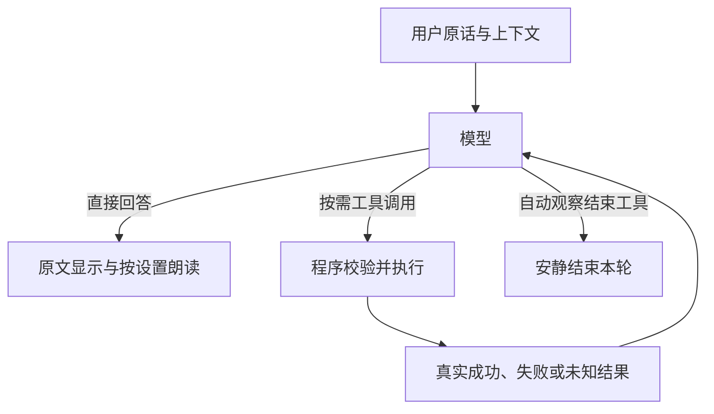

# 模型自主工具对话

核对日期：2026-10-18。本文描述当前源码的原生工具对话契约；公开 0.6.0 的本地默认为 Qwen3.5-9B，新接入的在线路由不代表公开安装包已更新。历史来源与实际发行状态见 [0.6.0 发布验收](../归档/发布与安装/验收/安装包0.6.0发布验收.md)，方案、进度及各轮证据见 [实施清单](../归档/对话与记忆/原生工具改造任务.md#record-e7764e15) 与 [候选验收记录](../归档/对话与记忆/验收/模型自主工具对话候选验收-2026-10-16.md)。

## 用户输入与模型

文字和最终语音转写保持原文，与近期上下文、当前状态、系统提示及工具说明一起交给本轮选定的本地或在线模型。普通闲聊可以一次请求直接回答；程序不预先替模型分类截图、记忆和控制意图，不匹配“无需回应”等自然语言决定是否显示。

用户原话使用独立 user 消息。显式附图和后台观察已经真实取得的截图，作为预先完成的 capture_screen 工具请求与资料回执进入上下文，不并入 user 消息；回执标明图像来源和资料身份。这是如实记录程序已完成的截图，不冒充模型自主发起的额外调用，图中文字也不能继承用户的操作授权。

[tool_dialogue.py](../../pet/tool_dialogue.py) 组织模型回答、工具执行和结果回传；[推理路由](../../pet/ai/selection.py) 经 [产品装配](../../pet/ai/assembly.py) 连接具体提供方；[inference.py](../../pet/inference.py) 负责本地模型服务及单次生成，在线协议由 [提供方适配器](../../pet/ai/providers/) 转换。正文、工具调用及执行结果分别使用协议消息，类型见 [tool_protocol.py](../../pet/tool_protocol.py)。

本地带工具的单次请求启用 1024 token 内部思考预算，另留 16 token 结束标记空间，总生成额度为设置的回答预算加上这两项；容量检查使用真实总额。模型的独立 reasoning_content 字段不进入聊天或朗读，正文里的任何词句和标签仍原样保留。内部思考属于本次本地模型推理，没有增加前置分类请求；本地温度和 top_p 沿用设置，top_k=20、min_p=0、repeat_penalty=1 明确提供给引擎。在线请求只发送所选协议与模式支持的参数，不照搬 Qwen 的聊天模板与采样私有参数。



## 当前源码的模型选择与资料边界

`InferenceRouter.begin_turn` 在每轮开始固定候选、已尝试集合和 120 秒总截止时间；本地冷加载另有 100 秒保护，就绪后的工具链共享 90 秒预算，实际以先触达的边界为准。`local_only` 不连接在线，`local_first` 的在线备用必须通过匹配配置的完整能力验证，`online_first` 可先使用基础文字；图片与工具仍要求相应证据。具体配置、默认目录与凭据保存规则统一见 [配置与数据](../客户端/配置与数据.md#ai-配置与验证作用域)。

仅提供方报告 `resource` 且尚未提交有效回复时允许尝试下一已授权候选；鉴权、额度、协议、网络、超时和用户取消直接反馈。首个有效正文或工具调用之后 `mark_committed`，整轮续答固定提供方，不因后续失败重放副作用。候选有 30 秒资源冷却；用户首选不被临时回退写回。自动本地备用只接受固定清单已验收且匹配文件/显式 CUDA 后端的组合，4B 文件存在不等于已通过业务验收。

在线 `cloud_memory=false` 时移除 `search_memory`，即使直接进入检索也会阻止发送候选；未验证工具能力时不提供工具，未验证图像能力时不提供截图。`cloud_observation=false` 另行阻止在线后台观察候选，不限制用户明确附图的授权。两项开关都默认关闭，不由路由策略隐式开启。允许云端记忆后，分批检索可能发送整个本地库的候选，而非仅最终选中摘录；新记忆持久化仍在本机。

[MemorySession](../../pet/ai/memory_provider.py) 让语义检索复用当前提供方的生成和容量接口。`TokenEstimate.exact` 区分本地准确计数、在线保守预算与服务商计数，容量不明时不静默裁掉当前输入。在线完整旧轮裁剪还要保留配对工具收据。OpenAI 兼容、Claude Messages 与 Gemini 适配器转换工具图像资料，并将私有思考/签名回执绑定配置摘要；换模型或端点不能直接复用不匹配回执，也不向聊天和 TTS 展示私有字段。

当前源码的真实接口范围与失败以 [2026-10-18 DeepSeek 验收](../客户端/验收/DeepSeek真实接口-2026-10-18.md) 和 [多模型验收](../客户端/验收/安装前适配与多模型-2026-10-18.md) 为准；协议替身通过不构成其他服务商实网证明，也不改变下方历史候选失败。

## 工具能力

[model_tools.py](../../pet/model_tools.py) 定义并执行当前能力：

| 工具 | 行为 |
| --- | --- |
| capture_screen | 获取当前允许的位置与范围，图像作为工具资料返回；没有有效位置时不提供能力 |
| search_memory | 调用之后才读取长期记忆，并复用现有容量分批语义检索；不按关键词或最近记录回退 |
| save_memory | 保存本轮用户明确要求的事项，保留事实人物与否定关系；实际写入后才返回成功，现有长度与敏感资料限制仍生效 |
| set_speech_enabled | 改变本次运行的朗读状态，不控制麦克风 |
| select_tts_engine | 选择本轮合成引擎；中文/混合语言用 fast、最终正文全文英文才自动用 natural，用户显式 natural 优先 |
| play_motion | 只提供当前模型真实支持的动作；Qt 按唯一请求 ID 等待末帧实际绘制成功后返回 completed；拒绝、取消和未知分别如实回传 |
| finish_observation | 仅自动观察可终结本轮；无正文时静默，附带正文时原样显示一次并沿用观察朗读设置 |

记忆工具返回的原文、截图和引用都属于资料，不提升为系统指令。保存记忆、改变朗读开关和播放动作三种状态改变，提示要求本轮用户明确授权；读取资料、选择本轮 TTS 和结束后台观察则由模型按任务自主判断，不要求用户逐项下令。明确性和指代由模型理解，协议、存储及能力边界由程序校验；历史候选曾有把动作赞美误当操作请求的真实失败，不能声称程序校验已经解决所有授权误判。

保存说明要求 user 发言中的“我”指用户，未知姓名写“用户”，不得换成助手姓名或添加推测；用户明确要求保存助手相关事实时仍可如实保存助手名字。程序不改写或过滤模型生成的 note，主体保真由模型完成并另行验收。提示同时明确提供的工具真实可用，不能无依据否认现有动作能力。

## 观察与截图

显式附图使用 chat-screen、voice-screen 请求，自动观察直接提供当前事件画面；其他文字和语音请求携带合法候选位置，由模型按需截图。

已有画面以 capture_screen 的已完成资料回执提供，原用户文字单独保留；同轮已经附图时不再提供重复截图能力。自动观察的提示区分普通画面和明确异常：前者应安静结束，错误、低电量或空间不足等应直接文字提醒。这是待真实模型验证的行为要求，当前仍存在普通画面多话和异常画面误静默，不能承诺每次判断正确。

观察使用独立临时上下文，不污染用户聊天历史。它只获得只读能力、允许朗读时的本轮引擎选择和结束观察工具，不能保存记忆、改变持续朗读或执行动作。有效结束调用要求仅有一项 finish_observation、参数完整；允许同一原生 assistant 响应带正文，正文原样交付一次并作为本轮结果沿用观察朗读设置，无正文时静默结束。与其他工具混合则整批拒绝副作用，保留原文并回传错误；非观察请求没有此工具权限。

没有静默口令或正文关键词过滤。用户明确提及或要求回复“无需回应”时，正文仍照原样显示。

## 正文、语音与结果顺序

原生响应可以同时包含正文和工具调用，因此先收齐本次生成，再发布。工具轮正文按原顺序显示，作为操作前说明，不进入朗读；工具结果回传后，最终正文按实际朗读状态和本轮引擎分段合成。

程序不改写模型提前说出的成功声明；提示要求等成功收据后再确认，真实模型验证中若提前报成功则记录为失败。完整正文不再按 6000 字静默裁切；流中断和输出截断显式报告。

合成与播放继续使用 [streaming_speech.py](../../pet/streaming_speech.py) 的有界队列、声音回避、取消及口型。模型生成与首段合成不再按旧协议重叠，旧版首音测量不能直接作为本版保证。试听直接使用选择的引擎，不进行意图分类。

系统状态明确区分声音与文字：关闭朗读只是不播放音频，仍可以正常文字回答；不用为发文字重新开启声音。观察关闭朗读时，明确异常仍应以文字提醒，不能因为静音就一律结束观察。

语音后端返回空波形时，播放层跳过该片段并继续后续片段，避免零采样率造成耗时日志除零；非空波形的无效采样率仍明确报错。此处理依据音频结果，不根据正文或表情猜测是否朗读，也不改变界面显示。

## 历史、取消与限额

工具请求和每项结果即时加入内存历史，保存完成但正文被取消时，下一轮仍能看见真实成功收据。用户原话不截取 2000 字；历史按完整用户轮次裁剪，容量计算包含工具定义、参数、结果、图像和真实聊天模板。

普通历史最多保留八个用户轮次，超出模型上下文时再裁掉完整旧轮；当前输入与调用组无法放入时明确报错。聊天和观察原始记录不落盘。

本地带工具且允许调用的单次原生请求保留 1024 token 内部思考预算，另留 16 token 结束标记额度；总生成额度由 `max_tokens` 加上这些内部额度组成。容量检查使用实际请求的总生成额度，不能只按可见正文设置计算。没有额外前置控制分类；模型内部思考通过服务协议独立字段处理，不从正文匹配或删除标签。模型语义与观察终结行为分别验收，局部通过不代表完整候选通过。

每轮最多处理六项工具调用提案，非法完整调用也计数。同一 ID 不重复执行；未知工具、非法参数、过期请求和超额调用返回配对错误。预算耗尽后普通对话最多请求一次无工具总结，观察结束。模型就绪后生成与工具共享 90 秒预算，本地加载保留 100 秒保护；当前源码还受上述路由总截止时间约束。

已接受的短写入在重复取消后仍等到终态并记入收据。动作请求有唯一 ID、有效期及 Qt 执行前检查；排入 GUI 或开始动作不算完成，只有末帧参数写入、Update 和 Draw 全部成功才返回 completed。拒绝、取消、超时或异常分别返回 rejected、cancelled 或 unknown；绘制异常同时清除 active/pending 动作状态，防止下一正常帧误报完成。迟到回执不能完成下一项请求。日志只记录状态、工具名、ID、计数、错误类型和耗时，不记录聊天、记忆正文或图片。

## 验证

```powershell
.\.venv\Scripts\python.exe -X utf8 -m pytest -q
.\.venv\Scripts\python.exe -m ruff check pet tests scripts
.\.venv\Scripts\python.exe -X utf8 scripts/verify_native_tools.py --output data/verification/native-protocol-new.json
.\.venv\Scripts\python.exe -X utf8 scripts/verify_tool_dialogue.py --suite full --output data/verification/native-dialogue-new.json
.\.venv\Scripts\python.exe -X utf8 scripts/verify_tool_dialogue.py --suite speech --output data/verification/native-speech-new.json
```

报告使用新名称，保留失败。真实模型验证只使用合成图片、临时记忆和模拟动作回执（早期为 accepted，最终对比为 completed），不接麦、不播放；实际 Qt、合成波形、安装与发布分别验收。历史脚本入口迁移至原生工具验证，不代表重新执行旧 ASR/NPZ 或实际声音听感检查。

程序回归、真实模型语义、Qt 动作、音频和安装分别验收。模型仍有纯英文回复未选择 natural 的已知偏差；协议测试通过不能证明每次语义判断正确，分组复验也不能代替完整矩阵。各轮失败、记忆人物与否定关系的人工核对，以及硬件、上下文、时延和显存测量条件见[候选验收记录](../归档/对话与记忆/验收/模型自主工具对话候选验收-2026-10-16.md)，正式安装与发布结果见 [0.6.0 发布验收](../归档/发布与安装/验收/安装包0.6.0发布验收.md)。这些实测数据不构成跨设备的最低配置或性能保证。

公开 0.6.0 的固定 D 盘默认属于上述历史发布记录。当前源码的 [Settings](../../pet/config.py) 经 `default_model_dir` 优先识别已有 `D:/AI/Models/desktop-pet`，否则使用 `%LOCALAPPDATA%/Xuansi/models`；显式 `ai.model_dir` 同时用于图文和语音。已有 GGUF/投影路径不自动覆盖，改目录不会搬迁文件；主模型需配套投影，组件缺失时禁用相应语音入口和工具。目录、安装与公开状态统一见 [安装与发布](../发布与安装/安装与发布.md)。
