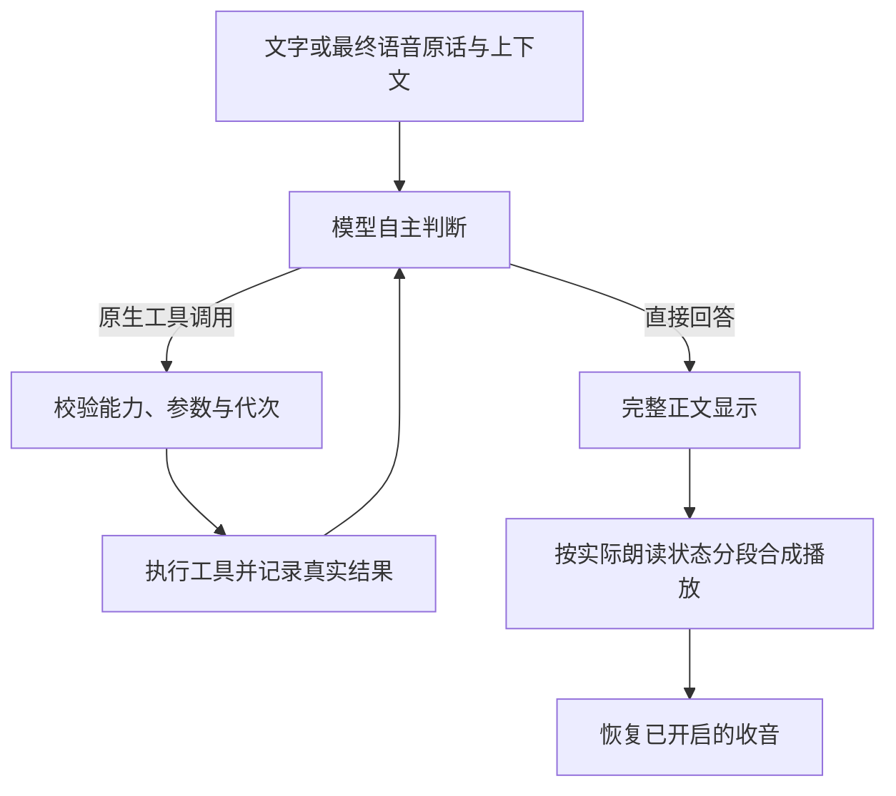

# 玄司 Xuansi 项目文档

基础架构核对日期：2026-10-16；本轮同步模型自主工具对话，界面协调沿用已提交实现。**0.6.0 候选验证中，公开安装包仍为 0.5.6。** 本文描述候选源码，原生工具对话、浏览器式标签栏控制中心和官网资源接入尚未随新安装包发布。真实模型语义验收仍有失败项，不能把程序边界或模拟测试视为语义可靠性保证。正式包来源见 [发布验收](../发布与安装/验收/安装包0.5.6发布验收.md)，候选进度见 [更新记录](CHANGELOG.md)。首次整理时的提交及版本差异保留于 [核对记录](../文档维护/文档核对记录-2026-10-11.md)，使用、配置、安装分别见 [文档索引](../README.md)。

## 技术组成与目录

这是 Python/PySide6 原生 Windows 应用。NekoAI 仅提供保留供追溯的历史精灵和动画定义；本项目没有使用其 Tauri/Rust/TypeScript 应用作为当前运行外壳。

| 用途 | 当前实现 | 版本依据 |
| --- | --- | --- |
| 桌面 UI | Python 3.13、PySide6 Essentials | [依赖锁文件](../../requirements.lock.txt) |
| 图文推理 | 本分支独立实验默认 Qwen3.5-9B Q4_K_M、匹配 mmproj；主线仍 4B；llama.cpp CUDA 12.4 服务 | [基础下载清单](../../assets-manifest.json) |
| 默认语音识别 | sherpa-onnx 在线 Paraformer int8 | [独立实时下载脚本](../../scripts/download_realtime.py) |
| 可选整句识别 | SenseVoice int8 | 基础下载清单 |
| 语音合成 | Melo 中英 ONNX；可选 Kokoro int8 | 基础下载清单 |
| 屏幕与图片 | mss、Pillow | 依赖锁文件 |
| 动画与系统接口 | live2d-py、OpenGL、pynput、pycaw、psutil、Windows API | 依赖锁文件及 [第三方范围](THIRD_PARTY.md) |
| 检查与安装 | pytest、Ruff、PowerShell、Inno Setup | [开发与验证](CONTRIBUTING.md)、[安装与发布](../发布与安装/安装与发布.md) |

`pet/` 是应用；`tests/` 是逻辑和生命周期测试；`scripts/` 是下载、制作和验收工具；`assets/` 是素材；`installer/` 是安装器定义。`data/`、`runtime/`、`.venv/`、`build/`、`dist/` 为本机生成目录，不进入 Git。普通安装器还内置 `runtime/python/`，但该二进制不在源码仓库内。

## 启动、线程与生命周期

[入口](../../pet/__main__.py) 先创建日志、设置进程优先级和 DPI，再在创建 `QApplication` 前配置 OpenGL 上下文共享。锁文件与当前用户命名管道按应用根目录隔离；重复启动同一目录打开已有面板，不同目录可各有实例。

Qt 主线程操作窗口和协调状态；[Runtime](../../pet/runtime.py) 的独立线程运行 asyncio 循环。HTTP 和模型子进程采用异步接口，模型计算、截图、导入、保存等耗时操作按需交给工作线程；启动读取配置、创建日志等仍有同步操作，不能笼统声称全部文件 I/O 都是异步。

新请求增加对话代次，在控制锁内取消并等待上一轮，然后启动新任务；麦克风有独立代次，自动观察还有窗口和时间有效性检查。Windows [Job Object](../../pet/process_guard.py) 管理附加的模型子进程，不回收其他软件的进程。

## 统一控制中心与标签导航

[Panel](../../pet/panel.py) 以一个原生窗口承载九个功能标签：对话、人设、记忆、语音与行为、模型设置、桌宠形象、官网资源、模型上传、运行日志。内容页头保留完整名称。暖白与草绿配色保持，横向标签栏下方提供六项常用操作。

[ControlNavigation](../../pet/control_navigation.py) 使用 `QTabBar` 与固定 `QStackedWidget`，每次显示一个功能页。各页的控件实例、配置草稿、滚动位置与上传回执复用；未应用的形象候选在已应用形象未变化时保留。切换不保存配置，也不创建额外控制窗口。窄窗通过标签滚动按钮导航，`Ctrl+Tab` / `Ctrl+Shift+Tab` 循环切换。

角色点击、托盘与全局快捷键共用该窗口，不再创建独立快捷对话。托盘保留打开控制中心、休眠/唤醒、退出。人设、偏好、模型共用原有配置保存事务；关闭或 Esc 有修改才保存，失败保留草稿。记忆和形象分别经自己的操作保存。

形象、官网资源及上传组件以普通子控件嵌入，文件选择器和浏览器授权仍使用系统交互。离开形象标签停止预览，离开日志标签停止刷新；切换标签或收起主窗口不取消资源任务，显式取消和完整退出沿用后台任务清理与等待机制。入库恢复状态在同一站点的上传表单中复用，不跨客户端进程持久化。验证范围见 [控制中心合并验收](../客户端/验收/控制中心合并验收.md)。

## 对话与模型决策

[conversation.py](../../pet/conversation.py) 处理识别、明确附图和音频；[tool_dialogue.py](../../pet/tool_dialogue.py) 统一模型与工具循环；[inference.py](../../pet/inference.py) 和 [text_stream.py](../../pet/text_stream.py) 处理原生消息与完整响应。普通闲聊无需工具时一次模型请求直接回答；截图、记忆、朗读开关、合成引擎和动作由模型按需调用，不再强制先做控制分类。

[model_tools.py](../../pet/model_tools.py) 复用截图、存储和声音能力。记忆检索只在模型调用后发生，[model_memory.py](../../pet/model_memory.py) 继续按真实容量分批并验证出处；写入仍校验长度、敏感资料和重复整行。实际完成才反馈成功，失败和未知结果回传给模型。

用户原话独立保留为 user 消息，程序明确取得的附图或观察图放入预先完成的 capture_screen 工具资料回执，标明截图来源，避免图中文字继承用户授权。该预完成回执记录已发生的真实截图，不能计成模型自主请求。状态改变类工具（保存、朗读开关、动作）要求本轮明确用户授权；读工具、本轮 TTS 和后台结束观察由模型按任务自主选择。声音关闭状态明确说明仍能发送文字，不应为回复文字擅自恢复朗读。

带工具的单次请求采用 1024 token 内部思考预算，另留 16 token 结束额度；输入容量检查加上该次请求真实总生成额度。它仍是同一次原生请求，不增设前置分类器。无工具调用能力的请求不启用该预算；完整语义矩阵及增加预算后的实际响应延迟仍待复验。

正文与工具协议分开，原话及完整正文不静默截断；历史支持完整调用与配对收据，按用户轮次裁剪。取消后已完成的写入结果仍保留，Qt 动作使用唯一请求 ID 与执行前门控。当前角色真实动作仍只开放 blink，不开放原生抬手。

详细能力、预算、观察和验证约定见[模型自主工具对话](../对话与记忆/模型自主工具对话.md)。本地服务仍只监听 127.0.0.1 动态端口，临时鉴权、禁环境代理及 Job Object 保持；模型不能执行系统命令。

## 语音与流式输出

| 路径 | 实际行为 |
| --- | --- |
| 默认实时识别 | 16kHz、100ms 输入块，后台在线转写；普通结束阈值 0.35 秒，轻声 0.75 秒，体感约 0.4/0.8 秒且受转写更新影响 |
| 整句识别 | 约 0.8 秒静音结束；最长约 12 秒切句，包含前置缓冲；有效语音不足约 0.25 秒丢弃 |
| 开麦准备 | 默认实时模式加载模型与预热 TTS，不生成或执行操作建议；整句模式准备识别器 |
| 收音暂停 | 最终话段提交后，后处理、模型判断、生成和播放阶段均暂停；关闭朗读也不提供思考期间口头插话 |
| 中间转写 | 只更新界面，不触发回复或记忆；实时模式 15 秒重置仅用于无语音空闲缓存 |
| 完成与取消 | 等待回复处理及播放结束后恢复收音；停止本轮保留原开启选择，主动关闭连续对话则停止 |

[streaming_speech.py](../../pet/streaming_speech.py) 将正文分段放入容量 8 的文本队列，合成后进入容量 1 的音频队列，按序播放。原生单次响应收齐后发布；工具轮正文保留但不朗读，最终正文按标点分段，过长段落约 48 字符切分，合成与播放重叠。没有逐字流式展示，旧版提前合成的首音测量不能沿用。

默认 fast 设置下，模型可按需选择本轮语音引擎，提示约定中文和混合语言用 Melo、纯英文用 Kokoro；实际选择仍可能误判，显式 natural 偏好保持。观察遵守独立朗读偏好，试听直接使用当前选择，不另起分类。自动 Kokoro 加载失败仍回退 Melo，生成错误继续反馈；试听的非流式输入清理后最多 240 字符。

取消先停止播放，再等待已进入 ONNX 的短段计算结束并丢弃结果。开始的持久化写入会等待结束，取消不回滚已保存记忆。声音回避会丢弃本轮待播片段，安静后也不补播。

## 屏幕观察与桌面状态

[鼠标监控](../../pet/mouse_monitor.py) 把左键释放、拖拽结束、滚轮及停留转为事件。自动观察检查频率与状态、等待约 600ms 画面稳定，再截图；事件最多 5 秒有效，结果最多 30 秒有效，还要求前景窗口未变。

截图一次读取一块显示器，或约 640 × 448 的附近区域，长边最多 1600，标记事件位置。手动“看一眼”、附图聊天和语音附图用最近有效的外部鼠标事件位置；本应用内操作和单纯移动不会立即刷新该位置，多屏下不能等同于实时光标所在屏幕。

自动观察使用临时上下文与受限工具集合；可以按需检索记忆，但不能切换持续朗读、执行用户动作或自动保存。无话可说时模型调用 finish_observation 结束，不输出占位回复，也没有“无需回应”关键词过滤。观察默认不朗读。

[app.py](../../pet/app.py) 每两秒检查桌面与资源：全屏或桌面不可用时隐藏角色、暂停并释放模型；可用内存低于 2GiB 自动休眠；无忙碌任务和收音时，模型闲置超过约 120 秒卸载。清醒时遇到全屏等状态会关闭连续对话，恢复后需手动启麦；休眠保留此前选择，等唤醒且桌面可用后恢复。

## 模块职责

| 模块 | 职责 |
| --- | --- |
| [app.py](../../pet/app.py)、[companion_ui.py](../../pet/companion_ui.py) | 用户事件、窗口协调、托盘、配置应用、观察、休眠、退出 |
| [runtime.py](../../pet/runtime.py)、[conversation.py](../../pet/conversation.py) | 后台循环、轮次替换、语音会话和结果信号 |
| [inference.py](../../pet/inference.py)、[text_stream.py](../../pet/text_stream.py)、[process_guard.py](../../pet/process_guard.py) | 模型进程、上下文预算、原生工具请求、完整响应解析和进程回收 |
| [tool_dialogue.py](../../pet/tool_dialogue.py)、[model_tools.py](../../pet/model_tools.py)、[tool_protocol.py](../../pet/tool_protocol.py)、[model_memory.py](../../pet/model_memory.py) | 工具循环、能力执行、消息类型与按需相关记忆检索 |
| [microphone.py](../../pet/microphone.py)、[live_input.py](../../pet/live_input.py)、[live_dialogue.py](../../pet/live_dialogue.py)、[segmentation.py](../../pet/segmentation.py) | 音频队列、在线/整句断句、最终话段提交和去重 |
| [audio_models.py](../../pet/audio_models.py)、[streaming_speech.py](../../pet/streaming_speech.py)、[speech_output.py](../../pet/speech_output.py) | ASR/TTS、分段合成播放与口型响度；旧正文控制头解析已退役 |
| [desktop.py](../../pet/desktop.py)、[mouse_monitor.py](../../pet/mouse_monitor.py)、[events.py](../../pet/events.py) | 截图、桌面可用性、事件与观察有效性 |
| [avatar.py](../../pet/avatar.py) | 角色窗口、拖拽、跟随、尺寸、形象组合与兼容入口 |
| [avatar_live2d.py](../../pet/avatar_live2d.py)、[live2d_session.py](../../pet/live2d_session.py) | 各模型 GL 绘制和释放、应用级共享核心及着色器 |
| [avatar_dynamics.py](../../pet/avatar_dynamics.py)、[avatar_motion.py](../../pet/avatar_motion.py) | 视线、口型、摆动、一次性眨眼与动作白名单 |
| [avatar_idle_blade.py](../../pet/avatar_idle_blade.py)、[idle_action.py](../../pet/idle_action.py)、[idle_blade_animation.py](../../pet/idle_blade_animation.py) | 空闲资格、拔刀姿态缓存、时序与淡出 |
| [avatar_bubble.py](../../pet/avatar_bubble.py)、[avatar_mask.py](../../pet/avatar_mask.py) | 气泡、角色点击轮廓与帧蒙版 |
| [panel.py](../../pet/panel.py)、[control_navigation.py](../../pet/control_navigation.py) | 同一控制窗口、横向标签、固定内容栈及统一导航 |
| [control_section.py](../../pet/control_section.py) | 各功能页的独立滚动容器、组件挂载及滚动位置保留 |
| [panel_content.py](../../pet/panel_content.py)、[panel_style.py](../../pet/panel_style.py)、[theme.py](../../pet/theme.py) | 常用操作与内容组装、统一样式、界面字体 |
| [panel_settings.py](../../pet/panel_settings.py)、[preferences.py](../../pet/preferences.py)、[model_page.py](../../pet/model_page.py) | 配置草稿、关闭保存、语音设备、模型与快捷键表单 |
| [config.py](../../pet/config.py)、[memory.py](../../pet/memory.py) | 配置校验和文件替换、长期记忆候选和持久化 |
| [appearance.py](../../pet/appearance.py)、[animation_import.py](../../pet/animation_import.py) | 后台导入、格式与资源上限、规范化副本 |
| [character_frames.py](../../pet/character_frames.py)、[native_animation.py](../../pet/native_animation.py) | 静态轻微动作、动图缓存与帧时长播放 |
| [appearance_dialog.py](../../pet/appearance_dialog.py)、[appearance_preview.py](../../pet/appearance_preview.py) | 内嵌形象管理、独立模型预览、应用与隐藏后恢复 |
| [platform_dialog.py](../../pet/platform_dialog.py)、[platform_upload_dialog.py](../../pet/platform_upload_dialog.py) | 内嵌官网资源与上传表单、任务进度、取消和退出协调 |
| [audio_activity.py](../../pet/audio_activity.py)、[windows_audio.py](../../pet/windows_audio.py) | 其他应用声音电平查询与回避 |
| [log_viewer.py](../../pet/log_viewer.py)、[hotkey.py](../../pet/hotkey.py)、[instance.py](../../pet/instance.py) | 有界日志、Windows 全局热键、同目录单实例 |

## 形象与功能边界

默认 Live2D、自定义静态图和动图是三条渲染路径；预览持有独立模型，不接 TTS 口型或久置拔刀。实际绑定及文件说明集中在 [Live2D 制作规格](../Live2D与形象/Live2D玄司制作规格.md)，导入限制在 [使用指南](../客户端/使用指南.md#形象与预览)。

当前没有全双工口头打断、说话中提前回答、端到端原生语音模型、回声消除、摄像头面捕、持续视频理解、自动总结全部聊天、向量记忆库、任意系统操作或原生抬手。语义选择仍可能误判，结构和授权校验不能保证模型每次理解正确。

本项目安装和实测路线限于 Windows/NVIDIA；CPU、AMD GPU、macOS、Linux 及其他设备不属于已验证交付。固定磁盘目录、模型匹配、显存及推理负载限制见 [安装与发布](../发布与安装/安装与发布.md)。

基础架构文档核对的验证见 [核对记录](../文档维护/文档核对记录-2026-10-11.md)。模型、原生窗口、语音、安装和发布的历次结果保留在 [历史验收索引](../README.md#历史验收与发布证据)，不能用读代码或普通单元测试替代真实设备体验。

2026-10-16 候选真实工具闭环此前两轮分别为 119 项／30 失败和 119 项／21 失败；来源分离后的第三轮为 119 项／18 失败，后续定向复验为 15 项／4 失败，均未通过。54 次负例中仍出现 2 次未获明确请求的模拟动作受理，观察也有过度发言及误静默。主代理最近一次完整 pytest 为 500 passed、2 skipped，不能替代真实模型语义通过。报告保存在本机忽略目录，详细证据见[候选验收记录](../对话与记忆/验收/模型自主工具对话候选验收-2026-10-16.md)，验证入口和历史音频覆盖差异见 [开发与验证](CONTRIBUTING.md#专项验收工具)。旧 [model_control.py](https://github.com/DesktopPetXuansi/Xuansi/blob/1994f1a94c225e61e22ac869d40afe86321cb789/pet/model_control.py)、[speech_control.py](https://github.com/DesktopPetXuansi/Xuansi/blob/1994f1a94c225e61e22ac869d40afe86321cb789/pet/speech_control.py)、[model_semantics.py](https://github.com/DesktopPetXuansi/Xuansi/blob/1994f1a94c225e61e22ac869d40afe86321cb789/pet/model_semantics.py) 仅作为改造前源码追溯，不再属于当前模块。

后续相同范围的 25 项诊断，无思考为 12 失败、512 token 内部思考为 3 失败、1024 token 为 0 失败；这只支持局部改善，不能作为完整 full 或发布通过证据。最终生产配置的完整复验由后续新报告补录。
