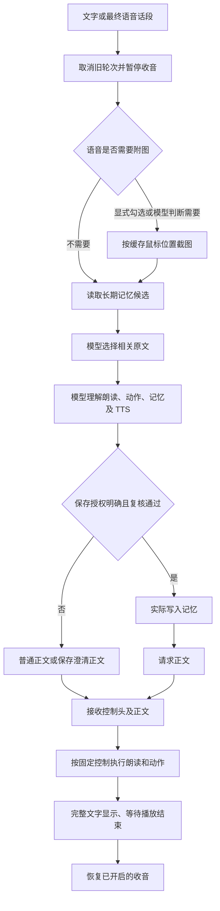

# 玄司 Xuansi 项目文档

基础架构核对日期：2026-10-11；2026-10-15 增量核对控制中心、官网资源与上传的界面协调。本文描述当前源码；单页控制中心与官网资源接入尚未随新安装包发布，公开安装包仍为 0.5.6。正式包来源与公开状态见 [发布验收](../发布与安装/验收/安装包0.5.6发布验收.md)。首次整理时的提交及版本差异保留于 [核对记录](../文档维护/文档核对记录-2026-10-11.md)，使用、配置、安装分别见 [文档索引](../README.md)。

## 技术组成与目录

这是 Python/PySide6 原生 Windows 应用。NekoAI 仅提供保留供追溯的历史精灵和动画定义；本项目没有使用其 Tauri/Rust/TypeScript 应用作为当前运行外壳。

| 用途 | 当前实现 | 版本依据 |
| --- | --- | --- |
| 桌面 UI | Python 3.13、PySide6 Essentials | [依赖锁文件](../../requirements.lock.txt) |
| 图文推理 | Qwen3.5-4B Q4_K_M、匹配 mmproj、llama.cpp CUDA 12.4 服务 | [基础下载清单](../../assets-manifest.json) |
| 默认语音识别 | sherpa-onnx 在线 Paraformer int8 | [独立实时下载脚本](../../scripts/download_realtime.py) |
| 可选整句识别 | SenseVoice int8 | 基础下载清单 |
| 语音合成 | Melo 中英 ONNX；可选 Kokoro int8 | 基础下载清单 |
| 屏幕与图片 | mss、Pillow | 依赖锁文件 |
| 动画与系统接口 | live2d-py、OpenGL、pynput、pycaw、psutil、Windows API | 依赖锁文件及 [第三方范围](THIRD_PARTY.md) |
| 检查与安装 | pytest、Ruff、PowerShell、Inno Setup | [开发与验证](CONTRIBUTING.md)、[安装与发布](../发布与安装/安装与发布.md) |

`pet/` 是应用；`tests/` 是逻辑和生命周期测试；`scripts/` 是下载、制作和验收工具；`assets/` 是素材；`installer/` 是安装器定义。`data/`、`runtime/`、`.venv/`、`build/`、`dist/` 为本机生成目录，不进入 Git。普通安装器还内置 `runtime/python/`，但该二进制不在源码仓库内。

## 启动、线程与生命周期

[入口](../../pet/__main__.py) 先创建日志、设置进程优先级和 DPI，再在创建 `QApplication` 前配置 OpenGL 上下文共享。锁文件与当前用户命名管道按应用根目录隔离；重复启动同一目录打开已有面板，不同目录可各有实例。

Qt 主线程操作窗口和协调状态；[Runtime](../../pet/runtime.py) 的独立线程运行 asyncio 循环。HTTP 和模型子进程采用异步接口，模型计算、截图、导入、保存等耗时操作按需交给工作线程；启动读取配置、创建日志等仍有同步操作，不能笼统声称全部文件 I/O 都是异步。

新请求增加对话代次，在控制锁内取消并等待上一轮，然后启动新任务；麦克风有独立代次，自动观察还有窗口和时间有效性检查。Windows [Job Object](../../pet/process_guard.py) 管理附加的模型子进程，不回收其他软件的进程。

## 单页控制中心

[Panel](../../pet/panel.py) 以一个原生窗口承载九个可展开分区：对话、人设与提示词、长期记忆、语音与行为、模型与快捷键、桌宠形象、官网资源、上传本地 Live2D、运行日志。顶部提供六项常用操作，定位下拉只展开目标并滚动，不切换页面；多个分区可以同时展开。

角色点击、托盘与全局快捷键共用该窗口，不再创建独立快捷对话。托盘保留打开控制中心、休眠/唤醒、退出。人设、偏好、模型共用原有配置保存事务；关闭或 Esc 有修改才保存，失败保留草稿。记忆和形象分别经自己的操作保存。

形象、官网资源及上传组件以普通子控件嵌入，文件选择器和浏览器授权仍使用系统交互。收起形象停止预览，收起日志停止刷新；收起分区或主窗口不取消资源任务，显式取消和完整退出沿用后台任务清理与等待机制。入库恢复状态在同一站点的上传表单中复用，不跨客户端进程持久化。验证范围见 [控制中心合并验收](../客户端/验收/控制中心合并验收.md)。

## 对话与模型决策

[conversation.py](../../pet/conversation.py) 组织上述流程；[inference.py](../../pet/inference.py) 管理本地服务和模型请求。整句模式先用 SenseVoice 转写，实时模式直接提交已完成的文本。文字只有显式附图时截图；语音未勾选时由模型结合输入和近期上下文决定，勾选时直接截图。

模型决策与正文是两阶段请求。短决策采用确定性采样，正文使用用户采样设置。[model_control.py](../../pet/model_control.py) 对结构、动作能力和保存授权做校验；保存候选另做模型授权复核，实际写入后才让正文反馈结果。授权含糊时不保存，澄清问题本身由正文模型生成，不是先显示固定询问再生成另一段回答。

朗读开关和一次性动作在正文流的受限控制头被 [SpeechDirective](../../pet/speech_control.py) 消费时执行；不能把“先决定控制”写成“全部动作在正文请求前执行”。当前动作白名单只开放默认模型的 `blink`，不开放原生抬手。

[model_memory.py](../../pet/model_memory.py) 根据实际聊天模板 token 容量分批检索，必要时裁剪最早历史，验证摘录来自原文，返回最多 700 字。无关时不注入记忆，不回退关键词排序；存储层仍保留敏感内容正则、长度校验和重复整行检查。

本地服务仅监听 `127.0.0.1` 的动态端口，每次启动生成临时凭据；HTTP 客户端禁用环境代理。模型只显示、朗读和映射预设动作，不执行其生成的系统命令。

## 语音与流式输出

| 路径 | 实际行为 |
| --- | --- |
| 默认实时识别 | 16kHz、100ms 输入块，后台在线转写；普通结束阈值 0.35 秒，轻声 0.75 秒，体感约 0.4/0.8 秒且受转写更新影响 |
| 整句识别 | 约 0.8 秒静音结束；最长约 12 秒切句，包含前置缓冲；有效语音不足约 0.25 秒丢弃 |
| 开麦准备 | 默认实时模式预热控制与 TTS；整句模式准备识别器，不做同样的预热 |
| 收音暂停 | 最终话段提交后，后处理、模型判断、生成和播放阶段均暂停；关闭朗读也不提供思考期间口头插话 |
| 中间转写 | 只更新界面，不触发回复或记忆；实时模式 15 秒重置仅用于无语音空闲缓存 |
| 完成与取消 | 等待回复处理及播放结束后恢复收音；停止本轮保留原开启选择，主动关闭连续对话则停止 |

[streaming_speech.py](../../pet/streaming_speech.py) 将正文分段放入容量 8 的文本队列，合成后进入容量 1 的音频队列，按序播放。推理、合成、播放可以重叠；正文通常按标点分段，过长段落约 48 字符切分。界面在完整正文生成后追加文字，没有逐字流式展示。

默认 `fast` 设置下，流式正文前由模型按预计回复语言选择 Melo 或 Kokoro；观察和试听在有完整文字后选择。显式 `natural` 使用 Kokoro。仅自动选择 Kokoro 的加载失败回退 Melo；生成错误继续反馈。非流式观察及试听的合成输入清理后最多取前 240 字符，不能承诺长正文全部朗读。

取消先停止播放，再等待已进入 ONNX 的短段计算结束并丢弃结果。开始的持久化写入会等待结束，取消不回滚已保存记忆。声音回避会丢弃本轮待播片段，安静后也不补播。

## 屏幕观察与桌面状态

[鼠标监控](../../pet/mouse_monitor.py) 把左键释放、拖拽结束、滚轮及停留转为事件。自动观察检查频率与状态、等待约 600ms 画面稳定，再截图；事件最多 5 秒有效，结果最多 30 秒有效，还要求前景窗口未变。

截图一次读取一块显示器，或约 640 × 448 的附近区域，长边最多 1600，标记事件位置。手动“看一眼”、附图聊天和语音附图用最近有效的外部鼠标事件位置；本应用内操作和单纯移动不会立即刷新该位置，多屏下不能等同于实时光标所在屏幕。

自动观察没有聊天历史和控制回调；可以检索长期记忆，但不允许屏幕内容触发朗读开关、动作或自动保存。模型输出“无需回应”时不显示，自动观察默认不朗读。主动对话不套用该静默过滤。

[app.py](../../pet/app.py) 每两秒检查桌面与资源：全屏或桌面不可用时隐藏角色、暂停并释放模型；可用内存低于 2GiB 自动休眠；无忙碌任务和收音时，模型闲置超过约 120 秒卸载。清醒时遇到全屏等状态会关闭连续对话，恢复后需手动启麦；休眠保留此前选择，等唤醒且桌面可用后恢复。

## 模块职责

| 模块 | 职责 |
| --- | --- |
| [app.py](../../pet/app.py)、[companion_ui.py](../../pet/companion_ui.py) | 用户事件、窗口协调、托盘、配置应用、观察、休眠、退出 |
| [runtime.py](../../pet/runtime.py)、[conversation.py](../../pet/conversation.py) | 后台循环、轮次替换、语音会话和结果信号 |
| [inference.py](../../pet/inference.py)、[text_stream.py](../../pet/text_stream.py)、[process_guard.py](../../pet/process_guard.py) | 模型进程、上下文预算、受限正文请求、流解析和进程回收 |
| [model_control.py](../../pet/model_control.py)、[model_semantics.py](../../pet/model_semantics.py)、[model_memory.py](../../pet/model_memory.py) | 执行意图、附图及 TTS 判断、相关记忆检索 |
| [microphone.py](../../pet/microphone.py)、[live_input.py](../../pet/live_input.py)、[live_dialogue.py](../../pet/live_dialogue.py)、[segmentation.py](../../pet/segmentation.py) | 音频队列、在线/整句断句、最终话段提交和去重 |
| [audio_models.py](../../pet/audio_models.py)、[streaming_speech.py](../../pet/streaming_speech.py)、[speech_output.py](../../pet/speech_output.py)、[speech_control.py](../../pet/speech_control.py) | ASR/TTS、分段合成播放、口型响度、控制头解析 |
| [desktop.py](../../pet/desktop.py)、[mouse_monitor.py](../../pet/mouse_monitor.py)、[events.py](../../pet/events.py) | 截图、桌面可用性、事件与观察有效性 |
| [avatar.py](../../pet/avatar.py) | 角色窗口、拖拽、跟随、尺寸、形象组合与兼容入口 |
| [avatar_live2d.py](../../pet/avatar_live2d.py)、[live2d_session.py](../../pet/live2d_session.py) | 各模型 GL 绘制和释放、应用级共享核心及着色器 |
| [avatar_dynamics.py](../../pet/avatar_dynamics.py)、[avatar_motion.py](../../pet/avatar_motion.py) | 视线、口型、摆动、一次性眨眼与动作白名单 |
| [avatar_idle_blade.py](../../pet/avatar_idle_blade.py)、[idle_action.py](../../pet/idle_action.py)、[idle_blade_animation.py](../../pet/idle_blade_animation.py) | 空闲资格、拔刀姿态缓存、时序与淡出 |
| [avatar_bubble.py](../../pet/avatar_bubble.py)、[avatar_mask.py](../../pet/avatar_mask.py) | 气泡、角色点击轮廓与帧蒙版 |
| [panel.py](../../pet/panel.py)、[control_section.py](../../pet/control_section.py) | 单页控制中心、同页展开、定位及组件挂载 |
| [panel_content.py](../../pet/panel_content.py)、[panel_style.py](../../pet/panel_style.py)、[theme.py](../../pet/theme.py) | 常用操作与内容组装、统一样式、界面字体 |
| [panel_settings.py](../../pet/panel_settings.py)、[preferences.py](../../pet/preferences.py)、[model_page.py](../../pet/model_page.py) | 配置草稿、关闭保存、语音设备、模型与快捷键表单 |
| [config.py](../../pet/config.py)、[memory.py](../../pet/memory.py) | 配置校验和文件替换、长期记忆候选和持久化 |
| [appearance.py](../../pet/appearance.py)、[animation_import.py](../../pet/animation_import.py) | 后台导入、格式与资源上限、规范化副本 |
| [character_frames.py](../../pet/character_frames.py)、[native_animation.py](../../pet/native_animation.py) | 静态轻微动作、动图缓存与帧时长播放 |
| [appearance_dialog.py](../../pet/appearance_dialog.py)、[appearance_preview.py](../../pet/appearance_preview.py) | 内嵌形象管理、独立模型预览、应用与隐藏后恢复 |
| [platform_dialog.py](../../pet/platform_dialog.py)、[platform_upload_dialog.py](../../pet/platform_upload_dialog.py) | 内嵌官网资源与上传表单、任务进度、取消和退出协调 |
| [audio_activity.py](../../pet/audio_activity.py)、[windows_audio.py](../../pet/windows_audio.py) | 其他应用声音电平查询与回避 |
| [log_viewer.py](../../pet/log_viewer.py)、[hotkey.py](../../pet/hotkey.py)、[instance.py](../../pet/instance.py) | 有界日志、Windows 全局热键、同目录单实例 |

## 形象与功能边界

默认 Live2D、自定义静态图和动图是三条渲染路径；预览持有独立模型，不接 TTS 口型或久置拔刀。实际绑定及文件说明集中在 [Live2D 制作规格](../Live2D与形象/Live2D玄司制作规格.md)，导入限制在 [使用指南](../客户端/使用指南.md#形象与预览)。

当前没有全双工口头打断、说话中提前回答、端到端原生语音模型、回声消除、摄像头面捕、持续视频理解、自动总结全部聊天、向量记忆库、任意系统操作或原生抬手。语义选择仍可能误判，结构和授权校验不能保证模型每次理解正确。

本项目安装和实测路线限于 Windows/NVIDIA；CPU、AMD GPU、macOS、Linux 及其他设备不属于已验证交付。固定磁盘目录、模型匹配、显存及推理负载限制见 [安装与发布](../发布与安装/安装与发布.md)。

基础架构文档核对的验证见 [核对记录](../文档维护/文档核对记录-2026-10-11.md)。模型、原生窗口、语音、安装和发布的历次结果保留在 [历史验收索引](../README.md#历史验收与发布证据)，不能用读代码或普通单元测试替代真实设备体验。
