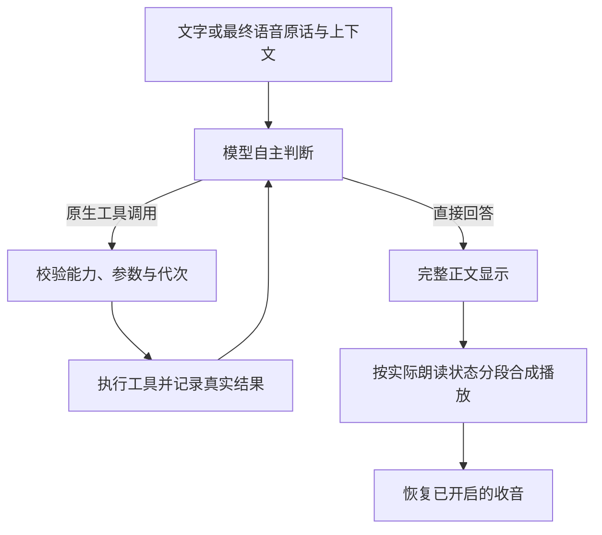

# 玄司 Xuansi 项目文档

核对日期：2026-10-19。本文维护客户端模块职责、线程和生命周期契约；紧凑控制中心与完整形象流程已随0.7.1正式包和本机原目录升级交付，来源见 [发布验收](../发布与安装/验收/安装包0.7.1发布验收.md)。用户操作见 [使用指南](../客户端/使用指南.md)，工具协议见 [模型自主工具对话](../对话与记忆/模型自主工具对话.md)。

2026-10-19 新增的本机历史及网页个人空间以当前源码为准，尚未纳入上述公开0.7.1包；模块入口见 [客户端历史](../客户端/形象与模型历史.md) 与 [网页个人空间](../官网/个人空间与历史.md)，交付范围见 [本轮验收](../官网/验收/个人空间与历史-2026-10-19.md)。

同日新增形象一键使用：在线/我的形象列表直接使用，独立预览可选，缓存按当前官网清单和本地摘要核对后复用。已更新本机local-preview，尚未发布新安装包；任务与来源见 [一键使用验收](../客户端/验收/形象一键使用-2026-10-19.md)。

## 当前源码的推理与安装边界

`pet/ai/device.py`、`catalog.py`、`assessment.py`、`install_plan.py` 与 `settings.py` 是安装前可使用的标准库契约。安装计划的 `prepare_plan` 接收计划草案、设备事实和可选已验证档案，集中定稿后端、适配与空间预算，不负责探测、凭据读取或文件写入。[预检 CLI](../../scripts/preflight.py) 负责输入转换、探测及结果保存，之后部署只执行已选择计划；模型和语音目录共用根配置。资源推荐属于估算，CPU 与未验收组合不冒充完整支持。

`Runtime.engine` 与工具验收入口共同使用 [产品装配函数](../../pet/ai/assembly.py) 创建 [InferenceRouter](../../pet/ai/selection.py)。路由显式接收本地引擎、候选解析器和在线提供方工厂；[本地候选解析](../../pet/ai/local_candidates.py) 负责固定型号、配套文件、显示名及隐式回退资格，默认模型根目录由装配函数提供，文件检查在线程中执行。核心路由不创建具体引擎、不读取全局目录，也不识别固定备用型号。

对话与记忆共用提供方生成和容量预算；原有 [LocalEngine](../../pet/inference.py) 管理本实例 llama.cpp，[远端适配器](../../pet/ai/providers/) 处理兼容协议、Claude Messages 和 Gemini 原生格式。提供方不导入 UI、安装器或工具执行器；私有思考元数据绑定配置摘要，工具图像按协议转换并保持资料身份。本地准确计数，兼容接口保守预算与官方估算分别标记。模块复用的本轮范围及验证见 [边界收敛记录](../客户端/任务/模块复用边界收敛-2026-10-18.md)，不要求 UI 和业务编排脱离产品独立复用。

每轮固定候选、已尝试集合与总等待时间；首个有效回复或工具之后不再回退重放。首选保留在配置，当前模型和位置通过 `SelectionEvent` 通知界面。完整自动本地候选限于固定目录已验收且显式选择 CUDA、GPU 层数非零的组合；CPU、自定义文件和失败的 4B 仍可按明确选择使用，但不隐式作为完整备用。未同意云端记忆时过滤检索工具并阻止候选发送；后台观察另行授权。

[模型表单](../../pet/ai_page.py) 与 [后台任务](../../pet/ai_tasks.py) 保留独立密钥草稿和验证请求编号。新凭据先写独立引用，配置提交失败只回收新引用；关闭期间编辑、取消验证及迟到回调均保留当前草稿。API-only 保存不依赖本地文件。凭据与官网 OAuth 命名空间隔离，原生 Windows 合成往返已验证。

语音目录随配置切换并释放旧会话，未安装组件不提供相应入口和控制工具。收音拥塞丢弃不完整话段并给出可见反馈。应用保留低于 2GiB 的自动休眠；软调度在可用内存低于 4GiB 时将观察间隔增至三倍，空闲渲染由 33ms 放缓到 66ms，到至少 5GiB 才恢复，忙碌时仍用 33ms。这些调度阈值不是硬件最低配置，主动请求优先。

公开 0.6.0 的默认与发布事实见 [历史发布验收](../归档/发布与安装/验收/安装包0.6.0发布验收.md)；当前源码的真实失败与发行缺口见 [实施验收](../客户端/验收/安装前适配与多模型-2026-10-18.md)。

## 技术组成与目录

这是 Python/PySide6 原生 Windows 应用。NekoAI 仅提供保留供追溯的历史精灵和动画定义；本项目没有使用其 Tauri/Rust/TypeScript 应用作为当前运行外壳。

| 用途 | 当前实现 | 版本依据 |
| --- | --- | --- |
| 桌面 UI | Python 3.13、PySide6 Essentials | [依赖锁文件](../../requirements.lock.txt) |
| 图文推理 | 默认 Qwen3.5-9B Q4_K_M、匹配 mmproj；llama.cpp CUDA 12.4 服务 | [基础下载清单](../../assets-manifest.json) |
| 默认语音识别 | sherpa-onnx 在线 Paraformer int8 | [独立实时下载脚本](../../scripts/download_realtime.py) |
| 可选整句识别 | SenseVoice int8 | 基础下载清单 |
| 语音合成 | Melo 中英 ONNX；可选 Kokoro int8 | 基础下载清单 |
| 屏幕与图片 | mss、Pillow | 依赖锁文件 |
| 动画与系统接口 | live2d-py、OpenGL、pynput、pycaw、psutil、Windows API | 依赖锁文件及 [第三方范围](THIRD_PARTY.md) |
| 检查与安装 | pytest、Ruff、PowerShell、Inno Setup | [开发与验证](CONTRIBUTING.md)、[安装与发布](../发布与安装/安装与发布.md) |

`pet/` 是应用；`tests/` 是逻辑和生命周期测试；`scripts/` 是下载、制作和验收工具；`assets/` 是素材；`installer/` 是安装器定义。`data/`、`runtime/`、`.venv/`、`build/`、`dist/` 为本机生成目录，不进入 Git。普通安装器还内置 `runtime/python/`，但该二进制不在源码仓库内。

## 启动、线程与生命周期

[入口](../../pet/__main__.py) 先创建日志、设置进程优先级和 DPI，再在创建 `QApplication` 前配置 OpenGL 上下文共享。锁文件与当前用户命名管道按应用根目录隔离；重复启动同一目录打开已有面板，不同目录可各有实例。

Qt 主线程操作窗口和协调状态；[Runtime](../../pet/runtime.py) 的独立线程运行 asyncio 循环。HTTP 和模型子进程采用异步接口，模型计算、截图、导入、保存等耗时操作按需交给工作线程；启动读取配置、创建日志等仍有同步操作，不能笼统声称全部文件 I/O 都是异步。

新请求增加对话代次，在控制锁内取消并等待上一轮，然后启动新任务；麦克风有独立代次，自动观察还有窗口和时间有效性检查。Windows [Job Object](../../pet/process_guard.py) 管理附加的模型子进程，不回收其他软件的进程。

## 统一控制中心与标签导航

[Panel](../../pet/panel.py) 以一个原生窗口承载九个固定页面，主导航显示七个标签：对话、人设、记忆、语音与行为、模型设置、更换形象、运行日志。官网资源和模型上传仍为固定实例，从形象页的“更多资源”“上传分享”进入，维持形象标签高亮，点击形象标签可返回。内容页头保留完整名称。暖白与草绿配色保持，标签栏下方是紧凑状态、连续对话和休眠；朗读、看屏幕、停止回复与声音回避位于对话输入附近。

当前源码默认720×560，最小520×480；[panel_window.py](../../pet/panel_window.py) 独立保存普通窗口宽高，由生产入口传入 `data/panel-window.json`。显式隐藏覆盖直接收起、配置保存后隐藏和退出三条路径；系统自发隐藏不写入。尺寸变化不触发配置保存或改变对话/麦克风状态。

[ControlNavigation](../../pet/control_navigation.py) 使用 `QTabBar` 与固定 `QStackedWidget`，每次显示一个功能页。各页的控件实例、配置草稿、滚动位置与上传回执复用；未应用的形象候选在已应用形象未变化时保留。切换不保存配置，也不创建额外控制窗口。窄窗通过标签滚动按钮导航，`Ctrl+Tab` / `Ctrl+Shift+Tab` 只循环七个主标签。

角色点击、托盘与全局快捷键共用该窗口，不再创建独立快捷对话。托盘保留打开控制中心、休眠/唤醒、退出。人设、偏好、模型共用原有配置保存事务；关闭或 Esc 有修改才保存，失败保留草稿。记忆和形象分别经自己的操作保存。

形象、官网资源及上传组件以普通子控件嵌入，文件选择器和浏览器授权仍使用系统交互。离开形象标签停止预览，离开日志标签停止刷新；切换标签或收起主窗口不取消资源任务，显式取消和完整退出沿用后台任务清理与等待机制。入库恢复状态在同一站点的上传表单中复用，不跨客户端进程持久化。验证范围见 [控制中心合并验收](../归档/客户端/控制中心验收.md#record-ea27e9df)。

## 对话与模型决策

[conversation.py](../../pet/conversation.py) 处理识别、明确附图和音频；[tool_dialogue.py](../../pet/tool_dialogue.py) 统一模型与工具循环；推理路由通过公共提供方契约选择本地或在线实现；[inference.py](../../pet/inference.py) 和 [text_stream.py](../../pet/text_stream.py) 处理本地原生消息与完整响应，在线适配器完成各自协议转换。普通闲聊无需工具时一次模型请求直接回答；截图、记忆、朗读开关、合成引擎和动作由模型按需调用，不再强制先做控制分类。

[model_tools.py](../../pet/model_tools.py) 复用截图、存储和声音能力。记忆检索只在模型调用后发生，[model_memory.py](../../pet/model_memory.py) 继续按真实容量分批并验证出处；写入仍校验长度、敏感资料和重复整行。实际完成才反馈成功，失败和未知结果回传给模型。

用户原话独立保留为 user 消息，程序明确取得的附图或观察图放入预先完成的 capture_screen 工具资料回执，标明截图来源，避免图中文字继承用户授权。该预完成回执记录已发生的真实截图，不能计成模型自主请求。状态改变类工具（保存、朗读开关、动作）要求本轮明确用户授权；读工具、本轮 TTS 和后台结束观察由模型按任务自主选择。声音关闭状态明确说明仍能发送文字，不应为回复文字擅自恢复朗读。

本地带工具的单次请求采用 1024 token 内部思考预算，另留 16 token 结束额度；输入容量检查加上该次请求真实总生成额度。它仍是同一次原生请求，不增设前置分类器。无工具调用能力的请求不启用该预算；语义与性能检查分别记录在对应验收中，分组通过不表示完整矩阵重新通过。

正文与工具协议分开，原话及完整正文不静默截断；历史支持完整调用与配对收据，按用户轮次裁剪。取消后已完成的写入结果仍保留，Qt 动作使用唯一请求 ID 与执行前门控。当前角色真实动作仍只开放 blink，不开放原生抬手。

详细能力、预算、观察和验证约定见[模型自主工具对话](../对话与记忆/模型自主工具对话.md)。本地服务仍只监听 127.0.0.1 动态端口，临时鉴权、禁环境代理及 Job Object 保持；模型不能执行系统命令。

## 语音与流式输出

| 路径 | 实际行为 |
| --- | --- |
| 默认实时识别 | 16kHz、100ms 输入块，后台在线转写；普通结束阈值 0.35 秒，轻声 0.75 秒，体感约 0.4/0.8 秒且受转写更新影响 |
| 整句识别 | 约 0.8 秒静音结束；最长约 12 秒切句，包含前置缓冲；有效语音不足约 0.25 秒丢弃 |
| 开麦准备 | 默认实时模式加载模型与预热 TTS，不生成或执行操作建议；整句模式准备识别器 |
| 收音暂停 | 最终话段提交后，后处理、模型判断、生成和播放阶段均暂停；关闭朗读也不提供思考期间口头插话 |
| 中间转写 | 只更新界面，不触发回复或记忆；实时模式 15 秒重置仅用于无语音空闲缓存 |
| 完成与取消 | 等待回复处理及播放结束后恢复收音；停止本轮保留原开启选择，主动关闭连续对话则停止 |

[streaming_speech.py](../../pet/streaming_speech.py) 将正文分段放入容量 8 的文本队列，合成后进入容量 1 的音频队列，按序播放。原生单次响应收齐后发布；工具轮正文保留但不朗读，最终正文按标点分段，过长段落约 48 字符切分，合成与播放重叠。没有逐字流式展示，旧版提前合成的首音测量不能沿用。

默认 fast 设置下，模型可按需选择本轮语音引擎，提示约定中文和混合语言用 Melo、纯英文用 Kokoro；实际选择仍可能误判，显式 natural 偏好保持。观察遵守独立朗读偏好，试听直接使用当前选择，不另起分类。自动 Kokoro 加载失败仍回退 Melo，生成错误继续反馈；试听的非流式输入清理后最多 240 字符。

取消先停止播放，再等待已进入 ONNX 的短段计算结束并丢弃结果。开始的持久化写入会等待结束，取消不回滚已保存记忆。声音回避会丢弃本轮待播片段，安静后也不补播。

## 屏幕观察与桌面状态

[鼠标监控](../../pet/mouse_monitor.py) 把左键释放、拖拽结束、滚轮及停留转为事件。自动观察检查频率与状态、等待约 600ms 画面稳定，再截图；事件最多 5 秒有效，结果最多 30 秒有效，还要求前景窗口未变。

截图一次读取一块显示器，或约 640 × 448 的附近区域，长边最多 1600，标记事件位置。手动“看一眼”、附图聊天和语音附图用最近有效的外部鼠标事件位置；本应用内操作和单纯移动不会立即刷新该位置，多屏下不能等同于实时光标所在屏幕。

自动观察使用临时上下文与受限工具集合；可以按需检索记忆，但不能切换持续朗读、执行用户动作或自动保存。无话可说时模型调用 finish_observation 结束，不输出占位回复，也没有“无需回应”关键词过滤。观察默认不朗读。

[app.py](../../pet/app.py) 每两秒检查桌面与资源：全屏或桌面不可用时隐藏角色、暂停并释放模型；可用内存低于 2GiB 自动休眠；无忙碌任务和收音时，模型闲置超过约 120 秒卸载。清醒时遇到全屏等状态会关闭连续对话，恢复后需手动启麦；休眠保留此前选择，等唤醒且桌面可用后恢复。

## 模块职责与依赖边界

下表按功能覆盖 `pet/` 的全部生产 Python 模块（含包入口），是模块归属的唯一映射；测试、制作/验收脚本和官网服务端不算客户端运行模块。各组保留现有文件边界，不为每个文件另建说明。

| 功能组 | 模块 | 主要接口与职责 |
| --- | --- | --- |
| 入口与实例 | [__init__.py](../../pet/__init__.py)、[__main__.py](../../pet/__main__.py)、[instance.py](../../pet/instance.py) | 包入口、日志/DPI/OpenGL 初始化；同目录锁与命名管道唤起。 |
| 应用协调 | [app.py](../../pet/app.py)、[companion_ui.py](../../pet/companion_ui.py)、[hotkey.py](../../pet/hotkey.py) | DesktopPet 协调主线程状态、托盘/热键、观察、休眠、配置应用与退出。 |
| 后台与单轮 | [runtime.py](../../pet/runtime.py)、[conversation.py](../../pet/conversation.py) | Runtime 的 asyncio 循环、取消/代次/存储锁、语音会话和 Qt 信号；converse 组织一轮输入输出。 |
| 配置与持久记忆 | [config.py](../../pet/config.py)、[memory.py](../../pet/memory.py) | Settings/load_settings/save_settings 与 MemoryStore/durable_io；校验、临时文件替换和取消后写入收据。 |
| 推理配置与固定目录 | [ai/__init__.py](../../pet/ai/__init__.py)、[ai/settings.py](../../pet/ai/settings.py)、[ai/catalog.py](../../pet/ai/catalog.py)、[ai/provider_catalog.py](../../pet/ai/provider_catalog.py) | AISettings/ModelProfile、固定模型/资源清单和官方协议预设；能力声明与验证证据分离。 |
| 设备与安装计划 | [ai/device.py](../../pet/ai/device.py)、[ai/assessment.py](../../pet/ai/assessment.py)、[ai/install_plan.py](../../pet/ai/install_plan.py) | DeviceReport/probe_device 提供设备事实；assess 纯评估；prepare_plan/resources_for 定稿计划和空间预算，供安装前 CLI 与客户端复用。 |
| 产品装配与路由 | [ai/assembly.py](../../pet/ai/assembly.py)、[ai/local_candidates.py](../../pet/ai/local_candidates.py)、[ai/selection.py](../../pet/ai/selection.py) | create_inference_router 装配具体依赖；prepared_local_candidates 识别已安装候选；InferenceRouter 固定本轮候选、授权、资源回退和 SelectionEvent。 |
| 提供方契约 | [ai/providers/__init__.py](../../pet/ai/providers/__init__.py)、[ai/providers/base.py](../../pet/ai/providers/base.py) | create_provider 选协议；Provider 的 start/complete/input_tokens/stop、TokenEstimate 和 ProviderError 统一生命周期、容量与错误类别。 |
| 在线协议 | [ai/providers/openai.py](../../pet/ai/providers/openai.py)、[ai/providers/claude.py](../../pet/ai/providers/claude.py)、[ai/providers/gemini.py](../../pet/ai/providers/gemini.py) | OpenAICompatible、ClaudeMessages、GeminiNative 转换图像/工具/私有回执；HTTPProvider 管理有界异步 HTTP，不依赖 UI 或工具执行器。 |
| 凭据与验证 | [ai/credentials.py](../../pet/ai/credentials.py)、[ai/validation.py](../../pet/ai/validation.py) | 独立 Windows CredentialStore；validate_profile 只发送合成资料，证据绑定 ModelProfile 摘要，不自动保存配置。 |
| 本地模型与进程 | [inference.py](../../pet/inference.py)、[text_stream.py](../../pet/text_stream.py)、[process_guard.py](../../pet/process_guard.py) | LocalEngine 管理本实例 llama.cpp、准确容量计数和原生响应；SSE 完整性校验，Job Object 回收自有子进程。 |
| 模型工具与检索 | [tool_dialogue.py](../../pet/tool_dialogue.py)、[model_tools.py](../../pet/model_tools.py)、[tool_protocol.py](../../pet/tool_protocol.py)、[model_memory.py](../../pet/model_memory.py)、[ai/memory_provider.py](../../pet/ai/memory_provider.py) | run_dialogue/ToolContext 处理工具闭环与真实收据；公共消息类型及完整性校验；MemorySession 复用当前提供方计数/生成，LegacyMemorySession 仅服务旧脚本接口。 |
| 屏幕与事件 | [desktop.py](../../pet/desktop.py)、[mouse_monitor.py](../../pet/mouse_monitor.py)、[events.py](../../pet/events.py) | 桌面可用性、只读鼠标事件、截图位置/范围、观察节流与有效期；钩子不运行模型。 |
| 收音与断句 | [microphone.py](../../pet/microphone.py)、[live_input.py](../../pet/live_input.py)、[live_dialogue.py](../../pet/live_dialogue.py)、[segmentation.py](../../pet/segmentation.py) | 有界音频队列、在线/整句断句、部分转写、最终话段提交、去重和麦克风代次。 |
| 识别与朗读 | [audio_models.py](../../pet/audio_models.py)、[streaming_speech.py](../../pet/streaming_speech.py)、[speech_output.py](../../pet/speech_output.py) | 本地 ASR/TTS 会话、资源根目录切换、分段合成/顺序播放和口型响度；组件选择门控与取消。 |
| 声音回避 | [audio_activity.py](../../pet/audio_activity.py)、[windows_audio.py](../../pet/windows_audio.py) | 专用后台线程管理 Windows Core Audio COM，只读其他应用电平，不录音。 |
| 角色与渲染 | [avatar.py](../../pet/avatar.py)、[avatar_live2d.py](../../pet/avatar_live2d.py)、[live2d_session.py](../../pet/live2d_session.py) | 角色交互与渲染组合、独立 GL 模型、应用级共享 Cubism 核心/着色器和当前上下文资源释放。 |
| 角色动态与点击 | [avatar_dynamics.py](../../pet/avatar_dynamics.py)、[avatar_motion.py](../../pet/avatar_motion.py)、[avatar_bubble.py](../../pet/avatar_bubble.py)、[avatar_mask.py](../../pet/avatar_mask.py) | 视线、口型、摆动、已开放动作回执、气泡及透明点击轮廓；动作以实际末帧绘制完成为准。 |
| 待机与图片帧 | [avatar_idle_blade.py](../../pet/avatar_idle_blade.py)、[idle_action.py](../../pet/idle_action.py)、[idle_blade_animation.py](../../pet/idle_blade_animation.py)、[character_frames.py](../../pet/character_frames.py)、[native_animation.py](../../pet/native_animation.py) | 五分钟待机资格、拔刀姿态缓存/淡出；静态轻微动作和导入动图的缓存帧与时长播放。 |
| 形象导入与预览 | [appearance.py](../../pet/appearance.py)、[animation_import.py](../../pet/animation_import.py)、[appearance_import.py](../../pet/appearance_import.py)、[appearance_preview.py](../../pet/appearance_preview.py) | 图片规范化、自动识别、本地模型内容标识及安全安装；独立真实预览、隐藏停止 GL；旧 appearance_dialog.py 保留兼容入口。 |
| 形象流程与保存 | [appearance_hub.py](../../pet/appearance_hub.py)、[appearance_layout.py](../../pet/appearance_layout.py)、[appearance_flow.py](../../pet/appearance_flow.py)、[appearance_sources.py](../../pet/appearance_sources.py)、[appearance_apply.py](../../pet/appearance_apply.py) | 直接使用与独立预览分开；任务退场后交付候选，等待业务保存的意图可取消，迟到结果不误用；先保存再真实试载，失败只恢复形象字段。 |
| 形象缓存核验 | [appearance_cache.py](../../pet/appearance_cache.py) | 只读核对当前官网与本机清单、内容身份和文件摘要，拒绝链接/损坏/错配；完整才复用，失败不覆盖旧文件。 |
| 个人历史与存储 | [personal_history.py](../../pet/personal_history.py)、[model_history.py](../../pet/model_history.py)、[history_storage.py](../../pet/history_storage.py) | 有界本机形象/AI配置历史、原子读改写、恢复候选和清验证后的配置草稿；密钥正文不进历史。 |
| 历史界面与同步 | [history_controller.py](../../pet/history_controller.py)、[history_dialog.py](../../pet/history_dialog.py)、[history_tasks.py](../../pet/history_tasks.py)、[history_sync.py](../../pet/history_sync.py) | 成功信号接入、后台串行磁盘队列、历史列表和账号/站点隔离同步；默认关闭、旧记录不补传，网络复用官网任务。 |
| 控制中心结构 | [panel.py](../../pet/panel.py)、[control_navigation.py](../../pet/control_navigation.py)、[control_section.py](../../pet/control_section.py)、[panel_chrome.py](../../pet/panel_chrome.py)、[panel_content.py](../../pet/panel_content.py)、[panel_window.py](../../pet/panel_window.py) | 固定九页实例、七个主标签与资源/上传次级导航；紧凑公共区、实时转写、持续模型状态、对话伸展和记忆编辑；独立窗口大小记忆。 |
| 设置表单与后台任务 | [panel_settings.py](../../pet/panel_settings.py)、[preferences.py](../../pet/preferences.py)、[model_page.py](../../pet/model_page.py)、[settings_forms.py](../../pet/settings_forms.py)、[ai_setup_form.py](../../pet/ai_setup_form.py)、[ai_page.py](../../pet/ai_page.py)、[ai_tasks.py](../../pet/ai_tasks.py) | 配置草稿/关闭保存、人设/语音/模型/热键；普通配置步骤、默认折叠的高级参数与窄窗表单。AIPage 管理密钥草稿，ValidateProfile/ProbeDevice 用请求编号拒绝迟到回调。 |
| 样式与日志 | [panel_style.py](../../pet/panel_style.py)、[theme.py](../../pet/theme.py)、[log_viewer.py](../../pet/log_viewer.py) | 唯一 QSS、系统中文字体与有界异步日志尾部；日志页隐藏停止轮询。 |
| 官网连接与资源 | [platform_auth.py](../../pet/platform_auth.py)、[platform_api.py](../../pet/platform_api.py)、[platform_resources.py](../../pet/platform_resources.py) | 浏览器 PKCE、独立 OAuth 凭据、官网异步 API/下载；严格清单与引用校验、安全安装及离线索引。 |
| 官网上传服务 | [platform_model_package.py](../../pet/platform_model_package.py)、[platform_upload_transport.py](../../pet/platform_upload_transport.py)、[platform_upload.py](../../pet/platform_upload.py) | 只收集显式引用的 Cubism 运行文件；限量流式上传、等待校验及 finalize_upload 入库收尾。 |
| 官网页面 | [platform_dialog.py](../../pet/platform_dialog.py)、[platform_upload_dialog.py](../../pet/platform_upload_dialog.py)、[platform_layout.py](../../pet/platform_layout.py) | 固定资源与上传子页面、共享原生布局、后台任务进度/取消/退出等待；账号和事务仍由原窗口负责。 |

依赖方向为：Qt 页面/应用协调 → Runtime 与业务编排 → 推理路由/工具/存储 → 具体提供方及系统接口。安装前契约 `device/catalog/assessment/install_plan/settings` 仅用标准库，不导入 Qt 或运行推理；`ai/providers/` 不导入安装器、页面或工具执行器。`panel_chrome/settings_forms/platform_layout` 只负责原生控件布局，保存与账号事务仍由调用方持有。

关键接口：`Runtime.ask` 返回对话代次，`reply/state/failed/finished/provider_changed` 发回主线程；`InferenceRouter.begin_turn` 固定候选，`complete/input_tokens/select_memory/stop` 复用同一提供方；`SelectionEvent` 区分保存的首选与实际模型。提供方 `input_tokens` 返回 `TokenEstimate(tokens, exact)`；本地准确计数，在线估算或服务商计数保留精度标记，不能把预算估算写成实测 token。

耗时设备探测与 API 验证由 `QThreadPool` 执行，结果经 `AIResults` 信号返回；切走/隐藏模型页取消验证、增加探测代次，迟到结果不能覆盖当前草稿。资源任务则在切页/收起后继续，只有显式取消或退出才清理并等待。
## 形象与功能边界

默认/导入 Live2D、自定义静态图和动图共用候选契约，预览持有独立模型，不接 TTS 口型或久置拔刀。本地模型复用 `build_model_package`、安全安装与离线索引，只读取运行引用，不要求上传；按入口和文件内容计算稳定 UUID，源文件移走仍可使用，拒绝链接/越界/压缩包及未导出的工程。

`AppearanceSources` 复用既有 `PlatformTask`，本地IO放入线程；仅在任务线程已清理后交付候选，避免完成回调嵌套启动任务。在线匿名读取公共列表，按后端created_at降序取首个READY且未标记不兼容的版本；完整缓存核对当前官网清单后复用，缺失才下载。缓存损坏或身份不符保留文件并返回错误。动作/表情仍在资源管理入口。

`AppearanceFlow` 分开“预览”和“直接使用”意图：直接使用不调用独立预览器，仍通过真实Avatar严格试载。源任务完成时其他设置若正在保存，保留待使用候选，等保存事件后继续；取消或关闭清除意图，不靠轮询等待。候选身份在开始应用时固定，成功回执更新同一候选和历史。仅选中、可选预览或重选当前形象不生成成功使用记录。

`AppearanceApply` 只提交 `avatar_image`、`platform_model_version`、`platform_expression_version`。保存成功后真实 Avatar 先严格试载再替换；失败保留旧 Avatar 并异步恢复原三字段，不覆盖其他业务配置。恢复记录失败明确提示；不结束对话、不关闭收音。默认和模型候选不能用 PNG 回退冒充成功，启动恢复时的容错回退仍保留。实际绑定及文件说明集中在 [Live2D 制作规格](../Live2D与形象/Live2D玄司制作规格.md)，导入限制在 [使用指南](../客户端/使用指南.md#形象与预览)。

当前没有全双工口头打断、说话中提前回答、端到端原生语音模型、回声消除、摄像头面捕、持续视频理解、自动总结全部聊天、向量记忆库、任意系统操作或原生抬手。语义选择仍可能误判，结构和授权校验不能保证模型每次理解正确。

当前源码提供 Windows 本地 CUDA/CPU 与在线路线选择；资源评估不等于业务已验收，CPU、AMD GPU、macOS、Linux 及未实测组合不属于已验证交付。目录选择、模型匹配、显存及推理负载限制见 [安装与发布](../发布与安装/安装与发布.md)。

历史检查、失败和测试条件见 [归档](../归档/README.md)。

## 客户端上传与权限边界

浏览器 PKCE 明确申请资源读写权限，既有只读令牌不自动升级。整理器只收集 Cubism 明确引用的运行文件，拒绝越界、符号链接和 Windows 目录链接，未知元数据附件及私人笔记不进入包；源文件只读。外部对象存储只收到限时上传请求，不接收官网 Bearer 或 Cookie。

上传、校验和入库在后台执行，通过 Qt 信号更新界面。切页或隐藏不取消任务；显式取消和退出等待线程清理。已完成上传若最后设置当前版本或入库失败，复用同一回执只补做收尾，不重复创建或重传；回执在同站点表单内复用，不跨客户端退出持久化。再次提交时重新校验当前官网地址，防止同页导航绕过换站隔离。

网络与界面线程边界遵循 [HTTPX 异步流式请求](https://www.python-httpx.org/async/) 和 [Qt 线程与信号](https://doc.qt.io/qtforpython-6/overviews/qtdoc-threads-qobject.html)。
