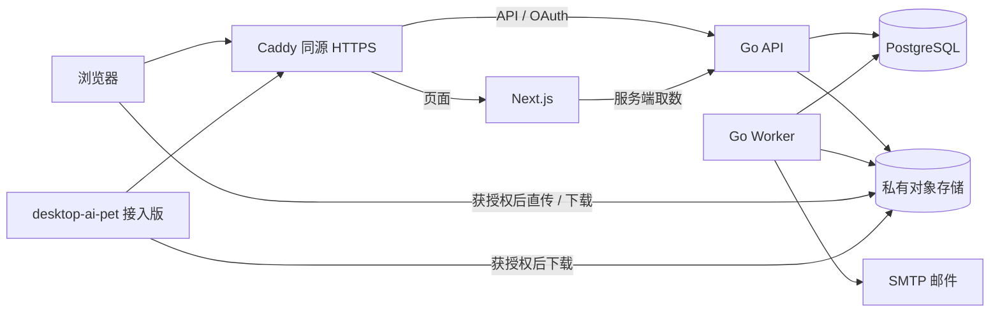

**玄司 Xuansi 官方网站与资源平台规划**

创建日期：2026-10-11。状态：用户已于 2026-10-12 确认并要求参考既定系统执行，现进入开发。原规划阶段只新增本文；实际实现与验证进度以 [开发任务](../tasks/todo.md) 和后续验收记录为准。

2026-10-12 补充：用户允许前端使用 React 或 Vue。本方案继续选择 React + TypeScript，以 Next.js 作为 React 应用框架处理官网渲染与路由；业务后端由 Go 提供。

目标目录为当前仓库的 `web/`，与相邻的 `E:/code/ctctct/Web/` 无关。

**现有项目分析与规划依据**

| 已核对事实 | 对官网方案的影响 | 源码依据 |
|---|---|---|
| 当前源码版本为 0.5.6，使用 Python 3.13、PySide6、asyncio、live2d-py/OpenGL，本地模型推理 | 官网是新增系统；不复用一个不存在的前端或后端 | [项目文档](E:/code/ctctct/desktop-ai-pet/项目文档.md:7)、[依赖锁文件](E:/code/ctctct/desktop-ai-pet/requirements.lock.txt:11) |
| 已有屏幕观察、文字聊天、连续语音、明确授权的长期记忆、形象导入、托盘与休眠 | 官网产品介绍以现有能力为依据，明确连续语音与动作的限制 | [README](E:/code/ctctct/desktop-ai-pet/README.md:17) |
| 已验证安装路线是 Windows 11 x64、NVIDIA/CUDA 12.4、D 盘，首次安装联网下载模型；没有自动更新 | 下载页展示实际系统要求、在线安装说明、摘要和手动升级步骤 | [安装与发布](E:/code/ctctct/desktop-ai-pet/docs/安装与发布.md:23)、[安装器](E:/code/ctctct/desktop-ai-pet/installer/online.iss:47) |
| 无官网账号、云资源服务或云同步；推理 HTTP 是带临时凭据的本机回环服务 | 新账号用于资源平台；截图、录音、聊天、长期记忆继续留在本地 | [配置与数据](E:/code/ctctct/desktop-ai-pet/docs/配置与数据.md:97)、[本地推理连接](E:/code/ctctct/desktop-ai-pet/pet/inference.py:155) |
| Live2D 入口写死为玄司模型，检查玄司专用参数；没有外部 motion3/exp3 文件消费实现 | 必须规划客户端接入版；不能承诺 0.5.6 已能使用网站任意模型、动作、表情 | [Live2D 加载](E:/code/ctctct/desktop-ai-pet/pet/avatar_live2d.py:16)、[受控动作](E:/code/ctctct/desktop-ai-pet/pet/avatar_motion.py:47) |
| 图片/透明动图导入已有格式、大小、像素和哈希命名边界；持久化到 data/appearances | 可复用客户端的规范化副本与安全落盘思路；它不等同于 Live2D 资源包导入 | [图片导入](E:/code/ctctct/desktop-ai-pet/pet/appearance.py:32)、[动图导入](E:/code/ctctct/desktop-ai-pet/pet/animation_import.py:12) |
| assets-manifest.json 是 GGUF、推理引擎与 ASR/TTS 下载清单 | 新建独立宠物资源协议，保留现有 AI 依赖安装流程 | [现有清单](E:/code/ctctct/desktop-ai-pet/assets-manifest.json:1) |
| web 目录原先不存在；安装器递归包含归档载荷；玄司素材保留版权 | 网站代码加入仓库后应排除在桌面安装载荷之外；模型分发授权单独记录 | [安装载荷](E:/code/ctctct/desktop-ai-pet/installer/online.iss:34)、[素材许可](E:/code/ctctct/desktop-ai-pet/assets/xuansi/LICENSE:1) |

上述现状结论置信度高，来自本地源码与文档。本轮没有重新验证远端 GitHub 最新发布，也没有运行客户端测试。下文是建议方案，不能视为已具备的功能。

**1. 功能模块**

默认产品边界：首期中文站，开放免费客户端下载；用户上传默认私有，公开资源首期由管理员发布。用户公开分享、付费交易和自动安装更新留到后续。

| 模块标识 | 首期功能 | 扩展边界 |
|---|---|---|
| site | 产品首页、功能与隐私说明、安装指南、FAQ、更新日志 | 多语言、更多教程 |
| identity | 邮箱注册、验证、密码登录、退出、找回/修改密码、会话管理；用户/管理员两种角色 | 第三方登录、更多角色 |
| resources | Live2D 模型、动作、表情、图片、透明动图的上传、校验、版本管理、封面、标签与许可信息 | 模型分享、收藏、评论、举报、审核 |
| library | 个人资源库、官方资源添加、版本选择、客户端可用状态和下载 | 跨设备同步资源库与版本偏好 |
| releases | Windows 安装包、SHA-256、大小、来源、系统要求、历史版本、更新记录 | 多平台、stable/beta 渠道、检查更新、签名更新元数据 |
| admin | 用户停用、官方资源发布/隐藏、客户端版本发布、上传失败检查、审计日志 | 分享审核、商店运营 |
| client-integration | 网站授权、拉取清单、下载校验、安装、模型选择、动作/表情应用、离线继续使用 | 资源更新提示与更完整的兼容验证 |

模块依赖保持单向：资源、个人资源库和管理功能使用账号模块；资源使用存储与任务基础设施；版本下载可匿名访问；客户端消费账号、资源与版本契约。首期采用模块化单体，不拆微服务。

Live2D 模型按完整导出包上传：`.model3.json`、`.moc3`、纹理及被引用的可选附属文件保留相对路径。独立 `.motion3.json` / `.exp3.json` 绑定精确的目标模型版本；同名参数也不能直接证明跨模型兼容。[官方导出说明](https://docs.live2d.com/en/cubism-editor-manual/export-moc3-motion3-files/)、[动作处理源码](https://github.com/Live2D/CubismWebFramework/blob/develop/src/motion/cubismmotion.ts)、[表情处理源码](https://github.com/Live2D/CubismWebFramework/blob/develop/src/motion/cubismexpressionmotion.ts)

首期提供封面和文件/参数信息预览。网页实时 Live2D 预览，以及支持用户导入模型的客户端发行，需要核对 SDK/Core 再分发范围与 Expandable Application 许可；本规划不把这项许可视为已解决。[Live2D 官方许可说明](https://www.live2d.com/en/sdk/license/expandable/)

**2. 页面结构**

| 区域 | 路径 | 内容 |
|---|---|---|
| 官网 | `/`、`/features` | 玄司介绍、实际使用场景、功能演示、本地数据边界、下载入口 |
| 下载 | `/download`、`/changelog` | 当前 Windows 在线安装包、系统要求、SHA-256、历史版本与手动升级 |
| 帮助 | `/docs`、`/faq` | 安装、首次下载、形象与资源使用、故障排查 |
| 官方资源 | `/resources`、`/resources/[id]` | 类型/标签筛选、封面、作者、许可、版本、兼容状态、加入资源库 |
| 账号 | `/register`、`/login`、`/verify-email`、`/forgot-password`、`/reset-password` | 注册登录和账户恢复 |
| 工作台 | `/dashboard`、`/dashboard/resources`、`/dashboard/uploads` | 资源列表、容量占用、上传进度、校验结果、失败原因 |
| 资源编辑 | `/dashboard/resources/new`、`/dashboard/resources/[id]` | 新资源、元数据、模型绑定、版本上传、当前版本选择、隐藏/删除 |
| 账号管理 | `/dashboard/account`、`/dashboard/sessions` | 资料、密码、网站会话与客户端授权撤销 |
| 客户端授权 | `/authorize` | 系统浏览器登录后的授权确认；OAuth 协议端点由 Go 提供 |
| 管理后台 | `/admin/users`、`/admin/resources`、`/admin/releases`、`/admin/jobs`、`/admin/audit` | 用户、资源、版本、任务和审计管理 |
| 法律与授权 | `/privacy`、`/terms`、`/licenses` | 本地/平台数据边界、网站条款与素材授权说明 |
| 后续增加 | `/community`、`/store` | 分享社区与商店，首期不提供空壳页面 |

视觉方向沿用玄司角色与黑金点缀，官网重真实角色图、桌面使用演示和清楚的下载信息；工作台采用稳定的导航、列表、表格和编辑表单。移动端优先保证介绍、下载信息、登录和资源浏览可用。

**3. 技术栈**

| 层面 | 选择 | 选择理由与依据 |
|---|---|---|
| 前端 | React、TypeScript strict、Next.js App Router、pnpm | React 编写页面与组件，Next.js 提供路由和官网公开页的服务端渲染/预渲染，工作台按需启用交互组件；具备 Metadata、sitemap 等官网能力。[官方文档](https://nextjs.org/docs/app) |
| UI | Tailwind CSS、shadcn/ui | 组件源码可控，定制玄司视觉与可访问交互；按需引入组件。[shadcn 文档](https://ui.shadcn.com/docs)、[Tailwind 文档](https://tailwindcss.com/docs/installation/framework-guides/nextjs) |
| 数据与表单 | TanStack Query、React Hook Form、Zod | 查询缓存、上传状态轮询、表单与运行时边界校验；用户操作走事件处理。[Query 上游文档](https://github.com/TanStack/query/blob/main/docs/framework/react/overview.md)、[表单上游](https://github.com/react-hook-form/react-hook-form)、[Zod 文档](https://zod.dev/) |
| Go HTTP | Go、标准库 net/http、chi v5 | 标准 Handler 与 context 体系，分组路由和中间件保持简单。[chi 上游](https://github.com/go-chi/chi) |
| ORM/驱动 | GORM 泛型 API、gorm PostgreSQL driver/pgx | 首期减少代码生成流程；查询携带 context，排序/过滤字段走白名单。[GORM 泛型](https://gorm.io/docs/the_generics_way.html)、[PostgreSQL 驱动](https://gorm.io/docs/connecting_to_the_database.html) |
| 数据库/迁移 | PostgreSQL 稳定版、Goose SQL 迁移 | PostgreSQL 存关系数据和 JSONB 元数据；Goose 是唯一迁移入口，关闭 AutoMigrate。[PostgreSQL 文档](https://www.postgresql.org/docs/current/)、[Goose 上游](https://github.com/pressly/goose) |
| 文件存储 | S3 存储接口；生产默认 Cloudflare R2 + AWS SDK for Go v2；本地 filesystem | 数据库保存元数据，模型包进入对象存储；更换 S3 服务不改业务规则。[R2 Go 文档](https://developers.cloudflare.com/r2/examples/aws/aws-sdk-go/) |
| 后台任务 | Go worker、PostgreSQL jobs 表 | 上传校验、规范化、邮件和清理异步执行；首期不依赖 Redis |
| 邮件 | 可配置 SMTP；开发使用邮件捕获服务 | 邮箱验证和密码恢复有真实发送通道；生产发件域名与服务凭据在部署时配置 |
| 客户端授权协议 | 嵌入式 Fosite、项目内 PostgreSQL 存储适配 | 只启用授权码、PKCE S256、刷新、撤销与 opaque token 校验，不另建身份平台。[上游接口](https://github.com/ory/fosite/blob/master/oauth2.go) |
| 接口契约 | OpenAPI 3.1、oapi-codegen、openapi-typescript、独立资源 manifest schema | 生成 Go/TS 边界类型，运行时仍需验证；避免产生宽泛 any 的 schema。[Go 生成器](https://github.com/oapi-codegen/oapi-codegen/blob/v2.8.0/README.md#does-oapi-codegen-support-openapi-31)、[TS 生成器](https://openapi-ts.dev/introduction) |
| 部署/日志 | Docker Compose、Caddy、Go slog、请求 ID | 同源 HTTPS 与路由、结构化日志、健康检查；密钥与签名下载地址不入日志 |
| 验证 | Go test、真实 PostgreSQL 集成测试、前端类型/构建检查、Playwright、原生客户端验收 | 覆盖权限、并发上传、资源契约和实际消费 |

依赖版本在开发开始时统一核对官方发布与安全公告后锁定。Goose v3.28.0 要求 Go 1.26，工具链与依赖需成组选择，不笼统指定“全部 latest”。[Goose 发布说明](https://github.com/pressly/goose/releases/tag/v3.28.0)

Fosite 没有现成生产 PostgreSQL 适配器；本项目需要实现存储接口及事务、授权码重放检测、刷新轮换和令牌家族撤销。其最近发布/提交较旧，不能宣称近期活跃；开发启动时复核锁定版本及安全依赖，并将上述协议行为纳入验收。[上游说明](https://github.com/ory/fosite)、[存储接口](https://github.com/ory/fosite/blob/master/handler/oauth2/storage.go)

TypeScript 禁止 `any` / `as any`；业务模块按职责拆分；代码对关键规则提供注释，流程记录可关联的结构化日志。React 的 effect 只用于外部系统同步，不代替事件处理或派生计算。

**4. 系统架构与资源流程**



Next.js 只负责页面与交互；Go 独占账号、授权、资源规则和数据库。反向代理把 `/api/v1/*`、`/oauth/*` 路由到 Go。需要账号数据的服务端取数显式转发当前凭据并禁用共享缓存；公开介绍、官方目录和已发布版本信息可缓存。

网站登录采用随机会话凭据，数据库只保存摘要，Cookie 设置 HttpOnly、Secure、SameSite，并对写操作验证 CSRF。密码使用 Argon2id 与独立盐，验证/找回令牌一次性、限时使用。[OWASP 密码存储建议](https://cheatsheetseries.owasp.org/cheatsheets/Password_Storage_Cheat_Sheet.html)

未验证邮箱的账号可查看账号状态，上传和私有客户端授权要求邮箱已验证。密码重置或用户停用同步撤销相关会话与客户端授权。授权响应与带用户数据的响应使用 no-store。

客户端采用系统浏览器 OAuth2 授权码 + PKCE S256；回调只监听 `127.0.0.1`/`::1` 临时端口，固定回调路径，不内置 client secret。使用短期 opaque access token 和轮换 refresh token；数据库保留令牌家族与复用证据，凭据存 Windows 凭据管理器。[原生应用授权规范](https://www.rfc-editor.org/rfc/rfc8252)、[刷新令牌安全规范](https://www.rfc-editor.org/rfc/rfc9700)

资源上传与安装流程：

1. Go 检查账号、类型、目标模型访问权和配额，原子预留容量并创建限时上传会话。
2. 生产模式返回预签名 PUT/分片上传信息，写入随机 quarantine key；本地模式由 Go 提供限量流式上传。共同返回上传方式、URL、必要请求头和过期时间，不让页面依赖具体存储厂商。
3. 完成接口核对会话，幂等创建校验任务并返回 202；上传完成与资源可用是两个状态。
4. Worker 检查实际大小，把对象读入受控临时副本；从这份副本计算 SHA-256、检查包路径和引用、执行格式校验及规范化。限制文件数、解压大小、压缩比、像素/帧数、处理时间和并发；拒绝越界路径、链接、Windows 冲突路径、脚本和可执行文件。
5. 用已验证的同一份副本生成新的不可变资源包、文件清单和规范化封面。不能校验 quarantine key 后再读取它作为发布内容，旧上传 URL 可能仍可覆盖它。
6. 在事务中将版本标记 READY、预留容量转为实际占用；失败、取消或过期幂等释放预留，未引用对象异步清理。个人私有资源此时可用；公开官方资源由管理员单独发布。
7. 客户端取得 manifest 与下载授权，在暂存区下载、验证哈希、检查并安全解包；试载成功后原子安装、切换并写入本地配置，保留旧版回退。临时下载 URL 过期可重新申请，不改变版本内容。

R2 生产模式使用私有桶、精确来源 CORS 和 SDK 支持的 PUT/分片流程。预签名 URL 是短期持有者凭证，不能把 R2 API 域名直接换成 CDN 自定义域名；私有封面也必须鉴权。ETag 不当作整包 SHA-256，应用自己对实际字节计算摘要。[R2 预签名文档](https://developers.cloudflare.com/r2/api/s3/presigned-urls/)、[CORS 文档](https://developers.cloudflare.com/r2/buckets/cors/)、[S3 完整性说明](https://docs.aws.amazon.com/AmazonS3/latest/userguide/checking-object-integrity-upload.html)

资源 manifest 独立于现有 AI 依赖清单，包含 `schemaVersion`、`resourceId`、`resourceVersionId`、`kind`、`entrypoint`、`files[{path, bytes, sha256}]`、精确依赖版本、最低客户端版本、可确认的 Cubism/MOC 版本信息、参数映射与能力声明。manifest 中的版本和路径稳定，临时下载 URL 单独申请。无法确定的运行时兼容信息标记待验证，不编造支持范围。

客户端接入必须补齐：可配置模型入口、资源选择与版本持久化、独立模型试载、motion/expression 加载、参数能力映射、主线程渲染与后台下载分离。缺少眨眼/口型等可选参数时仅关闭相应能力，不再要求所有模型带玄司专用参数。手动动作优先于对话动作，再到空闲动作；动作/表情占用的参数跳过自动眨眼、口型和视线写入，物理按 SDK 顺序更新。失败保持上一份可用形象；重启与离线读取已安装资源，网站登录失效不阻断本地推理。

Go 结构校验通过与客户端渲染兼容分开记录；完整 MOC 一致性检查需要选定合法可用的检查工具后接入。最小闭环验收是“网页上传模型及匹配动作/表情 → 授权 → 下载安装 → 实际切换/播放/应用 → 重启与离线继续使用”。0.5.6 不能作为这个闭环已经具备的证据。

客户端版本首期由管理员登记，下载源沿用已有 GitHub Release，保存已验证的版本、来源提交、大小与 SHA-256。仅新增官网不会改变安装器内模型下载路径。先支持版本查看与手动升级；签名自动更新另行设计。网站进仓库后，客户端构建需排除 `web/` 载荷。

性能主要靠路径设计：大文件直传/直下、流式处理、有限并发 worker、查询分页与索引、连接池复用、避免 N+1、公开信息缓存。耗时资源操作不占用同步 API 请求，首期不作未经测试的吞吐或延迟承诺。

**5. 数据库设计**

主键采用 UUID；时间为 `timestamptz`；文件大小/配额为 `bigint`。JSONB 只存有 schemaVersion 的 manifest、兼容详情和校验报告；身份、归属、状态、版本及依赖使用关系字段。文件存对象存储，数据库不存模型二进制或临时签名 URL。

| 表 | 关键字段与用途 |
|---|---|
| users | email_normalized、password_hash、display_name、role、status、email_verified_at、quota_bytes、used_bytes、reserved_bytes |
| web_sessions | user_id、token_hash、expires_at、revoked_at、last_seen_at；网站会话 |
| account_tokens | user_id、purpose、token_hash、expires_at、used_at；验证邮箱、找回密码 |
| oauth_codes | client_id、user_id、code_hash、redirect_uri、code_challenge、scope、request_id、session_payload、expires_at、used_at；一次性授权码与 PKCE |
| oauth_grants | client_id、user_id、scope、device_label、revoked_at；客户端授权及令牌家族 |
| oauth_tokens | grant_id、token_hash、kind、parent_id、request_id、session_payload、expires_at、used_at、revoked_at；短期访问、刷新轮换与复用检测 |
| resources | owner_id、kind、name、description、tags、author、source、license、visibility、status、current_version_id |
| resource_versions | resource_id、version、entrypoint、validation_status、compatibility_status、minimum_client_version、package_key、package_sha256、package_bytes、cover_key、manifest、validation_report、published_at |
| resource_files | version_id、relative_path、mime、bytes、sha256；包内文件索引，首期不重复存所有解压文件对象 |
| resource_dependencies | version_id、depends_on_version_id、relation；模型、动作、表情的精确版本依赖 |
| user_library | user_id、resource_id、pinned_version_id、added_at；个人资源库与版本偏好 |
| uploads | owner_id、resource_id、expected_bytes、reserved_bytes、quarantine_key、expires_at、status、error_code、result_version_id |
| jobs | kind、subject_id、dedupe_key、status、attempts、run_after、lease_until、locked_by、error_code；校验、邮件、清理任务 |
| idempotency_requests | actor_id、route、key、request_hash、status、result_type、result_id、expires_at；写接口重试保存意图和结果引用，不保存签名 URL |
| client_releases | version、channel、status、source_commit、release_notes、published_at；客户端发布 |
| release_artifacts | release_id、os、arch、distribution_type、url/object_key、sha256、bytes、system_requirements；安装包 |
| audit_logs | actor_id、action、target_type、target_id、request_id、created_at、脱敏详情 |

关键关系：用户一对多资源，资源一对多不可变版本，版本一对多文件，版本之间用依赖表关联；用户通过个人资源库保存资源；客户端版本一对多平台安装包。

约束与生命周期：

- 邮箱归一化后唯一；`(resource_id, version)`、`(version_id, relative_path)`、`(user_id, resource_id)` 唯一；授权码和令牌摘要唯一。
- 当前版本与 pinned version 必须属于相应资源，用复合外键等数据库约束保证；版本创建后内容不可变。文件引用和依赖禁止越权，依赖图不允许循环。
- 模型动作/表情的目标通过精确版本依赖表达；发布公开资源时所有必需依赖必须可公开获取，不能泄露私有模型。
- 配额预留在事务中原子检查和增加；READY 转实际占用，失败/取消/过期只释放一次。规范化后的实际占用超过预留时再次原子核额，额度不足则失败并释放预留。删除/取消任务与存储清理分离，避免数据库成功而对象操作失败导致状态混乱。
- 上传状态为 CREATED → UPLOADED → VALIDATING → READY/FAILED；CREATED/UPLOADED 可 CANCELLED/EXPIRED。版本的校验状态、兼容状态与公开发布状态分别记录。
- 资源隐藏只影响展示，停用禁止申请新下载；有依赖或被使用的版本不直接删除。物理清理在解除引用和保留期后执行；已下载的离线副本不会被服务端自动撤销。
- jobs 使用事务与 SKIP LOCKED 领取，租约过期可重试；`dedupe_key` 唯一，任务和完成接口幂等，避免重复生成版本。幂等请求记录以 `(actor_id, route, key)` 唯一约束原子领取，同时核对请求体摘要，重复请求通过结果引用返回同一逻辑结果；保留期覆盖对应上传/任务的最长重试窗口。
- 为 owner/status/kind 与游标排序、已发布版本、授权过期、任务领取建立对应索引；额外搜索索引根据实测查询增加。[PostgreSQL 约束](https://www.postgresql.org/docs/current/ddl-constraints.html)

商店与分享后续新增 listings、entitlements、orders、order_items、payments、comments、favorites、reports 等表；首期不生成这些空表。现有下载权限统一经资源访问策略判断，将来在同一位置接入购买授权，交易与模型文件生命周期分开。

**6. API 规划**

业务 API 使用 `/api/v1`。匿名接口只读取已发布官方内容；网站会话与客户端 token 最终进入同一资源权限规则。所有者和管理员权限分别验证，管理员页面隐藏不能替代服务端鉴权。

| 分组 | 接口（以下路径省略 /api/v1） | 主要权限与行为 |
|---|---|---|
| 账号 | `POST /auth/register`、`/auth/login`、`/auth/logout` | 注册、登录、退出；限流与统一失败语义 |
| 邮箱/密码 | `POST /auth/email-verifications`、`/auth/email-verifications/confirm`、`/auth/password-resets`、`/auth/password-resets/confirm` | 邮件发送、一次性验证、密码恢复 |
| 当前用户 | `GET/PATCH /me`、`PUT /me/password`、`GET /me/sessions`、`DELETE /me/sessions/{id}`、`GET /me/client-grants`、`DELETE /me/client-grants/{id}` | 资料、密码、会话和客户端授权撤销 |
| 公开目录 | `GET /resources` | 已发布官方资源；type/tag/search/cursor/limit 筛选 |
| 资源详情 | `GET /resources/{id}`、`/resources/{id}/versions` | 匿名只读已发布公开内容；所有者/管理员可读私有详情和校验状态，供工作台使用 |
| 个人资源 | `GET /me/resources`、`POST /resources`、`PATCH/DELETE /resources/{id}` | 列出、新建、修改、隐藏或按生命周期删除自己的资源 |
| 资源版本 | `POST /resources/{id}/versions`、`GET /resources/{id}/versions/{versionId}`、`PATCH /resources/{id}` | 新版本申请返回上传会话；查询校验/兼容状态；设置 currentVersionId |
| 上传 | `POST /uploads`、`POST /uploads/{id}/completion`、`DELETE /uploads/{id}` | 封面等附件申请、幂等完成、取消；版本申请统一调用相同上传逻辑 |
| 分片（生产） | `POST /uploads/{id}/parts` | 为指定分片重新签发上传地址；限制分片号和会话归属 |
| 本地存储模式 | `PUT /uploads/{id}/content` | Go 限量流式接收；短期凭据只允许写对应上传会话 |
| 资源库 | `GET /me/library`、`PUT/DELETE /me/library/{resourceId}` | 添加/移除可访问资源，设置固定版本 |
| 客户端资源 | `GET /resources/{id}/versions/{versionId}/manifest`、`POST /resources/{id}/versions/{versionId}/download-authorizations` | 鉴权并验证精确依赖，返回 manifest 或短期下载信息 |
| 客户端版本 | `GET /client/releases`、`/client/releases/latest`、`/client/releases/{id}` | OS/arch/channel 筛选、系统要求、包来源与校验信息 |
| 管理 | `PATCH /admin/users/{id}`、`PATCH /admin/resources/{id}`、`POST /admin/resources/{id}/publications`、`POST /admin/client-releases`、`PATCH /admin/client-releases/{id}`、`POST /admin/client-releases/{id}/publications` | 停用、隐藏、指定资源版本发布；登记/编辑安装包元数据，单独发布客户端版本 |
| 运维 | `GET /admin/jobs`、`/admin/audit-logs`、`GET /healthz`、`GET /readyz` | 管理员诊断与健康检查，公开健康响应不包含内部配置 |

OAuth 端点独立遵守规范：`GET/POST /oauth/authorize`、`POST /oauth/token`、`POST /oauth/revoke`；官网确认页 `/authorize` 调用 Go 授权流程。公共原生客户端仅开放授权码、PKCE 和刷新，禁止密码/隐式授权流程；OAuth 标准错误不套业务响应包装。

普通业务成功使用 `{data, meta}`（204 除外），错误使用 `{error:{code,message,details},requestId}`；状态区分 401/403/404/409/422/429。列表使用稳定游标分页，长任务返回 202 与可查询资源。上传完成、创建校验任务、资源发布等重试操作原子兑现 Idempotency-Key，复用键但请求体不同返回冲突；PUT/DELETE 本身采用明确幂等语义。manifest schemaVersion 与 API 主版本独立，只增加兼容字段。

OpenAPI 统一记录输入、输出、错误、权限和状态；前端生成类型，Go 边界绑定与验证；manifest 提供 fixture 做跨语言契约验收。

**7. web 目录结构**

以下是确认后采用的目录结构；当前只存在 docs/官网规划.md。

```text
web/
├─ docs/
│  ├─ 官网规划.md                 # 本轮方案，待审核
│  ├─ DESIGN.md                   # 确认后补产品视觉与交互规则
│  ├─ 资源协议.md                 # manifest、兼容与客户端接入契约
│  └─ decisions/                 # 需要长期保留的架构取舍
├─ frontend/
│  ├─ src/
│  │  ├─ app/
│  │  │  ├─ (public)/             # 产品、下载、帮助、官方资源
│  │  │  ├─ (auth)/               # 登录、注册、验证、授权确认
│  │  │  ├─ dashboard/            # 个人资源、上传、账号
│  │  │  └─ admin/                # 管理后台
│  │  ├─ features/                # auth、resources、uploads、releases
│  │  ├─ components/             # 品牌组件及按需引入的 UI 组件
│  │  └─ lib/                    # 类型化 API 客户端、校验、配置
│  ├─ public/                    # 可信品牌图片；用户上传不放这里
│  ├─ tests/
│  └─ package.json
├─ backend/
│  ├─ cmd/
│  │  ├─ api/                    # HTTP/OAuth 服务入口
│  │  └─ worker/                 # 异步任务入口，同一业务代码
│  ├─ internal/
│  │  ├─ identity/               # 账号、会话、客户端授权
│  │  ├─ resource/               # 元数据、版本、依赖、资源库、权限
│  │  ├─ upload/                 # 上传会话、校验与规范化
│  │  ├─ release/                # 安装包、渠道与更新信息
│  │  ├─ admin/                  # 管理与审计
│  │  ├─ job/                    # 领取、租约、重试、幂等
│  │  └─ platform/               # 数据库、存储、邮件、配置、日志
│  ├─ migrations/                # Goose SQL，数据库结构唯一迁移入口
│  ├─ tests/                     # 权限、并发、存储与集成验收
│  └─ go.mod
├─ contracts/
│  ├─ openapi.yaml
│  ├─ resource-manifest.schema.json
│  └─ fixtures/                  # 模型、动作、表情及非法包样例
├─ tests/
│  └─ e2e/                       # 浏览器与客户端闭环验收说明/脚本
├─ deploy/                       # Caddy、容器及生产配置说明
├─ compose.yaml
├─ .env.example                  # 仅字段名与安全示例，不放真实凭据
└─ README.md                     # 开发、迁移、构建、验证与部署
```

**确认边界与验收要求**

待确认的是以上首期范围、技术栈和客户端适配边界。域名、部署区域、SMTP 与存储账号在部署阶段配置；上传限额和保留期作为可配置运营参数，在上线前明确。动态 Live2D 发行/预览许可是相关功能上线前必须核实的事项，不阻止本次只读规划。

确认后才细分开发任务，分别交付网站与客户端接入；不会把完成网站页面等同于完成资源消费。验证至少覆盖：

- 两个用户交叉访问私有资源、封面和依赖被拒绝；撤销授权后不能取得新下载地址。
- OAuth 动态端口回环、错误 PKCE、授权码重放、并发刷新、令牌复用和撤销行为符合契约。
- 重复完成上传、worker 崩溃重试、并发配额预留只产生一次有效结果，配额可正确释放。
- 恶意 ZIP、引用越界、校验后覆盖上传对象、模型依赖不匹配被拒绝或隔离。
- 正常模型、匹配动作和表情在接入版客户端实际切换、播放和应用，重启/离线可继续使用。
- 下载损坏、试载失败保留旧资源；缺少可选参数有明确能力降级。
- 网站私有响应不进入公共缓存；下载页只承诺已经适配的平台；桌面安装载荷排除 web 源码。

2026-10-11 规划阶段未创建前后端项目、安装依赖、迁移数据库、改动客户端、运行服务或部署网站。2026-10-12 用户已批准开发，具体变更另记实施与验收文档。
